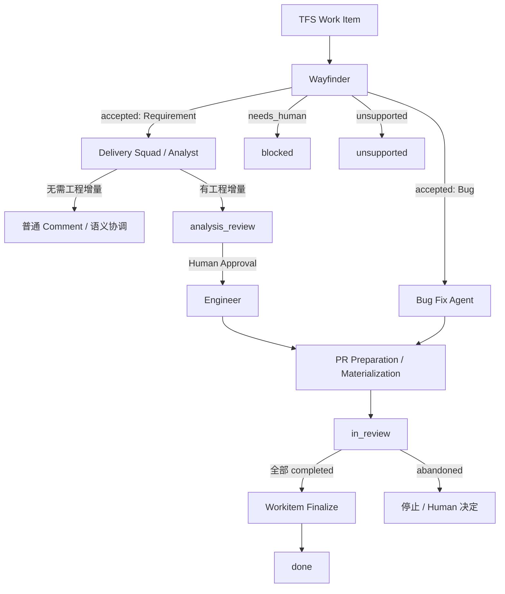

# Multica 研发交付生命周期设计方案

> Version: 1.6.15  
> Date: 2026-11-28  
> Status: 仓内现行设计基线；真实环境验收见 [07](07-multica-openspec-implementation-roadmap.md)  
> 上位规范：[01](01-multica-openspec-design-guideline.md)；专业契约：[03](03-workitem-analysis-design.md)、[04](04-engineer-development-design.md)、[05](05-openspec-schema-implementation-design.md)、[06](06-method-skill-library-implementation-design.md)。

<a id="delivery-scope"></a>

## 1. 文档定位与目标

以一个 Multica Issue 组织工作、原生 Assignment / Run / Comment / @mention 协作；Requirement 在确有工程增量时使用一个 OpenSpec Change，Bug 直接诊断修复。Human 负责需要授权的决定；专业 Agent 负责语义结果；Rondo 负责确定性校验、执行及事实登记。生命周期不是新的 Workflow Runner，不将专业步骤投影成子 Issue 或 Stage。

## 2. 总体架构

| 对象 | 责任 |
|---|---|
| TFS Sync Agent | 按 WIQL 同步 TFS 来源至 Multica |
| Wayfinder Agent | 准入判断、记录 Decision、执行交接 |
| Delivery Squad | Requirement 的协作容器；Delivery Lead + Workitem Analyst + Engineer |
| Delivery Lead | 语义协调、Human Approval 登记、原生交接与异常处理 |
| Workitem Analyst | 分析、工程增量判断、必要 OpenSpec 准备 |
| Engineer | 获批 Change 的实施、验证、研发工件发布及 PR |
| Bug Fix Agent | 独立 Bug 诊断、修复、验证和 PR；不使用 OpenSpec |
| PR Status Sync Agent | 巡检已登记 PR，按事实触发最终收口及必要 TFS 子任务规划 |
| Vayne | Workspace Runtime 主备协调；不参与业务交付 |
| Independent Verification | Human 要求时由可用且获授权的独立验证成员执行；当前受管配置未注册固定 Verify Agent |

实际注册、绑定及 Autopilot 以 [provisioning.json](workspace-config/provisioning.json)、[Agent Instructions](agents/) 和 [Squad Instructions](squads/squad-instructions.md) 为准。角色没有隐式全局权限。



## 3. 公共运行机制

<a id="delivery-gates"></a>

- 原生 Issue Status、Assignment、Run、Comment 为 Delivery Truth。一个 Issue 的状态不等于某个 Run 已成功；新 Run 是否启动按原生实际结果确认。Lead 完成本轮协调后退出，不持续轮询等待。
- Gate 是现有 Rondo 硬条件，不是独立执行角色。语义判断不可由字段存在、关键词或固定 Prompt 序列代替。
- `PASS` 表示当前操作已确认成功；`FAIL` 表示已确认条件不满足；`UNKNOWN` 表示必要事实无法确认。失败修正实际原因，未知先回核，不绕过授权或重复未知副作用。
- 已有可信事实按需复用，外部写入结果不明时回读确认。Human 评论触发的 Run 按当前线程回复；普通说明与正式 Decision / Approval 区分。单 Issue CLI 默认从当前 Multica Task Context 取身份；批量 Autopilot 的后续命令显式传入 Issue。

<a id="delivery-stage"></a>

正常协作不创建 Development Sub-Issues、Task Set 或原生 Stage。需要独立验证时按实际可用成员交接；无合适成员报告能力缺口。

## 4. TFS Sync 与 Wayfinder 准入

### 4.1 来源同步

TFS Sync Agent 直接执行 `rondo workitem sync-issue --wiql "<query>"`，WIQL 由其 [instructions.md](agents/tfs-sync-agent/instructions.md) 维护。Rondo 读取 TFS Work Item、更新来源及附件等必要信息；使用 Project 级配置与来源身份避免重复 Issue。自动入口创建或同步至 Wayfinder，遵循原生启动契约。已确认成功的写入不回滚；来源变化对已生效交付的影响由当前事实和 Human 决定，不覆盖有效下游工作。

<a id="delivery-intake"></a>

### 4.1.1 Wayfinder

准入仅核实 Business Scope、Repository Discovery、Processing Capability：
- 业务属于支持范围；定位能够支撑后续处理的仓库即可，不要求确定最终全部修改文件或完整根因。
- Bug 支持；Requirement 支持现有功能优化和 Bug 类诉求，暂不支持新增业务功能。新增代码不等于新增业务功能。
- 已授权的远程只读 MCP、Resource label 及源码作为证据；可信已有 Decision 可复用，按变化增量重评。

在当前 Issue 使用 `/note` 记录 Decision、依据、来源版本和必要 Evidence。确认已登记后执行 `rondo workitem apply-decision --decision <accepted|needs_human|unsupported>`。

| Decision | 后续 |
|---|---|
| accepted | 按 TFS 来源类型交给 Bug Fix Agent 或 Delivery Squad；确认原生交接结果 |
| needs_human | 保留 Wayfinder 指派，进入 blocked；说明待确认事项 |
| unsupported | 保留 Wayfinder 指派，进入 unsupported；明确依据 |

暂时故障或证据不足不等同 unsupported。明确直接指派不强制补 Wayfinder；各下游仍需其自身适用的授权和质量条件。

### 4.2 Issue Status

| Status | 语义 |
|---|---|
| todo | 已同步待准入/工作启动 |
| in_progress | 获准的专业执行 |
| analysis_review | 当前固定工程契约等待 Human Approval |
| in_review | 实际 PR 已全部登记，等待外部 PR 终态 |
| blocked | 关键事实、授权、异常或 PR 恢复待处理 |
| unsupported | 已确认不在支持/授权范围 |
| done | 已确认最终收口；仅残留 pending 时按恢复路径清理 |

原生其他状态按平台配置使用，不建立第二套状态机。无工程增量时 Analyst 普通 Comment，不由文档推断或强制写入 done/TFS 状态。

## 5. Analysis 与审核提交

<a id="section-5-3"></a>

Requirement Analyst 的工作不是默认生成 Change。先复用 Wayfinder 证据，判断有无工程增量；没有增量记录普通 Comment；有增量形成工程契约；影响结论的事实或授权不足则说明阻断，不将未知当作无变更。详细专业契约见 [03](03-workitem-analysis-design.md)。

`rondo openspec submit-review` 负责当前 Change 身份、Scope、工件、OpenSpec Strict Validation、当前 Change Git 发布、固定来源登记与审核状态确认。正常不重复调用 validate，不创建 Gate/Review/Handoff 文件。成功后专业摘要以 Comment 引用固定版本，不以可变 HEAD 替代。

<a id="human-analysis-review"></a>

## 6. Human Analysis Review

Human 审核对象为固定 `analysis.source`；Lead 理解真实 Human 评论及附加条件。明确批准时调用：

```bash
rondo workitem approve --comment-id <id> --commit <sha> --verify-required <true|false> [--waive-tasks <refs>]
```

批准须对应当前审核 Commit；豁免必须是 Human 明确批准的完整任务集合。CLI 登记 `analysis.human_approval`、回读并将适用 Requirement 转入 in_progress，不自行启动 Run。Lead 根据决定原生 @mention Engineer。拒绝或要求实质修订时，交 Analyst 定向修改并重新提交固定审核版本；模糊授权先澄清。专业 Gate PASS 不能替代 Human Approval，普通建议不能视为批准。

<a id="development-materialization"></a>

## 7. Development Runtime

Engineer 以当前 Issue 的获批 Change 为工作对象，使用 `rondo openspec read` 读取批准版本。需要本地仓时使用 native-workspace，使用实际 Task workdir 中的根仓和业务仓。完整授权 Scope 与实际 PR 集合分离，不按技术栈或每个 Task 创建 Run。跨 Runtime 依赖固定 Git 来源、已登记事实和可获取的 Candidate，而不是旧 Run 本地目录。

<a id="development-execution"></a>

## 8. Development Completion

Engineer 对真实实现、验证、Code Review、Tasks 状态与 PR 负责；Bug Fix Agent 对直接 Bug 修复负责。批准后的 Task 正文和编号保持不变，已完成项据实勾选，未执行的 Human 豁免保持未勾选。Requirement 研发工件由 Engineer 使用 `rondo openspec publish` 发布；非实质 Design 细化才用 `--minor-design`。发布与每仓 PR Prepare 不人为固定顺序；Materialize 前必须满足实际适用条件。详细契约见 [04](04-engineer-development-design.md)。

## 9. Independent Verification

Analyst 根据风险、开发验证能力与独立验收要求提出建议；Human 决定，Lead 根据可用成员协调。独立验收不替代开发侧验证和 Code Review，不默认新建 Stage 或报告工件。验收绑定实际候选版本和批准要求；结果不明或发现阻塞，保留证据、定向处理。当前 provisioning 未固定 Verify Agent，不能将该能力描述为已部署；需要独立验收但无可用执行者时报告能力缺口。具体 CLI 布尔输入与存储类型见 [01 §1.8](01-multica-openspec-design-guideline.md#issue-metadata-design)。

## 10. PR Preparation 与 Materialization

Bug 和 Requirement 共用 pull-request Skill。PR Prepare 登记实际每仓 Candidate 及验证/审查事实；Materialize 根据适用授权与交付事实逐仓创建或复用外部 PR、确认 Work Item 关联、补充 `pr_id` / `pr_url`，全部登记才进入 in_review。重复调用以已登记与外部事实恢复，不凭猜测重建。PR 合并由 Human 或授权外部机制完成，不属于 Lead 或 Engineer 的职责。命令和多仓语义由 [04 §9](04-engineer-development-design.md#development-section-09) 维护。

<a id="pr-status-sync"></a>

## 11. PR Status Sync 与异常

PR Status Sync Agent 直接执行 `rondo pr reconcile-status`。常规扫描 in_review / blocked；按需恢复 done 中残留 finalize.pending。以 Issue `pr` 中已经登记的仓库和 PR 身份查询 TFS；不依赖全量仓库映射。

| 已确认结果 | 行为 |
|---|---|
| active 或部分 completed | noop；不反复写评论、改变流向或唤醒 |
| 全部 completed | 确认适用状态后登记/复用 finalize.pending，返回 finalize / resume_finalize |
| abandoned | 停止受影响交付，保留事实并等待 Human |
| unknown | 核实原因，未确认前不推进 |

Human 明确要求恢复 abandoned PR 时，Lead 核实范围，调用 `rondo pr resume --comment-id <id> --next REWORK|RECREATE_PR`。REWORK 使受影响的准备事实失效；RECREATE_PR 只在 Candidate 未变化且证据有效时解除已确认 abandoned 的外部身份。Bug 混合状态需要 Human 决策。CLI 不启动 Run；由原生状态操作和交接继续授权工作。不自行丢弃其他有效 PR。

<a id="delivery-finalization"></a>

## 12. Workitem Finalize

### 12.1 收口与恢复

PR Status Sync Agent 对 finalize / resume_finalize 调用 [workitem-finalize](skills/workitem-finalize/SKILL.md)：

- Bug：`workitem finalize --phase prepare --issue <KEY>` → `workitem writeback --issue <KEY>` → `workitem finalize --phase complete --issue <KEY>`。无 OpenSpec Archive、无 TFS 子任务规划。
- Requirement：`rondo repo prepare-archive --issue <KEY>` 返回实际根仓；同一分析根仓 URL / branch 的本轮 Issue 可复用。依次 Prepare、Writeback、Complete，使用实际 root_repo。
- Prepare 核验已登记 PR 的真实终态、适用 Change / 交付事实，并准备必要 Archive；TFS Writeback 成功后才 Complete。Requirement 归档使用固定分析来源，具体工程契约见 [05 §16](05-openspec-schema-implementation-design.md#openspec-schema-section-16)。
- Prepare 返回 PASS/prepared、Writeback 非 Inspect 的实际操作 PASS、Complete PASS/done 才继续或确认完成。已 done 且残留 pending 按恢复命令清理，不重新推进交付。失败或未知先核实当前结果，保留已成功副作用和工作区。

### 12.2 Requirement TFS 子任务与估时

以批准版本的 tasks.md 和实际 PR 业务 Commit 为输入。先使用 `rondo workitem writeback --issue <KEY> --root-repo "<root_repo>" --inspect`；saved_plan=true 则复用，不重新规划。否则 PR Status Sync Agent 依据 approved_tasks 和 commits 作语义归并，Rondo 校验与物化。

- 合理归并为 1–5 个子任务，数量不超过可用未占用的唯一真实业务 Commit 数；任务必须有准确且互不重复的总结。
- 每项估时 0.5–4 小时；source_refs 引用批准任务编号；每个任务至少关联一个真实 Commit，所有任务之间 Commit 不重复。使用 Inspect 返回 owners 为空的 Commit、repo_key 和完整 SHA；冲突时不迁移/删除外部关联。
- JSON 计划格式：`{"tasks":[{"summary":"任务总结","estimate_hours":2,"source_refs":["1.1"],"commits":[{"repo_key":"winning-dps-df-example","sha":"<完整SHA>"}]}]}`。通过 `--task-plan <plan.json>` 提交；确定性计划登记在 `delivery.tfs_task_plan`，恢复复用既有计划。
- TFS 原始预估、剩余和完成工时由现有写回契约管理；完成工时按估计回填是现有管理约定，不是对实际投入的测量。Rondo 核对准确仓库身份、Commit 独占、父子关联及真实外部状态；不新增管理事实源，不以 OpenSpec Task 数量直接生成 TFS Task。
- Bug 跳过子任务；未知来源类型停止。写回已确认后才写 `delivery.tfs_written`，Complete 再确认必要的外部真实状态。

<a id="final-completion"></a>

### 12.3 最终完成

Requirement Archive、已确认 PR、必要 TFS 子任务及父项回写满足适用契约才允许 done；Bug 按自身直接交付契约收口。Complete 清除临时 finalize.pending。未知结果不能单凭 Metadata PASS 或手工设 done 推进。TFS 实际字段、目标状态和恢复规则以 [writeback.ts](rondo/src/commands/tfs/writeback.ts)、[requirement-tasks.ts](rondo/src/commands/tfs/requirement-tasks.ts)、[finalize.ts](rondo/src/commands/delivery/finalize.ts) 为准。

<a id="delivery-facts"></a>

## 13. 跨阶段事实

公共数据格式、最小 Key 与写入 Owner 见 [01 §1.8](01-multica-openspec-design-guideline.md#issue-metadata-design)。OpenSpec 持有工程契约与 Tasks；Multica 持有审核版本、批准、研发发布、PR 与收口机器事实；TFS 持有外部 PR、Work Item 与工时。专业 Comment 保存结论与 Evidence 引用。只保存实际消费者需要的事实，临时 Facts 输入不提交 Git，不创建额外流程状态机。

<a id="runtime-reconcile"></a>

## 14. 黑灯计划：Vayne Runtime 自动协调

Vayne 为 Squad 外基础设施 Agent，固定服务器 Runtime、计划单并发，Autopilot run_only，直接调用 `rondo runtime reconcile`。管理员维护各 Workspace 的 `RONDO_RUNTIME_POLICY` JSON Object：Agent Name → {primary_runtime_id, fallback_runtime_id}；两个 ID 必须不同，Vayne 不参与自动改绑。模板和维护说明见 [.claude/skills/rondo-sync/config/runtime-policy.md](.claude/skills/rondo-sync/config/runtime-policy.md)。

| Primary | Fallback | 动作 |
|---|---|---|
| online | 任意 | 目标 Primary |
| offline | online | 目标 Fallback |
| offline | offline | FAIL，保留绑定 |
| 未知或无法核实 | 任意 | UNKNOWN，保留绑定 |

CLI 一次读取 Agent / Runtime 列表，按准确名称与 ID 校验；当前已为目标时不写；成功响应确认即结束，未知响应回读，不重复写。单 Agent 错误不阻断其他有效项；`--dry-run` 只预览。允许不同 Provider，模型配置兼容性由管理员评估。代码未实现 Run 迁移或活跃 Run 门禁，不声称一定不打断已有运行；实际平台行为和 PoC 见 [07](07-multica-openspec-implementation-roadmap.md)。

配置建议按当前 provisioning 的 schedule_note：Asia/Shanghai 08:00–10:00、17:00–19:00，每十分钟；人工启用 Trigger，先完成 PoC。Run 调度、恢复、并发保持 Multica 原生负责，不新增监控服务或业务恢复 Agent。
