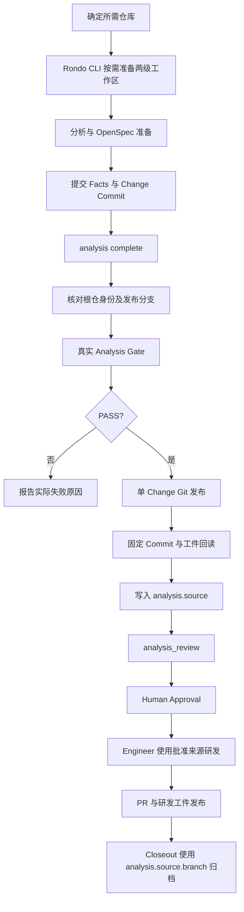

# Native Workspace 下游消费链路收敛与分析发布修复方案

- 日期：2026-11-24
- 状态：已完成设计 Review 修订 / 待实施
- 触发：LEI-53 实际回放阻塞
- 设计依据：[01 统一设计规范](01-multica-openspec-design-guideline.md)、[Native Repo 工作区准备](12-native-repo-workspace-preparation-design.md)
- 运行证据：[LEI-53 回放](projects/replay/20261124-LEI-53/review.md)、[Analyst 原始回放](projects/replay/20261124-LEI-53/workitem-analyst/20261124-1617-01a20ca1/replay.md)、[Native Workspace Spike](validation/native-workspace-spike-20261124.md)

## 1. 目标与结论

Native Workspace 已接管本地工作区准备，但分析发布、研发发布仍依赖持久根仓分支变量、daemon cache 形态；根仓及只读业务仓的 Checkout 还由 Agent 直接执行，未通过 CLI 确定性控制 cwd。修复 Rondo 的下游契约，并由 Rondo CLI 统一调用 Multica 原生 Checkout，保持已验证的根仓/业务仓两级目录布局，不要求 Multica 恢复旧工作区形态或重复配置。

以 First Principles、KISS、YAGNI、Native First、One Rule One Owner、Specialist Focus、Minimal Sufficient 为约束，保留现行 Analysis Gate、Human Approval、Repository Scope、Git 单 Change 发布算法和交付生命周期，不另建 Runtime。

## 2. 事实与阻断归因

| 时间（北京时间） | 事实 |
| --- | --- |
| 16:18:52 | Multica 根仓 Checkout 成功，Task Branch 为 agent/workitem-analyst/4b6808fe085f |
| 16:20:24 | runtime check-checkout PASS |
| 发布前 | OpenSpec 严格校验及 analysis validate 预检查 PASS；本地分析 Commit 已完成 |
| 16:26:02 | analysis complete 首次返回 UNKNOWN: 请配置 RONDO_WORKSPACE_BRANCH 后再准备根仓 |
| 16:26:42 | 显式提供 --target-branch 后返回 FAIL: --target-branch 仅用于 Native Requirement 分析发布 |
| 最终 | analysis.source 与 analysis.gate.result 未形成；Issue blocked，未进入 analysis_review |

实际 Project Resource 已有根仓 ref=master、业务仓 ref=dev；原始回放读取 .multica/project/resources.json，并确认提交前 HEAD 与 origin/master 无提交差异。根仓与 dataintegration 业务仓的实际 Checkout 返回路径均为 Task workdir 的直属子目录。

### 2.1 发布分支重复配置

[analysis/complete.ts](rondo/src/commands/analysis/complete.ts) 在最终 Gate 前调用 `args.targetBranch || requirementBranch()`；[root-git.ts](rondo/src/commands/runtime/root-git.ts) 的 requirementBranch() 强制读取 RONDO_WORKSPACE_BRANCH。因此预检查 PASS 并不意味着最终发布 Gate 已执行。

### 2.2 工作区内部形态耦合

analysis complete 显式 --target-branch 依赖 isDaemonCacheWorktree()；该判断读取 Git common dir 并匹配 .repos/<workspace-id>。root-git.ts 的 publishCommittedChange() 也使用相同判断选择 Native/非 Native 路径，并在非 Native 路径要求本地分支等于远端发布分支。

[check-checkout.ts](rondo/src/commands/runtime/check-checkout.ts) 使用 validateNativeCheckout()，仅验证 Git 根仓和 AGENTS.md，支持普通 Checkout 与 linked worktree；后续 assertNativeTaskCheckout() 又要求 .git 文件、cache 布局等条件，导致前后契约不一致。

回放归因汇总称本次为普通 .git 目录，但原始回放未完整保存 common dir 输出，故具体底层形态及判断失败的原因尚未独立确认。已确认的是 Native 判定为 false，不应据此断言 Multica 实现故障。

### 2.3 路径布局不一致

Multica repo checkout 按执行 cwd 放置仓库。此前 Spike 从根仓内执行业务仓 Checkout，形成嵌套布局；LEI-53 在 Task workdir 中执行，形成平级布局。两者都是平台可产生的结果。

原设计 §2.2 和真实 Spike §2、§3、§4.2 已证实两级布局可行：根仓与 frame/frame-web 的 Git 工作树独立，根仓不跟踪业务仓。当前 dev/native-prepare.ts 已在根仓 cwd 执行业务仓 Checkout；dev/prepare-workspace.ts、dev/pr-prepare.ts、dev/check-completion.ts、bug/git.ts 均消费原有两级布局。native-workspace 对根仓仍直接调用 Multica，对只读业务仓缺少确定性 CLI 准备入口，导致 LEI-53 出现布局偏差。该偏差不是 analysis complete 阻塞的直接原因，无证据表明机制不支持两级布局，因此保留原设计，不重构下游路径消费。

## 3. 核心设计决策

| ID | 决策 |
| --- | --- |
| D1 | Requirement 首次分析发布目标取根仓 Project Resource 配置的分支，并核对实际 Checkout 基线；Requirement 发布模式由 TFS 类型决定，Native 路径不依赖 RONDO_WORKSPACE_BRANCH。 |
| D2 | 统一必要的 Native 工作区身份核验；不以 .git 类型或 daemon cache 布局选择交付模式，保留实际身份、Task 归属、授权和交付校验。 |
| D3 | 保持根仓/业务仓两级布局；所有正式工作区准备入口由 Rondo CLI 调用 Multica 原生 Checkout 并确定性控制 cwd、Resource/ref 和返回路径，Agent 不直接执行 Checkout 或编排目录。 |
| D4 | 首次发布形成固定 analysis.source；研发发布及 Archive 使用该来源，审核重放、授权返工及部分成功恢复沿用现有发布机制，不自动改换发布分支。 |

### 3.1 分支语义

Multica Resource ref 原生语义是 Checkout 起点，并非平台天然定义的 Push 目标。D1 是 Rondo 针对根仓首次发布的明确项目约定，而非改变平台语义。

| 事实 | LEI-53 示例 | Owner |
| --- | --- | --- |
| 根仓初始 ref / 首次发布目标 | master | Multica Project Resource / Rondo 发布约定 |
| 本地工作分支 | agent/workitem-analyst/4b6808fe085f | Multica |
| 业务仓初始 ref | dev | Multica Project Resource |
| Requirement 业务仓 Candidate | feature/268376 | Rondo 交付规则 |
| 后续根仓发布与归档分支 | analysis.source.branch | 已发布固定来源 |

已形成固定审核来源后，即使 Project Resource ref 改变，也不得据此改写既有 Change 的发布分支。审核重放沿用原有固定来源核验逻辑。

## 4. P0 实施方案

### 4.1 Analysis Publish 分支解析

- 在 CLI 内根据当前 Task 的 Project Resource，按已验证根仓 URL 匹配唯一登记仓库；读取 resource_ref.ref，确认其为合法、实际存在的远端分支。
- 可直接消费已注入的 .multica/project/resources.json；核对当前 Issue/Project 身份及根仓 Origin，避免使用其他项目或任意本地配置。
- 缺失、歧义、非分支 ref 或远端不存在时报告具体原因；不回退 RONDO_WORKSPACE_BRANCH、当前 HEAD、默认 master 或其他猜测。
- 当前 analysis/complete.ts 将 Requirement 必须使用 --mode requirement 的条件绑定于 RONDO_WORKSPACE_PATH / RONDO_WORKSPACE_BRANCH。删除此环境变量条件：TFS Requirement 无条件要求现有 Requirement 发布模式，漏传或传 legacy 不得走旧 publishChange 路径。保留现有 CLI 模式契约，不扩展类型重构。
- 正常 Native Requirement 不传 --target-branch；旧参数如仍有消费者，仅保留其适用旧入口，Native 不允许覆盖 Resource 权威。显式冲突不得静默回退。
- 首次发布必须核实 Resource ref 与根仓实际 Checkout 基线一致。使用 Git 已有 upstream、远端分支与提交关系等可靠事实；不得仅凭 HEAD 与两个分支具有共同祖先认定基线相同。相同分支远端前进仍使用现有单 Change 并发发布机制；Resource ref 改成另一分支、Kept 保留旧基线或无法确认时停止受影响发布并报告，不自动切换、重置或改投其他分支。不新增 Resource Snapshot 或分支 Metadata。
- 已进入 analysis_review 的相同 Facts 重放仍核对固定来源，不重做 Gate 或重新选择目标；部分成功与授权返工见 §4.5。

分支解析仅增加必要的内部函数（如 resolveProjectRootBranch），复用 §4.4 的 Project Resource 读取逻辑，不新增分析发布命令、配置文件或 Manifest。

### 4.2 Git 工作区校验与单 Change 发布

涉及 native-checkout.ts、runtime/root-git.ts、analysis/complete.ts，及消费相同校验的下游入口。

- 统一普通 Checkout 和 linked worktree 的 Git 工作树语义，不强制 .git 为文件或 common dir 匹配 .repos 目录。
- 保留并核实当前 Task workdir、平台上下文、仓库真实根路径、Origin/Push URL、Project Resource、工程映射及操作授权。不得将任意有效 Git 目录视为已授权 Native 工作区；路径越界、链接、身份冲突或授权不明仍拒绝。
- 复用 readDaemonTaskContext、parsePlatformCheckoutOutput、assertPlatformCheckoutIdentity 等现有能力，核对当前 Multica Task/Agent/Workspace、daemon Task Context、实际工作区位置、Git 根目录与 Origin/Push、平台返回分支和实际分支；普通 Issue Task 的目标 Issue 绑定可复用现有 issue runs --active 查询机制，保留操作自身的授权 Guard。平台身份信息存在时须核对一致，不能用从调用者环境拼出的自证替代平台证据。仅缺少 cache 特征不构成失败；其他身份事实不足仍拒绝，不能将任意 Git 目录视为 Native 或回退旧模式。
- 实施前从 LEI-53 现场或同版本 Runtime 补录实际 .git 类型、Git common dir、Workspace/Task 上下文和平台返回结果，确认误判原因并验证最小替代身份依据。若现场不可用，使用可复现的目标 Runtime；不宣称已经证实普通 Checkout 形态，不为此增加独立预检、Manifest 或认证体系。
- 同步修复 publishCommittedChange() 内部 Native 判断以及本地 HEAD 分支必须等于发布目标的错误前提；明确的合法 Task Branch 可发布至不同名远端分支。
- 保留现有按 Change 范围构造 Commit、工件白名单、真实 Gate 与 Commit Tree 摘要核对、并发保护、非破坏性 Push、远端回读和幂等性；不重写 Git 发布算法，不直接推整个 Task HEAD。
- 修复所有已经确认的形态分流消费点：dev/prepare-workspace.ts 的 validateBusinessCheckout（含 Native dev prepare 与 Bug PR 调用），dev/pr-prepare.ts 的 .git 文件分支，bug/git.ts 与 bug/pr-prepare.ts 的 Native Delivery Mapping 判断，以及 root-git.ts、dev/publish.ts 的 cache 分流。Native 调用使用已确认的 Task/Checkout 身份，普通 .git 目录不跳过 Native 授权和映射校验；旧路径仅在其既有明确契约下使用，Native 身份未知不能退回旧路径。只改形态判断，不改路径、Candidate、PR 或 Gate 契约。
- 不新增一套独立 Preflight 来发现本应移除的实现形态限制。

### 4.3 Development Publish 与 Closeout

[dev/publish.ts](rondo/src/commands/dev/publish.ts) 当前依赖 isDaemonCacheWorktree() 选择 source.branch 或 requirementBranch()。统一使用已批准的 source.branch，保留 approved commit、仓库身份、研发工件范围、远端回读与授权检查。

Closeout 继续以 analysis.source.repo_url / branch 为根仓准备和 Archive 的权威来源。closeout-root.ts 的 platformIsolatedMode/verifyPlatformCheckout 仍依赖 cache 形态，按 §4.2 的实际平台身份证据修复，保留自身授权、批准 SHA、Task-local Archive Branch、远端快进及回读机制。

PR Status Sync Task 可以处理多个业务 Issue；共用 Checkout 函数不得要求其 Task 与目标业务 Issue 一一绑定，也不得要求已有合法 rondo/closeout/<task-suffix>/<target> 归档分支当前 HEAD 必须是 agent/...。普通 runtime checkout 与 dev prepare 校验当前业务 Issue 的 Task 归属，delivery root-prepare 保留自己的收口授权及原 Task Checkout 分支身份核验。仅共用技术操作，不合并业务入口，不重构归档或 TFS 回写。

### 4.4 CLI 统一准备 Native Workspace，保留两级布局

```text
Task workdir/
├── .multica/
└── winning-platform-monorepo/
    ├── AGENTS.md
    ├── docs/
    ├── openspec/
    ├── winning-dps-df-dataintegration/
    ├── winning-dps-df-frame/
    └── winning-dps-df-frame-web/
```

根仓和业务仓分别是独立 Git Repository，只在文件系统中嵌套，不是 Git Submodule。Multica 以 cwd 决定 Checkout 目录；由 CLI 显式设置子进程 cwd，不能依赖 Agent 的 cd/Set-Location、Shell 类型或当前目录。

#### 4.4.1 最小 CLI 接口

补充一个通用准备入口（建议命名 `rondo runtime checkout`，下列为拟实现接口而非已上线命令），负责根仓与本地只读业务仓准备；研发业务仓继续复用 `rondo dev prepare --workspace native`。

| 场景 | 建议入口 | Checkout cwd | ref |
| --- | --- | --- | --- |
| 首次分析 / Bug 根仓 | `rondo runtime checkout --issue <KEY> --root-url <root-url>` | 当前 Task workdir | 根仓 Resource ref |
| 已批准 Requirement 研发根仓 | `rondo runtime checkout --issue <KEY> --change-ref <change_ref>` | 当前 Task workdir | 已批准 analysis.source.branch；核实包含批准 commit |
| 只读业务调查 | `rondo runtime checkout --issue <KEY> --root-repo "<root>" --repo <repo_id>` | 已确认根仓路径 | 业务仓 Resource ref |
| Requirement / Bug 研发 | 现有 `rondo dev prepare --workspace native --issue <KEY> --repo <repo_id> --root-repo "<root>"`；Requirement 追加 `--change-ref <change_ref>` | 已确认根仓路径 | 已发布 Candidate 优先，否则 Resource ref |

首次根仓使用显式 --root-url 选择唯一登记 Resource：当前已核实的 Project Resource 没有 root 角色字段，不按名称、列表顺序、默认分支或遍历 Checkout 推测根仓。Checkout 后以已提交的 repo-context.yaml 中 root.repo_url 和 Git Origin 核验真实根仓身份；根仓规范不满足时不判就绪。已批准 Requirement 使用 --change-ref 及现有 approvedChange/授权校验解析固定 analysis.source，不能仅凭存在历史 source 判定批准；验证根仓包含批准 commit，不以当前 Resource ref 替换批准来源。根仓选择、批准根仓选择和只读业务仓选择三种参数组合互斥，拒绝歧义，不增加 --mode/--purpose 参数。

Requirement 首次根仓准备必须具有明确、合法、存在的远端分支；与发布前提一致，避免工件完成后才发现缺失。其他仅准备场景在 Resource 无 ref 时可沿用平台原生默认 Checkout 语义，但不得据此推导正式发布目标；研发新 Candidate 仍需要已确认的初始分支。

只读调查入口不引入 Candidate，不授予研发写权限，不改 Issue Metadata，不执行研发 Gate。CLI 仍核对当前 Task/Issue、Project Resource 可用性和工程仓库映射。研发入口继续执行已有 Bug/Requirement 授权、Scope、Candidate 基线和续接检查；通过共同的 Checkout 实现执行实际检出，不复制交付逻辑。原 Native dev prepare 的 --resource-ref 由 CLI 从现有 Resource 解析；确认其他调用方后再决定是否退役该参数，避免双权威。

#### 4.4.2 共用原生 Checkout 实现

优先在现有 clients/native-checkout.ts 或相应既有模块中抽取最小共用函数，复用 parsePlatformCheckoutOutput、runCommand、Multica Runtime 解析与现有校验，不增加 Manager、第二套 Runtime 或本地 Checkout 状态。

1. 从调用位置向上定位当前 Task 的 .multica/daemon_task_context.json；业务仓也可从已核验根仓的父目录定位。核对真实 Task workdir、daemon 上下文、Runtime Task/Agent/Workspace、相应 Issue/Project 身份与注入的 Project Resources。无有效上下文或存在冲突则报告，不把任意 process.cwd() 当成 Task workdir，不扫描磁盘、不新增 RONDO_TASK_WORKDIR。业务授权由各命令负责，底层技术函数只消费已确认的 cwd、URL、ref。
2. 解析所选 Resource 的唯一 URL/ref。业务仓同时核对根仓已提交的 repo-context.yaml；研发继续按已批准版本及 Scope 解析。
3. 根仓子进程 cwd 固定为 Task workdir；业务仓子进程 cwd 固定为实际根仓目录。CLI 以参数数组调用 multica repo checkout <url> --ref <ref>，不通过拼接 Shell 命令改变 cwd。
4. 消费平台实际返回的路径与 Task Branch，检查 Git top-level、Origin/Push URL、Task 归属及实际基线。根仓须为 Task workdir 直属目录；业务仓须为已登记的 root/repo_path 直属目录。首次 Checkout 核对选定远端基线；Kept 检查实际 upstream/HEAD 与所需基线（已批准来源及 Candidate 则核对相应 SHA/祖先关系），不能把传入 ref 当成已经切换。Fetch 失败或 fetch_error 不判准备成功，保留 WIP。
5. 保留根仓的 git ls-files / check-ignore、路径越界和链接检查，以及 Fetch/Kept、dirty/untracked/unpushed 保护；不自动 Clone、--fresh、reset、clean、移动或删除已有 Checkout。重入不等于切换 ref。
6. 输出结构化结果，至少包含 result、实际 path、repo_url、local_branch、head；研发入口保留现有 Candidate branch 等交付字段。根仓准备复用 runtime check-checkout 的根仓就绪检查，不要求 Agent 再手工检查。

现有 dev/native-prepare.ts 已通过 cwd=root 实现两级布局，保留其目录行为与 validateBusinessPath()。仅将实际平台 Checkout 与必要 Resource 解析收敛到共用实现；不改 dev/pr-prepare.ts、dev/check-completion.ts、bug/git.ts 的路径基准，不删除根仓 Ignore/Tracking 检查。现有 Delivery Closeout 根仓准备也在 CLI 内调用平台，应按需复用同一底层 Checkout 函数，仍以 analysis.source 为准，不改变归档授权或流程。

#### 4.4.3 存量现场与非目标

LEI-53 已存在的平级业务仓保留现场，不自动迁移；其分析发布只需已准备的根仓。后续 Task 按两级布局准备。无需兼容平级布局、自动发现或迁移工具，也不因布局偏差扩大下游改造范围。

### 4.5 分析发布恢复与授权返工

| 场景 | 处理 |
| --- | --- |
| analysis_review 中相同 Facts 重放 | 回读原固定来源与状态，不重新解析发布分支。 |
| Push 已成功，Metadata 或状态写入异常 | 复用同一发布目标上的现有 Rondo-Source 回执、远端 Commit 与工件摘要；如已有有效 source 则核对其与本次工件的关系。若 Resource/基线变化且无法可靠确认原发布目标，停止自动恢复，不跨分支重复发布。 |
| Human Review 要求返工 | 在现有合法分析授权和 in_progress 状态下执行真实 Gate，允许形成新的审核版本；历史 source/approval 的存在不等于当前版本已批准，也不自动改变原发布分支。保留现行状态、Facts、摘要和并发覆盖保护。 |
| 已批准 Requirement 研发 | 使用批准来源，不覆盖批准 SHA；dev.publication 独立记录。 |

不新增状态、回执文件、重试机制或恢复 CLI。现有 analysis/guard.ts 不允许 blocked 状态直接执行 complete；LEI-53 先通过现有合法恢复流程取得分析授权及 in_progress 状态，不为单个 Issue 放宽 Guard。

## 5. P1 历史依赖清理

Native 路径不消费 RONDO_WORKSPACE_BRANCH、RONDO_WORKSPACE_PATH；实际根仓路径由调用方明确提供。迁移 native-workspace 及实际调用方，Native --resource-ref 由 CLI 解析，--target-branch 不覆盖 Resource 权威；无消费者的冗余参数再删除。runtime check-checkout 保留为只读诊断入口，正常准备直接复用其检查函数。

当前 workspace-config/provisioning.json 仍登记 native-workspace 与 workspace-preparation，且含 workspace_branch；workspace provision 仍注入旧分支变量。Native Agent 不再需要该注入，按实际生效的工作区准备方式收敛；旧 workspace-preparation、runtime prepare-root、requirementBranch() 及配置注入如仍有真实消费者则保留，不全面重构旧模式。CLI、Skill、帮助/COMMANDS 文档和 Provision 部署保持一致，避免新 Skill 调用未部署的命令。

## 6. Skill 边界

### native-workspace

按需通过 Rondo CLI 准备根仓或业务仓，使用命令返回的实际路径。根仓及只读业务仓调用 runtime checkout；获授权的修复与研发使用 dev prepare。只读调查不要求 Candidate 或研发授权，不要求 Checkout 全部仓库。

Skill 只描述调用入口、必要业务输入与结果处理；不直接调用 multica repo checkout，不编排 cd/Set-Location，不解析平台内部目录、Resource ref 或 Git cache，不重复 CLI 校验。Agent 决定需要哪些仓库及调查/研发目的，CLI 负责确定性工作区准备。

### analysis-completion

继续使用现有正常命令，不新增参数或工作区类型说明：

```bash
rondo analysis complete --mode requirement --issue <issue> --facts <facts.json> \
  --registry-config "<config>" --workspace-id <workspace> --root-repo "<root>"
```

将当前根仓已提交的 Change 工件提交审核，完成真实 Analysis Gate、Git 发布及固定审核来源确认。分支解析和 Git 校验属于 CLI；Agent 负责专业产出和可见审核摘要，不负责排查 daemon 或补配历史变量。

## 7. 优化后流程



## 8. 验收

- [ ] 无 RONDO_WORKSPACE_BRANCH / RONDO_WORKSPACE_PATH 时，Resource ref=master 的正常 Requirement 首次分析发布成功；漏传 --mode requirement 或使用 legacy 均拒绝且无发布副作用。
- [ ] 在真实目标 Runtime 补录 Checkout 身份证据；经平台身份核实的普通 Checkout 与 linked worktree 均能通过分析发布；错误 Task/Issue、仓库、路径越界、身份无法确认仍拒绝，不能回退旧模式。
- [ ] 本地 Task Branch 与远端发布目标不同名，仍正确发布；错误分支、未登记或歧义 Resource 不写入交付状态；首次 Requirement 根仓无明确有效分支则不判就绪。Resource 改换分支或 Kept 基线不符时不得发布；同分支远端前进仍可安全发布。
- [ ] Gate 检查的工件与最终远端固定 Commit 一致；其他 Change、无关文件不被发布。
- [ ] 根仓由 runtime checkout 在当前 Task workdir 准备；只读业务仓由 runtime checkout 在根仓下准备；dev prepare 保留原有两级布局。测试断言 CLI 的子进程 cwd，不依赖调用者当前目录或 Shell 类型。
- [ ] 根仓和业务仓各自独立 Git 工作树；根仓未跟踪且忽略业务仓；现有 PR Preparation、Completion Check、Bug Git 路径消费正常。错误仓库、未授权研发和越界路径仍被拒绝。
- [ ] 首次根仓显式 URL 唯一匹配 Resource；已批准根仓按 --change-ref 使用固定来源并核对批准 SHA；三种参数组合互斥，未批准或仓库身份错误不能走批准路径。
- [ ] Skill 不直接执行 multica repo checkout；只读调查不创建 Candidate、不写研发 Metadata、不强制调用 dev prepare；研发授权与 Candidate 续接不退化。Fetch 失败/Kept 保留不兼容基线均不判就绪。
- [ ] 普通 Native Checkout 与 linked worktree 均经过业务仓 Native 身份和映射校验；dev prepare、Bug Git/PR、Requirement PR Preparation 不因 .git 形态跳过授权或校验。
- [ ] dev publish 直接使用 analysis.source.branch；保留批准 SHA 及现有研发工件校验。
- [ ] Closeout 以 analysis.source.branch 归档，不依赖历史分支变量；跨 Issue 收口与 Task-local Archive Branch 重入正常，保留各自授权。
- [ ] 已审核重放不改写固定来源；Push/Metadata 部分失败按同一目标现有幂等机制恢复，分支不明不自动跨分支发布；获授权分析返工产生新审核版本并真实执行 Gate，blocked 不绕过 Guard。
- [ ] 测试覆盖 Resource ref 后续变化、普通 Checkout/linked worktree、两级路径、非根仓 cwd 调用和存量 WIP 保护。
- [ ] CLI、Skill、Provision 与命令文档部署一致；仍有消费者的旧路径不退化。
- [ ] 完成真实 Multica + TFS Git 环境的端到端分析发布验收，不以 Checkout Spike 或 Gate 预检查替代。

## 9. LEI-53 恢复

- Change: df-job-migration-failure-logs-268376
- TFS ID: 268376
- 已提交本地分析 Commit: 0aaa37b2c8a5c80f74203f02f84d5f4c2bff6bc6

修复并部署匹配版本的 CLI/Skill 后，如现有工作区与 Commit 仍保留，通过现有合法恢复流程恢复分析授权及 in_progress 状态后复用已有分析成果，重新执行 analysis complete 的真实 Gate 与发布，核实 master 上固定 Commit、analysis.source、Gate PASS 和 analysis_review，再提供 Human 审核摘要。不得直接复用旧预检查 PASS、手填 Metadata、强制清理工作区或未经确认重新生成分析工件。现有平级业务仓不影响根仓发布，不要求迁移。

## 10. 实施顺序与范围约束

1. 统一 Native Checkout 准备、Resource/ref 解析及必要身份校验，迁移 native-workspace Skill，保留两级目录。
2. 贯通 Analysis / Development / PR / Bug Git / Closeout：修复模式绕过、分支与基线、形态判断和既有恢复契约；保留各入口业务授权和原有发布算法。
3. 迁移正常调用方、清理无消费者的输入与依赖，运行针对性回归及真实 Runtime 验收。LEI-53 恢复需合法授权和原有成果仍可用；不作为无授权自动执行的研发动作。

上述步骤属于同一优化任务，不另建子项目或新工作流。

只补充必要的 runtime checkout 准备入口并复用已有 dev prepare；不新增 Workspace Manager、Path Registry、Checkout Manifest、双布局支持、目录迁移、分支同步机制、Workspace Preflight Skill、过程性 Metadata 或新的分析发布命令；不重构 Analysis Gate、Human Approval、Repository Scope、Git 发布算法、交付生命周期及 TFS 回写。

本文件为方案记录，尚未修改实现、测试或运行环境；P0/P1 及验收均待实施。
