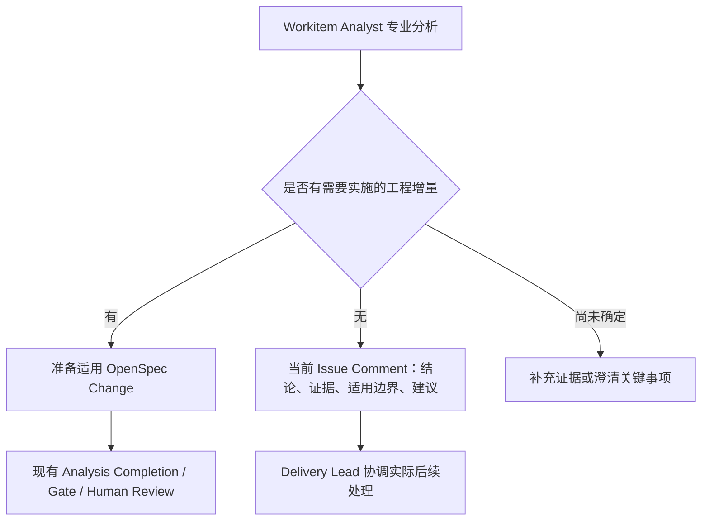

# 16 — Analysis 无工程增量处理与执行效率优化方案

## 1. 目标与范围

以 [LEI-61 回放](projects/replay/20261125-LEI-61/replay.md) 与 [LEI-62 回放](projects/replay/20261125-LEI-62/replay.md) 为事实依据，对照当前 main 的 Agent、Skill、Rondo CLI 与 [01 设计原则](01-multica-openspec-design-guideline.md)，消除不必要的 OpenSpec Change、重复调查、机械调用、工件发布返工及工具探索开销。LEI-61 验证无工程增量场景；LEI-62 验证真实且范围较小的工程增量场景。

核心目标：Analysis 首先判断是否存在需要实施的工程增量，而不是必然生成 OpenSpec。保持真实工程变更的现有授权、质量、Gate、Human Approval 和交付契约不变。

遵循 First Principles、KISS、YAGNI、Specialist Focus、One Rule One Owner、Native First、Minimal Sufficient、Right-sized Composition、Deterministic First。此次仅保存方案，不实施改造。

## 2. 回放事实

TFS 267834（LEI-61）：厦门弘爱医院-数据平台-调度中心作业备注优化。原始诉求为备注上线/取消备注上线不应将子作业备注覆盖为父作业备注。

回放完成消息表明：

- LEI-31 / TFS 265651 已处理同症状问题；PR #3854 合入 dataintegration dev，当前 HEAD 包含修复提交 efc8612。
- 备注上线与取消备注上线共用 tagOnline；已有 unifiedRemark 作用域修复覆盖原诉求。显式统一备注仍保留既有语义。
- 无新增生产代码需求；现场部署版本是否包含修复仍待确认。未重新执行业务验证，不把代码分支修复等同于现场问题已解决。
- Analyst 仍创建 confirm-schedule-remark-scope-267834（corrective-change、proposal + tasks、skip_specs: true），执行 Gate 与 Git 发布，生成 Independent Verify Recommendation，Issue 进入 analysis_review。
- 固定审核来源为业务根仓 winning-platform-monorepo@master，Commit 033ffa7f8cda65db3ff124accc8913b4e8f12047。方案及研发改造的仓库为 winning-platform-rondo，二者不要混淆。
- Lead 请求 Human 决定现场版本、显式统一备注语义、历史数据恢复、TFS 关闭方式四项事项；尚未派发 Engineer。

### 2.1 时间与调用统计

| Run | 时间（UTC+8） | 耗时 | 已导出工具调用 |
| --- | --- | --- | --- |
| Wayfinder | 13:05:04–13:12:53 | 7m49s | 73 |
| Lead 首次取消 | 13:18:42–13:18:52 | 10s | 未导出 |
| Lead 委派 | 13:19:15–13:21:14 | 1m59s | 未导出 |
| Analyst 首次取消 | 13:21:00–13:30:00 | 9m | 未导出 |
| Analyst 重跑 | 13:32:29–13:39:33 | 7m04s | 83 |
| Lead 审核协调 | 13:39:21–13:40:10 | 49s | 未导出 |

从准入开始至最后 Lead 完成共 35m06s；Run 有时间重叠，不能简单累加。已导出主会话共 156 次工具调用。取消原因、Lead 内部执行细节及等待原因无法由 partial 回放确定。

Analyst 成功 Run（按时间线工具序号分组）：

| 分组 | 序号 | 次数 | 时间（UTC+8） |
| --- | --- | --- | --- |
| 调查及核实 | 1–37 | 37 | 13:32:34–13:34:26 |
| OpenSpec 准备与校验 | 38–53 | 16 | 13:34:32–13:35:51 |
| CLI 探索、Facts、Gate、Git 发布 | 54–77 | 24 | 13:36:00–13:38:31 |
| 评论与回读 | 78–83 | 6 | 13:38:51–13:39:22 |

转入 spec-preparation 后，准备、校验和发布消耗 40 次调用（48.2%），工具事件跨度约 4 分钟。本例若确认无工程增量，可整体省略此类工作，而非仅加速命令。

来源：[Wayfinder timeline](projects/replay/20261125-LEI-61/wayfinder/20261125-1305-23011ef7/timeline.md)、[Analyst timeline](projects/replay/20261125-LEI-61/workitem-analyst/20261125-1332-ce9aeb95/timeline.md)、[Issue snapshot](projects/replay/20261125-LEI-61/evidence/issue.json)。

### 2.2 LEI-62：真实小范围工程变更

TFS 268376（LEI-62）：公版研发_DF集成调度_作业迁移日志没有打印详细日志，失败时无法排查失败原因，需输出详细日志。

- Wayfinder 已定位 dataintegration 的 DfJobMigration.java 失败分支只记录摘要、未记录堆栈，以及 OdrJobMigration.java 的既有堆栈落盘做法。现场 96 环境版本关系未确认。
- Analyst 最终建议仅修改 dataintegration/hybrid 的 DfJobMigration.trigger() 失败分支，在现有迁移日志记录异常类型、消息、cause 链和堆栈，凭据脱敏；API 与前端展示保持不变。
- 创建 job-migration-detail-error-log-268376（intentional-change），包含 proposal、spec、design、tasks；OpenSpec strict、Analysis Gate PASS，ai_review=APPROVED，Independent Verify Recommendation=not_required；固定根仓审核 Commit a69a182173bc6ede8bb76dc98f9a559ba51b2e4a（master）。未实施生产代码，等待 Human Approval。
- 该场景存在真实工程增量，不适用无 Change 出口。优化对象是分析深度、证据复用、工件最小充分性及发布效率，不是取消研发契约。

| Run | 时间（UTC+8） | 耗时 | 已导出工具调用 |
| --- | --- | --- | --- |
| Wayfinder | 13:02:15–13:06:47 | 4m32s | 59 |
| Lead 首次取消 | 13:18:42–13:18:53 | 11s | 未导出 |
| Lead 委派 | 13:19:06–13:20:11 | 1m05s | 未导出 |
| Analyst 首次取消 | 13:20:01–13:29:53 | 9m52s | 未导出 |
| Analyst 重跑 | 13:32:37–13:44:13 | 11m36s | 116 |
| Lead 审核协调 | 13:44:01–13:44:26 | 25s | 未导出 |

准入开始至最后 Lead 完成共 42m11s；主要成功 Run 合计 16m08s，已导出 175 次工具调用。Run 存在重叠，不简单累加。

Analyst 成功 Run 按工具序号划分：

| 分组 | 序号 | 次数 | 时间（UTC+8） |
| --- | --- | --- | --- |
| 上下文、工作区、证据调查及前置契约探索 | 1–53 | 53 | 13:32:41–13:36:17 |
| Change 创建、工件准备与原生校验 | 54–72 | 19 | 13:36:29–13:38:43 |
| Analysis Completion、CLI 探索与返工 | 73–111 | 39 | 13:38:50–13:43:19 |
| 审核评论与回读 | 112–116 | 5 | 13:43:38–13:44:01 |

Completion 部分占 39/116（33.6%）的工具调用，事件跨度 4m29s。部分调用的结果截断，不将全部时间归因于 CLI 自身运行耗时。

关键事实：
- #74–79 查询历史 analysis-facts、analysis-handoff、ai-review 等工件，#82 创建独立 ai-review.md；#95–103 发布失败后反查 root-git、complete、gate-evidence 等实现；#106–111 将复核依据并入 proposal，删除 ai-review.md、修正 Facts 后重新发布成功。
- #88、92、110 调用 analysis stage；#89、92 显式 analysis validate；#93、95、111 调用 analysis complete，前两次返回非零。#93 发生于首次本地 Commit 之前。部分完整错误结果被截断，不断言每次失败的唯一原因。
- #9 Checkout 根仓，#21 在 Task workdir 下 Checkout 后端，#45 在根仓下 Checkout 前端；#23 向 remote-codegraph 传入本地 Windows Checkout 路径，而远端工程目录为服务端路径。未证明 MCP 返回结果与目标版本一致。
- Wayfinder #54 先执行 handoff（13:06:05），#57 后发布 Decision（13:06:27），#58 回读。下游启动可能早于准入证据发布。

来源：[Wayfinder timeline](projects/replay/20261125-LEI-62/wayfinder/20261125-1302-6e6f62cd/timeline.md)、[Analyst timeline](projects/replay/20261125-LEI-62/workitem-analyst/20261125-1332-80ed8174/timeline.md)、[Analyst replay](projects/replay/20261125-LEI-62/workitem-analyst/20261125-1332-80ed8174/replay.md)。

## 3. 根因与优化点

| 优先级 | 问题 | 事实依据 | 优化方向 |
| --- | --- | --- | --- |
| P0 | Analysis 缺少无工程增量的正常出口 | Analyst 已确认原诉求被现有修复覆盖，仍创建 Change | Analysis 与 Change Preparation 解耦 |
| P0 | 分析完成契约与 OpenSpec 强绑定 | Analyst Delivery、analysis-completion、facts.ts、complete.ts、approve.ts、03 设计均以 Change 为前提 | 限定研发契约提交的适用范围，不放宽现有 Gate |
| P1 | Wayfinder 调查过深 | 73 次调用，读取历史工件、验证记录、源码、其他 Issue、CLI 内部实现 | 准入证据充分即停止；保留可供下游复用的 Evidence |
| P1 | 准入交接先于 Decision 发布 | 13:11:22 handoff；13:11:58 发布 Decision；13:12:42 回读 | 先发布并确认 Decision，再交接 |
| P1 | Human 待决范围扩大 | 将显式统一备注、历史数据恢复、TFS 关闭方式全部列为待决 | 只提出影响当前目标的实质决策 |
| P1 | 过早 Checkout，重复调查 | Analyst Checkout 根仓、后端、前端；未使用三个只读 remote MCP；Wayfinder 已使用它们 | 优先消费已有可信证据，只补缺口，必要时 Checkout |
| P1 | CLI 可发现性不足 | 部分 leaf --help 返回 64；Agent 读取 dist 内部实现 | 修复涉及命令的帮助与参数说明 |
| P0 | Analysis Completion 输入与执行接口不够自足 | 两次 Analyst 反查 CLI 内部实现；LEI-62 三轮 stage/complete、两轮显式 validate | 单一正常发布入口、合法 Facts 示例、提前诊断 |
| P0 | 工件准备与发布约束不一致 | LEI-61 额外 README；LEI-62 独立 ai-review.md，均发生提交后清理返工 | 最小原生工件；CLI 提前校验同一发布约束 |
| P1 | Wayfinder 过度探索平台与历史 Issue | LEI-61/62 多次 --help、issue list、历史 Comment、handoff.js；LEI-62 尝试不存在的 note 命令 | 提供当前原生 Decision 消费示例；只查询相关上下文 |
| P1 | MCP 路径与 Checkout 层级不一致 | LEI-62 Analyst #21、23、45；LEI-61 Wayfinder 首次 MCP 连接 ECONNRESET 后恢复 | 按实际远端路径与版本取证，遵循现有根子仓布局 |
| P2 | Comment 工作目录与诊断输出 | LEI-61 --content-file 违反实际 cwd；Replay 中底层命令日志截断关键错误 | 使用实际 cwd；结构化结果明确、可诊断 |
| P0（独立排查） | Run 取消、等待、采集缺失 | 两个 Lead 在 13:18:42 启动后取消；两个 Analyst 约 13:30 取消，13:32 重跑 | 查 Runtime/Daemon 实际原因，不预设架构改造 |

### 3.1 Analysis 与 Change 的语义边界

Issue 表达待处理问题或业务诉求；OpenSpec Change 表达需要实施的工程增量。两者不存在必然一对一关系。

corrective / intentional 是变更性质，不回答是否需要变更。存在真实工程增量才进入变更分类及工件准备。工程增量不局限于生产代码，确实需要新增测试、工程配置、迁移脚本时也可能构成 Change。

| 分析结论 | 处理方式 |
| --- | --- |
| 需修复代码或改变业务行为 | 准备适用 OpenSpec Change |
| 已有修复完整覆盖、已有功能满足目标 | 不创建 Change，记录证据和处理建议 |
| 仅需部署已有版本 | 不创建 Change，协调版本适用性 |
| 仅需使用指导或非研发配置调整 | 通常不创建 Change |
| 关键事实或意图未确定 | 补证或澄清，不提前制造未授权工程契约 |
| 已有修复仅覆盖部分诉求 | 仅为真实剩余增量准备 Change |

### 3.2 当前契约与原因

- [Workitem Analyst Instructions](agents/workitem-analyst/instructions.md) 的 Delivery 要求将专业分析沉淀到当前 OpenSpec Change，形成 Verify Recommendation 并使用 analysis-completion。
- [spec-preparation](skills/spec-preparation/SKILL.md) 缺少明确的工程增量前提。
- [analysis-completion](skills/analysis-completion/SKILL.md) 要求唯一 Change、facts、Git 来源。
- [facts.ts](rondo/src/commands/analysis/facts.ts) 强制 change_kind、change_ref、verify_agent 及适用 ai_review。
- [complete.ts](rondo/src/commands/analysis/complete.ts) 实施 Change Gate、Git 发布、固定来源及 analysis_review。
- [approve.ts](rondo/src/commands/analysis/approve.ts) 依据 Gate PASS 与固定 Commit 登记研发批准。
- [03 Analysis 设计](03-workitem-analysis-design.md) 将所有自动 Analysis 的完成与工程契约发布绑定。

这些要求对真实 Change 合理，问题在于适用范围。仅修改 Analyst 提示词并继续要求调用现有 analysis-completion，无法完成无 Change 的分析。反之，不应修改 CLI 使其接受虚构的 Change 或 Gate PASS。

### 3.3 专业聚焦与 Evidence

Wayfinder 的职责是判断能否承接，而非完整诊断。发现既有修复是有价值的证据，不必继续验证现场版本、全部回归场景、技术方案或最终任务。LEI-62 在确认日志问题归属、可访问的候选后端仓和承接能力后即可形成 eligible；已发现的代码位置和参考实现作为 Evidence，而非继续扩大专业调查。两个 Issue 均应复用可信 Decision 及已知路径，只核实影响当前结论的差异。

Analyst 可复用原 Decision、LEI-31、PR、Commit 和归档 Evidence，只核实当前诉求与已有修复之间的实质差异。已有证据并不自动等同当前代码事实；必要时验证版本与范围。远程 MCP 足够时不必准备本地仓；需要精确 Git 版本关系、本地验证或写入时按需 Checkout。不改变 native-workspace 的工作区架构。

Lead 消费专业结论，不重新诊断，不干预 Analyst 使用何种 Skill。

### 3.4 Human 决策边界

LEI-61 应聚焦现场部署版本是否包含修复。显式统一备注默认保持既有语义；历史数据恢复不属于原始诉求，不默认扩展范围。若 Human 提出新的明确目标，再按实际情况分析。TFS 工作项处理由 Lead 协调，不构造无实际工程增量的 Tasks。

### 3.5 CLI 可发现性与发布工件

Analyst #54–55 多次调用 analysis leaf --help 返回 64，#60–71 阅读 facts、change-schema、complete、root-git 等 dist 实现；Wayfinder 也读取 handoff、verify-decision 实现。修复相关命令的参数可发现性，不新增 Discovery Skill，不重构全部 CLI 参数框架。

Analyst #45 使用 openspec new change ... --description ...，生成 README.md；#73 将其提交，#74 首次 complete，#75–76 读取并删除 README 后重新提交，#77 再执行 complete。首次发布完整诊断被截断，不断言唯一失败原因。避免额外参数产生契约之外文件，不为 README 放宽发布白名单。

LEI-62 从历史归档推导当前契约并生成 ai-review.md；当前 complete.ts 的 ANALYSIS_CONTRACT_FILE 仅允许 .openspec.yaml、proposal.md、tasks.md、design.md 及 specs 下 Markdown。facts.ts 的 draftMetadataEntries 仅持久化 ai_review.verdict，不消费 findings_ref；gate-evidence.ts 绑定实际工程工件及 verify_agent.focus_refs，不要求独立 AI Review 文件。专业审查仍应真实完成，必要依据使用适用工件或可追溯引用，不为了机器字段重复生成文档。

### 3.6 CLI 正常消费接口与重复执行

当前 stage 负责 draft Metadata 逐键写入与回读，validate 负责只读 Gate 预检查，complete 重新执行真实 Gate、核对已登记 Facts、发布固定 Git 来源及登记审核状态。三个接口的职责可以区分，但常规发布不需要 LLM 手工编排多个机械步骤。stage.ts / validate.ts 的参数解析也未消费 Skill 示例中的 --registry-config；不得把被忽略的参数描述为已执行的配置校验。实施时对齐真实参数及 Runtime 权威来源，不引入第二套配置。

LEI-62 先查历史 Facts 和 CLI 内部实现，后多次修正输入、stage、validate、complete，反映正常调用契约不够自足。complete 内部已执行真实 Gate，因此显式 validate 不应成为固定流程。保留 spec-preparation 的原生工件校验与最终 Gate 的权威职责；不因预检查 PASS 跳过最终校验。

### 3.7 Runtime 与平台耗时边界

LEI-61/62 的首次 Lead 和 Analyst 均出现时间接近的取消。两份回放均为 partial，取消 Run 缺 session_id，Lead session 导出失败；不能确认是人为取消、Runtime 重启、超时、并发限制或其他原因。核实对应 Run、Daemon 日志、调度队列与取消来源；仅在复现并定位后修复实际原因，不新增 Watchdog、自动重试 Agent 或 Checkpoint 数据库。

## 4. 目标设计



此图仅表达专业结果及适用边界，不是新 Workflow、固定 Skill 调用链或持久化状态机。

无工程增量使用 Multica 原生 Issue Comment、@mention、既有 Issue Status 和协作机制；不生成 OpenSpec、研发契约 Gate、Git 发布、Independent Verify Recommendation，不调用研发契约批准，不派发无实际工程任务的 Engineer。无 Change 不意味着 Gate PASS 或已获研发批准。

不新增 analysis.disposition、no_change Change Kind、no-change Schema、No Change Gate、no-change-analysis Skill、rondo analysis no-change 命令、Analysis Result JSON、自定义 Status、第二套 Route。无机器消费需求时无需将每个语义结果转化为 Metadata。

## 5. 修改方案

### 5.1 Workitem Analyst — 核心职责

文件：agents/workitem-analyst/instructions.md。

Core Responsibilities 研发准备建议：

> 根据专业分析结论判断是否存在需要实施的工程增量。存在工程变更时，明确其性质、范围及验证要求，按实际需要准备 OpenSpec Engineering Contract。

Working Principles 建议：

> 优先复用已有可信结论及有效证据。发现既有修复、已有功能或其他可行处理方式时，仅核实影响当前诉求的实际差异；证据足以形成结论即可停止调查。

Delivery 建议：

> 存在需要实施的工程变更时，完成适用的 OpenSpec 工件及专业复核，提交研发契约审核。无需工程变更时，在当前 Issue 简明记录分析结论、关键 Evidence、适用边界和后续处理建议，并交接 Delivery Lead。关键事实或业务意图尚未确定时，明确影响当前判断的证据缺口或待决定事项。

原有变更分类、Intentional 专业审查、必要 Verify Recommendation 等要求保留在实际研发契约场景。保持专业判断自主性，不增加固定步骤或工具调用上限。

### 5.2 spec-preparation

文件：skills/spec-preparation/SKILL.md。

增加必要前提：已有明确需要实施的工程增量及其专业分析结论。

保持 Change Identity、Schema、Artifact、Validation、授权规则不变。使用最小创建参数（openspec new change <id> --schema <schema>），避免 --description 产生非必要 README。以当前原生 Schema、Artifact Instruction 和实际工程需要为依据，不从历史归档推导额外工件；合法 skip_specs、Conditional Design 不强制填满。Skill 不维护第二套发布白名单，不裁决业务是否需要研发，不枚举全部无 Change 场景。

### 5.3 analysis-completion

文件：skills/analysis-completion/SKILL.md。

建议 description：将已完成的 OpenSpec Engineering Contract 经确定性校验和 Git 发布提交 Human Review。

此 Skill 仅承担研发契约审核提交；不承担无需研发的分析结果处理。不放宽现有 Gate、Git 来源及审核契约。

常规提交只保留必要的当前 Change Commit、analysis complete 和原生审核 Comment；不要求 Agent 默认单独 stage、validate 或调查 CLI 源码。CLI 完成接口收敛后同步更新命令示例，不在 Skill 复制内部执行步骤。显式 validate 仅用于诊断或有实际需要的预检查。

提供一份可直接消费的最小 Facts 示例（以下为 Intentional 场景示意，不是默认专业判断）：

```json
{
  "change_kind": "intentional",
  "change_ref": "job-migration-detail-error-log-268376",
  "verify_agent": {
    "recommendation": "not_required",
    "reason": "当前开发侧验证可覆盖已识别风险",
    "focus_refs": ["tasks.md"]
  },
  "ai_review": {
    "verdict": "APPROVED"
  }
}
```

实际值由 Analyst 根据真实专业分析、复核和验证需求填写。Corrective 按当前 Schema 适用条件提供字段。临时 Facts 不进入 Git；AI Review 使用 verdict，必要专业依据进入适用的既有工件，不另建 ai-review.md 或 findings_ref 指向的无效文件。审核 Comment 使用当前实际命令 cwd 下的临时文件及原生线程，回读确认；评论失败只恢复评论，不重跑已经成功的 Gate/Git 发布。

### 5.4 Delivery Lead

文件：agents/delivery-lead/instructions.md。

保留按目标、已有成果、未解决问题及成员判断下一步的现有原则，仅补充：

> 根据专业分析结论，协调无需工程变更事项的后续处理及必要的 Human 决策；不将其作为研发契约批准或研发派发处理。

LEI-61 的适用行为：现场未部署则协调升级/交付确认；已部署仍复现则协调补充专业分析；Human 明确无需继续时依据有效授权与既有状态机制结束 Issue。外部 TFS 状态按真实业务决定和现有授权处理，不伪造 PR 完成、TFS 子任务、工时或交付事实。

实施前应核实现有 Multica 状态及 TFS 操作契约是否支持授权后的非研发终止；本方案不预设具体 TFS 终态，也不擅自复用依赖 PR 的 Closeout。若存在真实阻断，单独说明最小必要修正，不提前设计新状态机。

### 5.5 Wayfinder

文件：agents/wayfinder-agent/instructions.md。

建议：

> 调查深度以支撑当前准入 Decision 为限；发现可供后续处理复用的事实时，记录必要 Evidence，不扩展为完整专业分析。

eligible 描述明确为 Decision 已发布并确认后，通过 rondo delivery handoff --issue <KEY> 完成受控交接。

workitem-triage 已明确判断维度及充分证据停止条件，不重复添加检查表。补充一份经实际 Multica CLI 验证的 /note Decision 记录与原生 Comment 发布示例，复用 multica-platform 已有命令参考；避免 Agent 查询大量无关历史 Issue 以推导格式。不新增 Decision Gate，不让 CLI 解析自然语言判断准入语义。

### 5.6 Rondo CLI

针对两份 Replay 暴露的正常发布消费问题收敛现有接口，不扩大为全部 CLI 重构。

**常规入口：analysis complete。** 保留当前 Change 的本地路径限定 Commit 作为专业工程操作，CLI 负责 draft Facts 的确定性登记、最终真实 Gate、Git 发布及固定来源、审核状态。Agent 提供专业 Facts 和必要路径，不手工补写 Metadata。

- 将 stage 的现有校验、守卫、写入与回读逻辑复用为 complete 内部能力，避免复制实现；审查现有调用方后决定是否保留独立 stage 命令，不增加第二套发布入口。
- validate 保留只读诊断/按需预检查用途，不是常规发布前置操作。complete 必须重新执行真实 Gate，并以实际工件及 Facts 摘要绑定固定 Git 版本。
- 在任何 draft 写入前先完成必要输入、授权、状态及可本地确定的发布工件/Commit 前置校验；按同一 ANALYSIS_CONTRACT_FILE 权威规则尽早识别非法文件，返回具体路径、原因及可执行修正提示。保留最终候选 Git Tree 的授权路径检查与摘要校验，不能因早期预检通过而省略最终检查。不扩大发布白名单或自动删除用户文件。
- 对确认相同的 draft Metadata 不重复写入；仍回读并核对实际值。保留已有状态守卫、并发冲突检测、固定来源、发布后回读及结果不明时的幂等恢复。已在 analysis_review 的重放先核对固定版本，不重新 stage 或 Gate；不允许变更既有审核事实。
- 核实 facts.ts 中未实际消费的 findings_ref 等字段及所有消费者，确无依赖时删除；不新增结果字段、配置或过程性工件。
- 修复相关 leaf --help（handoff 已有正常 Help 分支，核实即可；stage/validate/complete 需修正实际异常），同步 COMMANDS.md 与 Skill，确保真实参数、合法 Facts 结构和用法一致；删除未消费的命令参数示例或按实际需要核验，不重复建立配置来源。
- 保持结构化结果包含明确失败原因、违规路径或缺失字段；底层详细执行日志保留按需诊断能力，避免正常输出淹没结果。仅处理实际受影响命令，不全局改造日志框架。

以上属于真实 Change 的消费效率改造；无 Change 仍使用既有原生 Comment 与 Lead 协调，不调用 analysis complete。不修改 approve、Gate 的核心语义，不弱化身份、授权、质量、Git 发布或 Human Approval。

### 5.7 工程调查与 Native Workspace

文件：skills/codebase-explorer/SKILL.md；必要时核实现有 native-workspace 的执行示例及已绑定 Skill 版本。

- 远端 MCP 使用服务端实际可访问的工程路径和可确认的版本，不能把本地 Windows Task Checkout 路径传给 remote-codegraph 当作远端路径。通过已有授权目录、资源和真实证据确认路径；不新增路径映射配置。
- 只读证据足够则不 Checkout；需要精确版本核验、无法取得必要远端证据或需要写入时才准备本地仓。优先利用已知文件、Symbol、Commit、PR 和前序 Decision，避免重复泛化检索。
- 本地工程仓遵循 native-workspace 现有根子仓两级布局，业务仓在实际根仓下按需 Checkout，复用当前 Task 已有工作区；不修改 Native Checkout 架构，不承诺跨 Run 共享工作树。
- MCP 暂时不可用时按实际需要选择合理的恢复或本地调查方式，不设置固定工具调用链，不强制 MCP 或 Checkout。

### 5.8 设计文档

- 01-multica-openspec-design-guideline.md：明确 Issue 与 Change 不必一对一；保持原则层职责，不写具体流程。
- 02-multica-delivery-lifecycle-design.md：明确无工程增量的后续协调出口；正常研发生命周期不变。
- 03-workitem-analysis-design.md：限定 Change Preparation、Analysis Completion、Gate、Verify Recommendation 的适用范围，区分专业分析结果与研发契约。
- 05-openspec-schema-implementation-design.md：不新增 Schema 或 Artifact；现有规则保持。

### 5.9 职责归属

| 对象 | 职责 |
| --- | --- |
| Wayfinder | 准入评估、必要证据与交接 |
| Workitem Analyst | 专业分析、实际工程增量判断、必要研发准备 |
| Delivery Lead | 协调实际处理、成员与 Human 决策 |
| workitem-triage | 准入判断方法 |
| codebase-explorer | 针对证据缺口获取工程事实 |
| spec-preparation | 准备真实工程变更的工件 |
| analysis-completion | 提交已完成的研发契约 |
| Rondo CLI | 确定性操作、校验、事实管理 |

## 6. LEI-61 目标行为

Wayfinder 确认范围、授权与承接能力，记录已有修复线索并交接。Analyst 核实原诉求与已有修复一致性、版本与必要覆盖，给出专业结论；Lead 协调现场版本确认及实际处理。

Issue Comment 示例（仅示意，不定义固定模板或新契约）：

> **分析结论：无需新增工程变更。**
>
> TFS 267834 与 TFS 265651（LEI-31）属于同一问题。PR #3854 合入 dataintegration dev，当前代码包含修复提交 efc8612。根据已有修复及本次核实结果，备注上线/取消备注上线原始诉求已被当前代码覆盖。
>
> Evidence：TFS 265651 / LEI-31、PR #3854、Commit efc8612、已归档的原修复与回归记录。
>
> 处理建议：确认现场版本是否包含上述修复；如已包含但仍复现，再基于现场现象补充分析。当前未发现新增研发需求，不创建 OpenSpec Change。

原 LEI-61 已发布的 Change 和 analysis_review 事实不自动清理或改写；如需处置该存量 Issue，另按实际授权协调，不在本方案中隐含执行。

### 6.1 LEI-62 目标行为

Wayfinder 确认业务归属、授权、访问能力和承接条件，记录已定位的 DfJobMigration / OdrJobMigration 证据。Analyst 复用定位结果，核查日志实际消费链、现有异常记录方式、凭据安全与验收边界；必要时核实前端/API 是否需要调整，证据充分即可结束调查。保持 API 与前端不变是当前回放的分析结论，不是对所有日志需求的固定约束。

确认真实增量后准备当前 Schema 所需最小 OpenSpec（是否需要 Design、Spec Delta 按原生 Schema 与专业判断决定），完成专业复核、本次 Change 的本地 Commit，调用一次常规 analysis complete，发布固定审核版本及 Comment。无需创建额外 AI Review 文档、反查 CLI 内部实现或重复 stage/validate。Human Approval、必要开发侧验证及脱敏要求保持。

## 7. 验收与收益

| 指标 | 当前 | 建议回放目标（非实测） |
| --- | --- | --- |
| Wayfinder 耗时 | 7m49s | 1–2m |
| Wayfinder 调用 | 73 | 10–20 |
| Analyst 成功 Run 耗时 | 7m04s | 1–3m |
| Analyst 调用 | 83 | 10–25 |
| 新建 OpenSpec | 1 | 0 |
| 根/子仓 Checkout | 3 | 按证据缺口决定 |
| Analysis Gate、Git 发布、Verify Recommendation | 已执行 | 本例不适用 |
| 无实际任务的 Engineer 派发 | 尚未发生 | 不派发 |

LEI-61 已导出的 Wayfinder 与成功 Analyst Run 合计 14m53s；目标 2–5m，约减少 66%–87%，待真实回放验证。不含取消 Run、Lead 与平台等待。

LEI-62 独立参考目标：

| 指标 | 当前 | 建议回放目标（非实测） |
| --- | --- | --- |
| Wayfinder 耗时 / 调用 | 4m32s / 59 | 1–2m / 10–20 |
| Analyst 成功 Run 耗时 / 调用 | 11m36s / 116 | 4–6m / 40–50 |
| 成功主要 Run 合计 | 16m08s / 175 | 5–8m / 50–70 |
| 独立 ai-review.md / 额外说明工件 | 存在 | 0 |
| 正常流程反查 CLI 源码 | 存在 | 0 |
| 显式 stage / validate | 3 / 2 | 正常发布无需，按诊断需要使用 validate |
| 常规 analysis complete 调用 | 3 | 1（无异常时） |
| 真实 Change / Gate / 固定 Git 来源 / Human Approval | 适用 | 保留 |

以上是同类样本的参考目标，不是硬性限时或调用配额，不牺牲专业证据质量。Run 取消与排队耗时单独统计，不混同成功 Run 的优化效果。

验收场景：

1. 已有修复完整覆盖：不创建 Change，记录证据并交接；不生成虚假 Gate、Approval、PR 或 TFS 研发事实。
2. 部分覆盖：仅实际增量进入正常工程契约。
3. 当前代码已修复、现场版本未知：明确适用边界，协调确认，不能直接宣称现场验收完成。
4. 已部署修复仍复现：补充诊断，不直接认定重复。
5. 确需新增测试、配置、脚本等工程变更：按真实工程增量准备 Change。
6. 正常 Corrective / Intentional Requirement：保留现有必要工件、Gate、Human Approval、工程验证。
7. 关键意图不清楚：补证或澄清，不制造未授权契约。
8. Wayfinder eligible：Decision 先发布确认，再交接。
9. 涉及 CLI --help：正常退出、准确说明用法；原有执行校验保持有效。
10. OpenSpec 新建：不产生非必要 README；不降低契约文件约束。
11. 无 Change Issue：不会误入 PR Status Sync、OpenSpec Archive 或依赖 PR 完成事实的 Delivery Closeout；授权终止、TFS 处理不伪造事实。
12. LEI-62 真实工程增量：最小合法 Change、真实专业复核、Verify Recommendation、固定 Git 来源与 Human Approval 均保留；常规 complete 自动完成 Facts 登记和最终 Gate。
13. 非法 README / ai-review.md 或缺失、错误 Facts：在高成本发布之前返回明确原因，不写入虚假 PASS、不推进审核状态；最终候选 Git Tree 仍校验。
14. 重入与冲突：相同 draft 不重复写入；已审核重放不改写固定来源、不重跑 Gate；Facts/工件变动、授权失效、候选不一致时不放行，发布或评论结果未知按真实事实恢复。
15. MCP 与 Checkout：远端路径/版本可核实，业务仓位于实际根仓下；不因证据充分强制重复 Checkout。MCP 异常不虚构证据。
16. 原生 Decision 与审核 Comment：当前契约示例可执行，Decision 发布确认后才触发 Handoff；正常 CLI Help、输出及 cwd 内临时文件不造成无关历史查询或返工。
17. Runtime：独立核对两个 Issue 取消、重新派发及排队原因；若未取得证据，记录缺口，不引入未经验证的恢复机制。

## 8. 实施顺序

- 第一阶段（P0/P1）：需求分析语义与执行深度优化。Analysis / Change Preparation 解耦；更新 Analyst、Lead、Wayfinder、相关 Skill 和设计文档，明确 Decision 发布顺序、已有 Evidence 复用及远端路径/本地 Checkout 语义。
- 第二阶段（P0/P1）：Analysis Completion 消费契约收敛。正常 complete 单入口、复用 stage 确定性能力、提前校验发布工件及 Facts、CLI Help/诊断输出和当前命令示例同步。保留原生 OpenSpec 校验、真实 Gate、固定来源及审核契约。
- 独立排查（P0）：Run 取消、重启、平台等待、回放缺失。可与前两阶段并行调查；未取得证据前不新增重试机制或调度架构。

实施时专业聚焦，避免不必要的跨模块改造。设计遵循 01 原则：由 Agent 作语义判断、Skill 提供可复用场景方法、CLI 管理确定性操作与事实；复用原生协作机制；证据充分后自然结束。

## 9. 限制

两次回放覆盖均为 partial；首次取消 Analyst 的完整日志及 Lead session 未导出，部分 CLI 错误输出截断；未重新执行真实业务测试。现场版本、实际问题是否仍复现、无 Change 的 TFS 适用终态仍需实际确认。CLI 独立 stage 的消费者、未消费字段及必要参数应在实施前核实。效率目标未实测。原已发布的 LEI-61/62 审核事实不自动改写。本方案为待评审设计，不表示已实现或修改任何 Agent、Skill、CLI、业务源码、Issue 或 TFS 数据。
