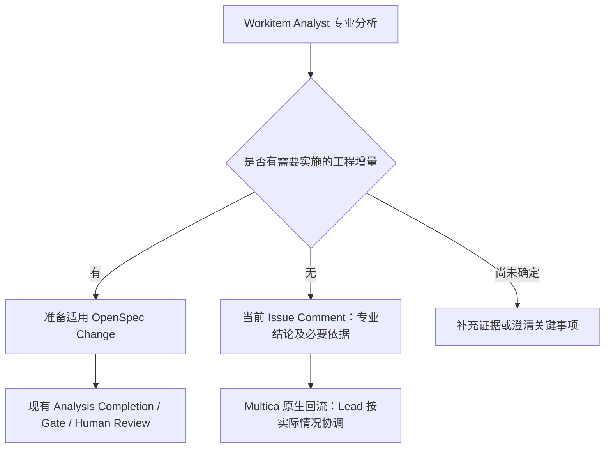

# 16 — Analysis 无工程增量处理与执行效率优化方案

## 1. 目标与范围

以 [LEI-61 回放](projects/replay/20261125-LEI-61/replay.md) 与 [LEI-62 回放](projects/replay/20261125-LEI-62/replay.md) 为事实依据，对照当前 main 的 Agent、Skill、Rondo CLI 与 [01 设计原则](01-multica-openspec-design-guideline.md)，消除不必要的 OpenSpec Change、重复调查、机械调用、工件发布返工及工具探索开销。LEI-61 验证无工程增量场景；LEI-62 验证真实且范围较小的工程增量场景。

核心目标：Analysis 首先判断是否存在需要实施的工程增量，而不是必然生成 OpenSpec。保持真实工程变更的现有授权、质量、Gate、Human Approval 和交付契约不变。

遵循 First Principles、KISS、YAGNI、Specialist Focus、One Rule One Owner、Native First、Minimal Sufficient、Right-sized Composition、Deterministic First。此次仅保存方案，不实施改造。

## 2. 回放事实

TFS 267834（LEI-61）：厦门弘爱医院-数据平台-调度中心作业备注优化。原始诉求为备注上线/取消备注上线不应将子作业备注覆盖为父作业备注。

回放完成消息表明：

- LEI-31 / TFS 265651 已处理同症状问题；PR #3854 合入 dataintegration dev，当前 HEAD 包含修复提交 efc8612。
- 备注上线与取消备注上线共用 tagOnline；已有 unifiedRemark 作用域修复覆盖原诉求。显式统一备注仍保留既有语义。
- 无新增生产代码需求；现场部署版本是否包含修复仍待确认。未重新执行业务验证，不把代码分支修复等同于现场问题已解决。
- Analyst 仍创建 confirm-schedule-remark-scope-267834（corrective-change、proposal + tasks、skip_specs: true），执行 Gate 与 Git 发布，生成 Independent Verify Recommendation，Issue 进入 analysis_review。
- 固定审核来源为业务根仓 winning-platform-monorepo@master，Commit 033ffa7f8cda65db3ff124accc8913b4e8f12047。方案及研发改造的仓库为 winning-platform-rondo，二者不要混淆。
- Lead 请求 Human 决定现场版本、显式统一备注语义、历史数据恢复、TFS 关闭方式四项事项；尚未派发 Engineer。

### 2.1 时间与调用统计

| Run | 时间（UTC+8） | 耗时 | 已导出工具调用 |
| --- | --- | --- | --- |
| Wayfinder | 13:05:04–13:12:53 | 7m49s | 73 |
| Lead 首次取消 | 13:18:42–13:18:52 | 10s | 未导出 |
| Lead 委派 | 13:19:15–13:21:14 | 1m59s | 未导出 |
| Analyst 首次取消 | 13:21:00–13:30:00 | 9m | 未导出 |
| Analyst 重跑 | 13:32:29–13:39:33 | 7m04s | 83 |
| Lead 审核协调 | 13:39:21–13:40:10 | 49s | 未导出 |

从准入开始至最后 Lead 完成共 35m06s；Run 有时间重叠，不能简单累加。已导出主会话共 156 次工具调用。取消原因、Lead 内部执行细节及等待原因无法由 partial 回放确定。

Analyst 成功 Run（按时间线工具序号分组）：

| 分组 | 序号 | 次数 | 时间（UTC+8） |
| --- | --- | --- | --- |
| 调查及核实 | 1–37 | 37 | 13:32:34–13:34:26 |
| OpenSpec 准备与校验 | 38–53 | 16 | 13:34:32–13:35:51 |
| CLI 探索、Facts、Gate、Git 发布 | 54–77 | 24 | 13:36:00–13:38:31 |
| 评论与回读 | 78–83 | 6 | 13:38:51–13:39:22 |

转入 spec-preparation 后，准备、校验和发布消耗 40 次调用（48.2%），工具事件跨度约 4 分钟。本例若确认无工程增量，可整体省略此类工作，而非仅加速命令。

来源：[Wayfinder timeline](projects/replay/20261125-LEI-61/wayfinder/20261125-1305-23011ef7/timeline.md)、[Analyst timeline](projects/replay/20261125-LEI-61/workitem-analyst/20261125-1332-ce9aeb95/timeline.md)、[Issue snapshot](projects/replay/20261125-LEI-61/evidence/issue.json)。

### 2.2 LEI-62：真实小范围工程变更

TFS 268376（LEI-62）：公版研发_DF集成调度_作业迁移日志没有打印详细日志，失败时无法排查失败原因，需输出详细日志。

- Wayfinder 已定位 dataintegration 的 DfJobMigration.java 失败分支只记录摘要、未记录堆栈，以及 OdrJobMigration.java 的既有堆栈落盘做法。现场 96 环境版本关系未确认。
- Analyst 最终建议仅修改 dataintegration/hybrid 的 DfJobMigration.trigger() 失败分支，在现有迁移日志记录异常类型、消息、cause 链和堆栈，凭据脱敏；API 与前端展示保持不变。
- 创建 job-migration-detail-error-log-268376（intentional-change），包含 proposal、spec、design、tasks；OpenSpec strict、Analysis Gate PASS，ai_review=APPROVED，Independent Verify Recommendation=not_required；固定根仓审核 Commit a69a182173bc6ede8bb76dc98f9a559ba51b2e4a（master）。未实施生产代码，等待 Human Approval。
- 该场景存在真实工程增量，不适用无 Change 出口。优化对象是分析深度、证据复用、工件最小充分性及发布效率，不是取消研发契约。

| Run | 时间（UTC+8） | 耗时 | 已导出工具调用 |
| --- | --- | --- | --- |
| Wayfinder | 13:02:15–13:06:47 | 4m32s | 59 |
| Lead 首次取消 | 13:18:42–13:18:53 | 11s | 未导出 |
| Lead 委派 | 13:19:06–13:20:11 | 1m05s | 未导出 |
| Analyst 首次取消 | 13:20:01–13:29:53 | 9m52s | 未导出 |
| Analyst 重跑 | 13:32:37–13:44:13 | 11m36s | 116 |
| Lead 审核协调 | 13:44:01–13:44:26 | 25s | 未导出 |

准入开始至最后 Lead 完成共 42m11s；主要成功 Run 合计 16m08s，已导出 175 次工具调用。Run 存在重叠，不简单累加。

Analyst 成功 Run 按工具序号划分：

| 分组 | 序号 | 次数 | 时间（UTC+8） |
| --- | --- | --- | --- |
| 上下文、工作区、证据调查及前置契约探索 | 1–53 | 53 | 13:32:41–13:36:17 |
| Change 创建、工件准备与原生校验 | 54–72 | 19 | 13:36:29–13:38:43 |
| Analysis Completion、CLI 探索与返工 | 73–111 | 39 | 13:38:50–13:43:19 |
| 审核评论与回读 | 112–116 | 5 | 13:43:38–13:44:01 |

Completion 部分占 39/116（33.6%）的工具调用，事件跨度 4m29s。部分调用的结果截断，不将全部时间归因于 CLI 自身运行耗时。

关键事实：
- #74–79 查询历史 analysis-facts、analysis-handoff、ai-review 等工件，#82 创建独立 ai-review.md；#95–103 发布失败后反查 root-git、complete、gate-evidence 等实现；#106–111 将复核依据并入 proposal，删除 ai-review.md、修正 Facts 后重新发布成功。
- #88、92、110 调用 analysis stage；#89、92 显式 analysis validate；#93、95、111 调用 analysis complete，前两次返回非零。#93 发生于首次本地 Commit 之前。部分完整错误结果被截断，不断言每次失败的唯一原因。
- #9 Checkout 根仓，#21 在 Task workdir 下 Checkout 后端，#45 在根仓下 Checkout 前端；#23 向 remote-codegraph 传入本地 Windows Checkout 路径，而远端工程目录为服务端路径。未证明 MCP 返回结果与目标版本一致。
- Wayfinder #54 先执行 handoff（13:06:05），#57 后发布 Decision（13:06:27），#58 回读。下游启动可能早于准入证据发布。

来源：[Wayfinder timeline](projects/replay/20261125-LEI-62/wayfinder/20261125-1302-6e6f62cd/timeline.md)、[Analyst timeline](projects/replay/20261125-LEI-62/workitem-analyst/20261125-1332-80ed8174/timeline.md)、[Analyst replay](projects/replay/20261125-LEI-62/workitem-analyst/20261125-1332-80ed8174/replay.md)。

## 3. 根因与优化点

| 优先级 | 问题 | 事实依据 | 优化方向 |
| --- | --- | --- | --- |
| P0 | Analysis 缺少无工程增量的正常出口 | Analyst 已确认原诉求被现有修复覆盖，仍创建 Change | Analysis 与 Change Preparation 解耦 |
| P0 | 分析完成契约与 OpenSpec 强绑定 | Analyst Delivery、analysis-completion、facts.ts、complete.ts、approve.ts、03 设计均以 Change 为前提 | 限定研发契约提交的适用范围，不放宽现有 Gate |
| P1 | Wayfinder 调查过深 | 73 次调用，读取历史工件、验证记录、源码、其他 Issue、CLI 内部实现 | 准入证据充分即停止；保留可供下游复用的 Evidence |
| P1 | 准入交接先于 Decision 发布 | 13:11:22 handoff；13:11:58 发布 Decision；13:12:42 回读 | 先发布并确认 Decision，再交接 |
| P1 | Human 待决范围扩大 | 将显式统一备注、历史数据恢复、TFS 关闭方式全部列为待决 | 只提出影响当前目标的实质决策 |
| P1 | 过早 Checkout，重复调查 | Analyst Checkout 根仓、后端、前端；未使用三个只读 remote MCP；Wayfinder 已使用它们 | 优先消费已有可信证据，只补缺口，必要时 Checkout |
| P1 | CLI 可发现性不足 | 部分 leaf --help 返回 64；Agent 读取 dist 内部实现 | 修复涉及命令的帮助与参数说明 |
| P0 | Analysis Completion 输入与执行接口不够自足 | 两次 Analyst 反查 CLI 内部实现；LEI-62 三轮 stage/complete、两轮显式 validate | 直接消费本次 Facts、单一正常发布入口、删除重复校验 |
| P0 | 工件准备与发布约束不一致 | LEI-61 额外 README；LEI-62 独立 ai-review.md，均发生提交后清理返工 | 最小原生工件；复用现有发布检查及明确诊断 |
| P1 | Wayfinder 过度探索平台与历史 Issue | LEI-61/62 多次 --help、issue list、历史 Comment、handoff.js；LEI-62 尝试不存在的 note 命令 | 准入语义归属 Wayfinder；精简评估维度及原生 Decision 示例 |
| P1 | MCP 路径与 Checkout 层级不一致 | LEI-62 Analyst #21、23、45；LEI-61 Wayfinder 首次 MCP 连接 ECONNRESET 后恢复 | 按实际远端路径与版本取证，遵循现有根子仓布局 |
| P2 | Comment 工作目录与诊断输出 | LEI-61 --content-file 违反实际 cwd；Replay 中底层命令日志截断关键错误 | 使用实际 cwd；结构化结果明确、可诊断 |
| P0（独立排查） | Run 取消、等待、采集缺失 | 两个 Lead 在 13:18:42 启动后取消；两个 Analyst 约 13:30 取消，13:32 重跑 | 查 Runtime/Daemon 实际原因，不预设架构改造 |

### 3.1 Analysis 与 Change 的语义边界

Issue 表达待处理问题或业务诉求；OpenSpec Change 表达需要实施的工程增量。两者不存在必然一对一关系。

corrective / intentional 是变更性质，不回答是否需要变更。存在真实工程增量才进入变更分类及工件准备。工程增量不局限于生产代码，确实需要新增测试、工程配置、迁移脚本时也可能构成 Change。

| 分析结论 | 处理方式 |
| --- | --- |
| 需修复代码或改变业务行为 | 准备适用 OpenSpec Change |
| 已有修复完整覆盖、已有功能满足目标 | 不创建 Change，记录证据和处理建议 |
| 仅需部署已有版本 | 不创建 Change，协调版本适用性 |
| 仅需使用指导或非研发配置调整 | 通常不创建 Change |
| 关键事实或意图未确定 | 补证或澄清，不提前制造未授权工程契约 |
| 已有修复仅覆盖部分诉求 | 仅为真实剩余增量准备 Change |

### 3.2 当前契约与原因

- [Workitem Analyst Instructions](agents/workitem-analyst/instructions.md) 的 Delivery 要求将专业分析沉淀到当前 OpenSpec Change，形成 Verify Recommendation 并使用 analysis-completion。
- [spec-preparation](skills/spec-preparation/SKILL.md) 缺少明确的工程增量前提。
- [analysis-completion](skills/analysis-completion/SKILL.md) 要求唯一 Change、facts、Git 来源。
- [facts.ts](rondo/src/commands/analysis/facts.ts) 强制 change_kind、change_ref、verify_agent 及适用 ai_review。
- [complete.ts](rondo/src/commands/analysis/complete.ts) 实施 Change Gate、Git 发布、固定来源及 analysis_review。
- [approve.ts](rondo/src/commands/analysis/approve.ts) 依据 Gate PASS 与固定 Commit 登记研发批准。
- [03 Analysis 设计](03-workitem-analysis-design.md) 将所有自动 Analysis 的完成与工程契约发布绑定。

这些要求对真实 Change 合理，问题在于适用范围。仅修改 Analyst 提示词并继续要求调用现有 analysis-completion，无法完成无 Change 的分析。反之，不应修改 CLI 使其接受虚构的 Change 或 Gate PASS。

### 3.3 专业聚焦与 Evidence

Wayfinder 的职责是判断能否承接，而非完整诊断。发现既有修复是有价值的证据，不必继续验证现场版本、全部回归场景、技术方案或最终任务。LEI-62 在明确受支持的业务范围、定位相关后端仓、判断为现有功能优化后即可形成 eligible；已发现的代码位置和参考实现作为 Evidence，而非继续扩大专业调查。两个 Issue 均应复用可信 Decision 及已知路径，只核实影响当前结论的差异。

Analyst 可复用原 Decision、LEI-31、PR、Commit 和归档 Evidence，只核实当前诉求与已有修复之间的实质差异。已有证据并不自动等同当前代码事实；必要时验证版本与范围。远程 MCP 足够时不必准备本地仓；需要精确 Git 版本关系、本地验证或写入时按需 Checkout。不改变 native-workspace 的工作区架构。

Lead 消费专业结论，不重新诊断，不干预 Analyst 使用何种 Skill。

### 3.4 Human 决策边界

LEI-61 应聚焦现场部署版本是否包含修复。显式统一备注默认保持既有语义；历史数据恢复不属于原始诉求，不默认扩展范围。若 Human 提出新的明确目标，再按实际情况分析。TFS 工作项处理由 Lead 协调，不构造无实际工程增量的 Tasks。

### 3.5 CLI 可发现性与发布工件

Analyst #54–55 多次调用 analysis leaf --help 返回 64，#60–71 阅读 facts、change-schema、complete、root-git 等 dist 实现；Wayfinder 也读取 handoff、verify-decision 实现。修复相关命令的参数可发现性，不新增 Discovery Skill，不重构全部 CLI 参数框架。

Analyst #45 使用 openspec new change ... --description ...，生成 README.md；#73 将其提交，#74 首次 complete，#75–76 读取并删除 README 后重新提交，#77 再执行 complete。首次发布完整诊断被截断，不断言唯一失败原因。避免额外参数产生契约之外文件，不为 README 放宽发布白名单。

LEI-62 从历史归档推导当前契约并生成 ai-review.md；当前 complete.ts 的 ANALYSIS_CONTRACT_FILE 仅允许 .openspec.yaml、proposal.md、tasks.md、design.md 及 specs 下 Markdown。facts.ts 的 draftMetadataEntries 仅持久化 ai_review.verdict，不消费 findings_ref；gate-evidence.ts 绑定实际工程工件及 verify_agent.focus_refs，不要求独立 AI Review 文件。专业审查仍应真实完成，必要依据使用适用工件或可追溯引用，不为了机器字段重复生成文档。

### 3.6 CLI 正常消费接口与重复执行

当前 stage 负责 draft Metadata 逐键写入与回读；validate 负责只读预检查；complete 再次读取相同 Facts、执行真实 Gate、发布固定 Git 来源并再次写入 Facts。正常提交不需要通过外部 Metadata 传递同一进程内的输入。应直接消费当前 Issue Facts 和本次专业 Facts，保留最后登记和回读；显式 validate 仅在实际需要诊断时执行。

stage / validate 均将 rawArgs 传给 analysisRuntime，后者实际消费 --registry-config、--profile 等参数并校验 Workspace。不得将 leaf parseArgs 未直接解析误判为未消费。保留现有 Runtime 参数及环境身份约束，不顺带改造配置体系。

当前 validateDraftFields 与 Gate 的部分字段检查重叠；complete 对同一份初始快照重复调用 assertAnalysisWritable；analysisRuntime 与 assertRegistryWorkspace 重复核验配置 Workspace；Gate 内部还自检固定检查项集合。应删除真正重复的机械操作，保留跨外部副作用的必要冲突检查。

validate.ts 的 Corrective Proposal 关键词匹配（expected、root cause、fix strategy、regression scope）及 Tasks 的 verification/验证 关键词匹配不能证明专业完整性，应删除；专业内容由 Analyst 按当前 Schema/Instruction 审查。原生 Strict Validation、必要工件、实际 Task 可消费性与 Repository Scope 校验仍保留。

### 3.7 Runtime 与平台耗时边界

LEI-61/62 的首次 Lead 和 Analyst 均出现时间接近的取消。两份回放均为 partial，取消 Run 缺 session_id，Lead session 导出失败；不能确认是人为取消、Runtime 重启、超时、并发限制或其他原因。核实对应 Run、Daemon 日志、调度队列与取消来源；仅在复现并定位后修复实际原因，不新增 Watchdog、自动重试 Agent 或 Checkpoint 数据库。

## 4. 目标设计



此图仅表达专业结果及适用边界，不是新 Workflow、固定 Skill 调用链或持久化状态机。

无工程增量直接在当前 Multica Issue 发布普通 Comment，复用现有原生评论回流机制，不额外 @Lead，不新建 Handoff 或固定状态转换；不生成 OpenSpec、研发契约 Gate、Git 发布、Independent Verify Recommendation，不调用研发契约批准，不派发无实际工程任务的 Engineer。无 Change 不意味着 Gate PASS 或已获研发批准。

不新增 analysis.disposition、no_change Change Kind、no-change Schema、No Change Gate、no-change-analysis Skill、rondo analysis no-change 命令、Analysis Result JSON、自定义 Status、第二套 Route。无机器消费需求时无需将每个语义结果转化为 Metadata。此出口仅适用于尚未形成有效研发契约的事项；不得借此放弃已生效的 Change、批准、派发或 PR。已有契约的取消、变更仍按实际授权处理。

## 5. 修改方案

### 5.1 Workitem Analyst — 核心职责

文件：agents/workitem-analyst/instructions.md。

调整研发准备职责为：

> 明确当前目标、实际差异及处理建议；存在需要实施的工程增量时，明确变更性质、范围与验证要求，准备适用的 OpenSpec Engineering Contract。

Delivery 区分真实研发契约与无需研发的分析结果：

> 存在需要实施的工程变更时，完成适用的 OpenSpec 工件及专业复核，提交研发契约审核。无需新增工程变更时，在当前 Issue Comment 中记录专业结论、关键依据及后续处理建议。关键事实或意图尚未确定时，说明影响判断的证据缺口或待决定事项。

无需显式 @Lead，复用 Multica 原生 Comment 回流。现有证据复用、最小充分分析、按需调用 Skill 及专业复核原则已足够，不重复增加限制。变更分类、Intentional Review、Independent Verify Recommendation 保留在实际工程契约场景。

### 5.2 spec-preparation

文件：skills/spec-preparation/SKILL.md。

以已明确需要实施的工程增量为适用场景；保留原生 Change Identity、Schema、Artifact Instruction、授权规则。现有最小创建命令 openspec new change <id> --schema <schema> 已正确，保持即可，不增加 --description 或额外工件。合法 skip_specs 与 Conditional Design 以原生 Schema 和专业判断为准。

保留必要 Artifact 状态、依赖和实际工件核实；独立 Strict Validation 调整为按需执行，最终发布的真实 Gate 必须执行原生 Strict Validation。不得因省略准备阶段的重复校验而遗漏归档冲突等必要诊断：最终 CLI 应保留有意义的原生诊断信息，专业判断交 Analyst。Skill 不维护额外白名单，不决定是否需要研发。

### 5.3 analysis-completion

文件：skills/analysis-completion/SKILL.md。

仅承担已完成工程契约的审核提交。保留必要输入、当前 Change 的限定范围 Commit、analysis complete 调用、结构化结果处理和原生审核 Comment。不复制 CLI 的 Workspace、Gate、Source、Metadata 和状态检查；CLI 已返回确认成功时不默认重新校验，结果不明时按实际事实核实和恢复。Comment 失败只补齐评论，不重跑已成功发布。

提供一个合法的最小 Facts 示例（Intentional 场景，非默认专业结论）：

```json
{
  "change_kind": "intentional",
  "change_ref": "job-migration-detail-error-log-268376",
  "verify_agent": {
    "recommendation": "not_required",
    "reason": "当前开发侧验证可覆盖已识别风险",
    "focus_refs": ["tasks.md"]
  },
  "ai_review": {
    "verdict": "APPROVED"
  }
}
```

实际值来自专业判断；Corrective 按适用契约提供字段。不新增 Review、Handoff 或 Gate 文件；临时 Facts 不提交 Git。必要专业复核依据使用适用工件或可信引用。正常流程不要求 stage 或 validate，validate 按需诊断。审核摘要引用 CLI 返回的固定 Git 版本；复用原生 Comment 与实际 cwd（使用 content-file 时）。命令示例与 CLI/COMMANDS.md 保持一致，保留现有必要参数。

### 5.4 Delivery Lead

文件：agents/delivery-lead/instructions.md。

现有 Working Principles 已支持根据当前目标、成果、未解决问题和可用成员判断下一步。仅在需要澄清适用范围时局部替换：

> 根据专业分析结论及当前 Issue 的实际情况，协调后续处理及必要的 Human 决策。

无工程增量直接消费 Analyst 的原生 Comment；不要求额外 @mention、不定义 No Change 专用状态转换或固定流程。Lead 根据实际情况决定是否补充分析、协调现场版本确认、交 Human 决策或按授权结束。无需研发不等于现场已解决或 TFS 已关闭。Lead 不承担 TFS 机械操作，不调用依赖 PR 完成事实的 Closeout。现有能力不支持非研发终止时由 Human 处理，不为此提前设计 TFS 写回或取消处理框架。

### 5.5 Wayfinder — 准入职责收敛（Instructions 正文待讨论）

当前 workitem-triage 仅绑定 Wayfinder（workspace-config/provisioning.json），其主要内容为准入语义、Decision 有效性、记录和结果处理，属于 Wayfinder 自身角色职责。建议合并到 agents/wayfinder-agent/instructions.md，取消独立 workitem-triage Skill，不新增替代 Skill 或兼容层；codebase-explorer 保持可复用工程调查方法。

已确认收敛方向：
- 删除 Repository Accessibility 和 Admission Boundary 两个独立评估维度；保留 Business Scope、Repository Discovery、Processing Capability，按下述已确认的准入规则判断。实际访问异常与已明确的授权/排除规则仍按实际影响处理，不要求常规逐项调查权限或限制。
- 保持 eligible / needs_human / unsupported 的现有语义及必要结果处理；已有有效 Decision 可直接复用。先记录并确认有效 Decision，再执行原有 rondo delivery handoff --issue <KEY>；不新增 Decision Gate、参数或自然语言解析。
- 减少重复职责、MCP 方法及不必要的调查限制，保留可追溯的 Evidence、增量重评和必要原生 Comment 使用说明。/note、supersedes、resume_ref 等当前记录语义是否简化，在 Instructions 正文讨论时核实实际消费者。
- 正文采用 Role & Goal、Working Principles、Admission Criteria、Decision、Delivery 的精简结构。Admission Criteria 已确认，其他正文措辞待讨论；不把本方案的举例或历史说明直接拼入 Instructions。

#### Admission Criteria（已确认）

三个维度均为准入条件，不是固定调查步骤或工具调用清单。

| 维度 | 准入条件 |
| --- | --- |
| Business Scope | 必须明确 Issue 所属业务范围，且属于当前支持的业务范围。 |
| Repository Discovery | 必须定位与当前 Issue 相关的工程仓库；无需确定最终修改文件、Symbol、完整调用链或技术实现方案。 |
| Processing Capability | 依据 TFS Work Item 类型和实际诉求判断当前支持范围，不额外调查 Agent、工具或技术实现能力。 |

当前支持规则：

| TFS Work Item 类型 | 实际诉求 | 支持情况 |
| --- | --- | --- |
| Bug | Bug 修复 | 支持；Business Scope 与 Repository Discovery 满足即可通过准入 |
| 需求 | Bug 类问题 | 支持 |
| 需求 | 现有功能优化 | 支持 |
| 需求 | 新增业务功能 | 暂不支持 |
| 需求 | 诉求性质尚不明确 | 按需取证或澄清，不能直接认定 eligible |

根据实际业务诉求及既有业务能力判断功能优化与新增业务功能，不以是否需要新增代码、接口或页面作为分类标准。准入分类不替代下游 Technical Change Kind、OpenSpec Schema 或技术方案的专业判断。

满足三项条件且无已明确硬性阻断时为 eligible；明确不属于当前支持范围（如新增业务功能）时为 unsupported；影响准入判断的关键事实确需 Human 确认时为 needs_human。尚未定位仓库或诉求尚不明确时先按实际需要调查，不把证据不足直接认定为 unsupported。

准入规则直接维护在 Wayfinder Instructions 中，不新增配置文件、规则引擎、CLI 语义 Gate 或固定调查顺序。

实施时同步清理 workspace-config/provisioning.json 的 Skill 发布及绑定、Wayfinder README、受影响设计文档与 Manifest 测试（rondo/test/d1-analysis-skills.test.mjs 已断言当前绑定）。确认实际 Workspace 解绑/退役能力，避免遗留活动 Skill；不改历史 Replay。正文与合并实施细节经讨论确认后再研发。

### 5.6 Rondo CLI

常规发布仅使用 analysis complete。优先直接消费本次专业 Facts，而不是将 stage 包装进 complete。

#### 最小执行模型

1. 读取当前 Issue 及 Metadata，核实适用身份、状态、Runtime；对已处于 analysis_review 的相同提交沿用固定版本重放，不重新执行 Gate。
2. 将本次 Analysis Facts 投影到当前来源事实的内存视图；共享 Gate 直接消费这份待提交视图，执行最终真实校验。专业字段由本次输入提供，不继承过期 Review Verdict。保留初始服务端事实作为冲突核验依据。
3. 使用现有 Git 发布能力核对候选版本与 Gate 摘要、实际发布路径及远端固定 Commit；不改 Git 发布算法。
4. 在写入最终 Facts、Gate、Source 前核对相关服务端事实及状态未发生冲突；只写变化字段，保留原有来源回读、状态写入及最终结果确认。部分成功与响应丢失依靠现有固定来源/发布恢复语义，不新增持久化事务。

待提交视图与初始服务端快照必须区分；最终 Gate 摘要绑定本次提交，冲突比较基于初始实际事实，不能要求旧 draft 与新输入相同。旧字段不适用时明确处理，不复用旧 ai_review。保留现有身份/授权及实际外部操作边界核验。若直接消费 Facts 经实现验证反而显著增加恢复复杂度，则采用最小的现有 stage 逻辑复用，不强行重构。

#### 删除或合并的检查

| 当前操作 | 目标调整 |
| --- | --- |
| 常规 stage 中间 Metadata 写入/回读 | 删除；确认独立消费者后退役 stage 命令 |
| Gate 再读取同一 Issue 与 Metadata | 直接消费 complete 已读取的事实；独立 validate 保留自身读入 |
| validateDraftFields 与 Gate 字段检查 | 统一必要字段校验，避免同一输入重复判断 |
| analysisRuntime 与 assertRegistryWorkspace 重复 Workspace 校验 | 统一由现有 Runtime 解析负责；保留真实配置身份检查 |
| 同一初始快照重复 assertAnalysisWritable | 删除重复调用；外部写入前状态核实仍保留 |
| Gate 自检固定检查项集合 | 删除同进程内的冗余自证；保留实际必需检查及测试 |
| Corrective Proposal 英文关键词匹配 | 删除；由 Analyst 按当前原生契约专业复核 |
| Tasks 的 verification/验证 关键词匹配 | 删除；保留 Task 可消费性和真实验证要求 |
| readAnalysisArtifact(tasks.md) 后再 readPublishedContract | 合并远端读取；保留固定 Commit、路径、必要 Blob Identity 与内容一致性检查 |
| 写入相同 Metadata、Skill 重复检查 CLI 后置条件 | 省略重复操作；结果不明时保留回读确认 |

保留必要的 Issue/Workspace/Run 身份、Change Identity、Schema、Repository Scope、必要工件与机器消费字段、适用 Review Verdict、原生 Strict Validation、实际 Git 发布路径、候选/远端契约一致性、最终状态与来源回读。不可将外部副作用前后的不同事实检查误当重复校验。

不新增 Artifact Preflight Gate 或命令，不创建第二份白名单；现有发布约束针对实际发布差异，不能改为拒绝整个 Change 目录。能够低成本确定的错误适当前移即可；不为提前失败重构发布流程。

保留 --registry-config 等现有真实参数，修复相关 leaf --help 和 COMMANDS.md 说明。validate 保留按需诊断；approve、read 保持不变。确认 findings_ref、旧 gate 输入等字段确无实际消费者后才删除。保持明确的结构化失败原因与必要原生诊断，不重构全局输出系统。补充现有回归测试覆盖正常发布、输入变化、远端不一致、部分成功恢复与审核重放。

### 5.7 工程调查与 Native Workspace

仅在 skills/codebase-explorer/SKILL.md 补充：使用远端 MCP 时，依据实际服务端目录及可确认的工程版本获取证据。

现有证据复用和调查方法保持。native-workspace 已规定本地根子仓两级目录、按需 Checkout 与当前 Task 复用，不重复写入其他 Skill，也不改变工作区架构。不新增路径映射配置，不强制 MCP 或 Checkout。

### 5.8 设计文档

仅修改 02、03 中真实工程契约与无工程增量出口、正常发布及 Wayfinder 资产的有效规范和必要引用；01 设计原则、05 Schema 无需增加规则，其他设计仅同步受合并影响的当前有效引用。不改历史记录或扩大设计重构。

### 5.9 职责归属

| 对象 | 职责 |
| --- | --- |
| Wayfinder | 准入语义、Decision 记录与交接 |
| Workitem Analyst | 专业分析、实际工程增量判断、必要研发准备 |
| Delivery Lead | 协调实际处理、成员与 Human 决策 |
| codebase-explorer | 针对证据缺口获取工程事实 |
| native-workspace | 本地工程仓准备（保持现状） |
| spec-preparation | 准备真实工程变更的工件 |
| analysis-completion | 提交已完成的研发契约 |
| Rondo CLI | 确定性操作、校验、事实管理 |

## 6. LEI-61 目标行为

Wayfinder 明确受支持的业务范围、定位相关工程仓库，判断需求属于 Bug 类问题，记录已有修复线索并交接。Analyst 核实原诉求与已有修复一致性、版本与必要覆盖，在当前 Issue 直接发布专业结论 Comment；Multica 原生回流后 Lead 根据实际情况协调处理，不要求 @Lead。

Issue Comment 示例（仅示意，不定义固定模板或新契约）：

> **分析结论：无需新增工程变更。**
>
> TFS 267834 与 TFS 265651（LEI-31）属于同一问题。PR #3854 合入 dataintegration dev，当前代码包含修复提交 efc8612。根据已有修复及本次核实结果，备注上线/取消备注上线原始诉求已被当前代码覆盖。
>
> Evidence：TFS 265651 / LEI-31、PR #3854、Commit efc8612、已归档的原修复与回归记录。
>
> 处理建议：确认现场版本是否包含上述修复；如已包含但仍复现，再基于现场现象补充分析。当前未发现新增研发需求，不创建 OpenSpec Change。

原 LEI-61 已发布的 Change 和 analysis_review 事实不自动清理或改写；如需处置该存量 Issue，另按实际授权协调，不在本方案中隐含执行。

### 6.1 LEI-62 目标行为

Wayfinder 明确受支持的业务范围、定位相关工程仓库，判断需求属于现有功能优化，记录已定位的 DfJobMigration / OdrJobMigration 证据。Analyst 复用定位结果，核查日志实际消费链、现有异常记录方式、凭据安全与验收边界；必要时核实前端/API 是否需要调整，证据充分即可结束调查。保持 API 与前端不变是当前回放的分析结论，不是对所有日志需求的固定约束。

确认真实增量后准备当前 Schema 所需最小 OpenSpec（是否需要 Design、Spec Delta 按原生 Schema 与专业判断决定），完成专业复核、本次 Change 的本地 Commit，调用一次常规 analysis complete，发布固定审核版本及 Comment。无需创建额外 AI Review 文档、在正常流程反查 CLI 内部实现或执行 stage；validate 和准备阶段 Strict Validation 按需执行，最终 Gate 仍执行原生严格校验。Human Approval、必要开发侧验证及脱敏要求保持。

## 7. 验收与收益

以两次原始 Replay 作为基线，不设置工具调用次数或耗时通过阈值。

| 观测指标 | LEI-61 基线 | LEI-62 基线 | 优化方向 |
| --- | --- | --- | --- |
| Wayfinder 成功 Run | 7m49s / 73 次 | 4m32s / 59 次 | 减少重复调查、平台探索 |
| Analyst 成功 Run | 7m04s / 83 次 | 11m36s / 116 次 | 减少无效工件及机械操作 |
| 成功主要 Run 合计 | 14m53s / 156 次 | 16m08s / 175 次 | 比较真实回放 |
| 准入至最后 Lead 完成 | 35m06s | 42m11s | 区分专业执行、等待与取消 |
| 工件/发布返工 | README | ai-review.md、重复 stage/validate/complete | 消除可避免返工 |

功能验收：
- 无工程增量：直接发布 Comment，原生回流，由 Lead 协调，不虚构 Change/Gate/Approval/PR/TFS 事实；现场版本未知不等于已解决；已有有效契约不被静默取消。
- 真实工程增量：正常 complete 直接消费本次 Facts，保留专业复核、原生 Strict Validation、必要 Gate、Git 固定来源、Human Approval；必要诊断仍可执行。
- CLI 回归：输入缺失或不合法、发布路径越界、身份或事实冲突、候选/远端不一致、部分成功恢复与审核重放；不得降低已有保护或增加无意义校验。
- Wayfinder：Business Scope 与 Repository Discovery 必须满足；Bug 满足前两项即可准入，需求仅支持 Bug 类及现有功能优化，新增业务功能暂不支持，关键性质不明时按需澄清。有效 Decision 先记录再交接；删除两个独立准入维度，不取消真实授权边界；合并实施后确认绑定及当前原生评论契约。
- 工程调查：远端路径和证据版本真实，按需使用工具；不强制重复 Checkout。
- 效率仅作回放观察，不写入 Agent Instructions、Gate 或固定限时、配额。Runtime 取消与等待独立调查，不作为功能实现验收条件。

## 8. 实施范围

- 模块一：Analysis 职责优化。Analysis / Change 解耦、直接 Comment 回流、Lead 按实际情况协调、最小工件与按需准备校验。
- 模块二：Analysis Completion 收敛。直接消费本次 Facts、删除常规 Stage 与重复/伪语义校验、保留必要 Gate 与发布后置条件、精简 Skill 和真实 CLI 使用契约。
- 模块三：Wayfinder 职责收敛。合并 workitem-triage、精简评估维度、确认有效 Decision 后交接、远端 MCP 路径语义。Wayfinder Instructions 正文待讨论确认后实施。

Runtime 取消及等待问题独立排查，不阻塞上述模块，不预设新调度机制。遵循 01 原则，按实际需要局部修改，不新增概念、Skill、Schema、状态机或执行框架。

## 9. 限制

两次回放覆盖均为 partial；首次取消 Analyst 的完整日志及 Lead session 未导出，部分 CLI 错误输出截断；未重新执行真实业务测试。现场版本、实际问题是否仍复现、无 Change 的 TFS 适用终态仍需实际确认。CLI 独立 stage 的实际消费者、可删除字段及校验等价性应在实施时核实；直接消费 Facts 的恢复复杂度需由回归测试确认。Wayfinder Instructions 正文待讨论，原生 Comment 回流采用用户确认的现有 Multica 机制，未在本次方案更新中重新实测。效率改善未实测。原已发布的 LEI-61/62 审核事实不自动改写。本方案为待评审设计，不表示已实现或修改任何 Agent、Skill、CLI、业务源码、Issue 或 TFS 数据。
