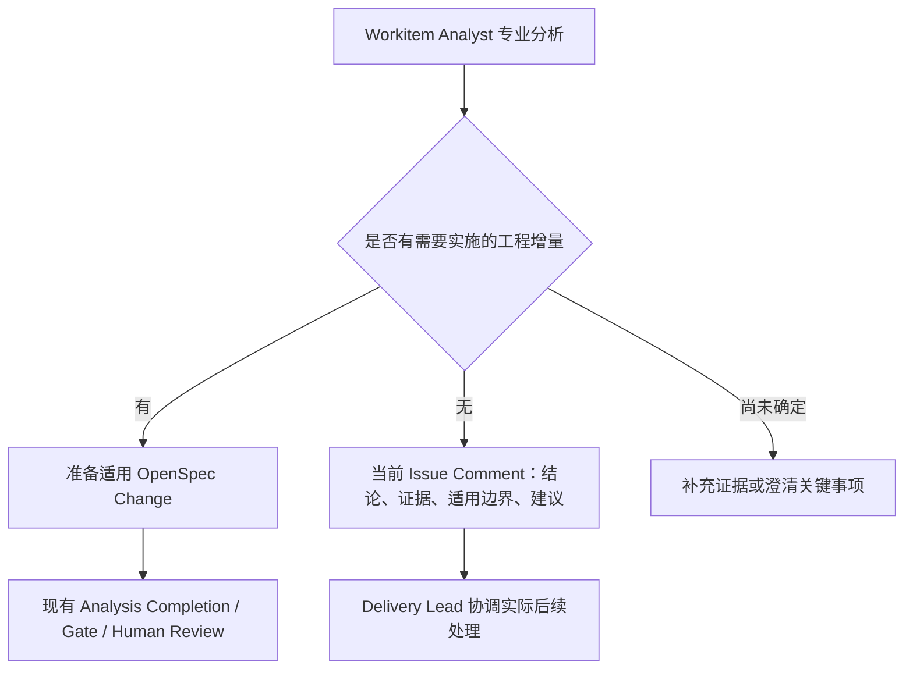

# 16 — Analysis 无工程增量处理与执行效率优化方案

## 1. 目标与范围

以 [LEI-61 回放](projects/replay/20261125-LEI-61/replay.md) 为事实依据，对照当前 main 的 Agent、Skill、Rondo CLI 与 [01 设计原则](01-multica-openspec-design-guideline.md)，消除不必要的 OpenSpec Change、重复调查及工具探索开销。

核心目标：Analysis 首先判断是否存在需要实施的工程增量，而不是必然生成 OpenSpec。保持真实工程变更的现有授权、质量、Gate、Human Approval 和交付契约不变。

遵循 First Principles、KISS、YAGNI、Specialist Focus、One Rule One Owner、Native First、Minimal Sufficient、Right-sized Composition、Deterministic First。此次仅保存方案，不实施改造。

## 2. 回放事实

TFS 267834（LEI-61）：厦门弘爱医院-数据平台-调度中心作业备注优化。原始诉求为备注上线/取消备注上线不应将子作业备注覆盖为父作业备注。

回放完成消息表明：

- LEI-31 / TFS 265651 已处理同症状问题；PR #3854 合入 dataintegration dev，当前 HEAD 包含修复提交 efc8612。
- 备注上线与取消备注上线共用 tagOnline；已有 unifiedRemark 作用域修复覆盖原诉求。显式统一备注仍保留既有语义。
- 无新增生产代码需求；现场部署版本是否包含修复仍待确认。未重新执行业务验证，不把代码分支修复等同于现场问题已解决。
- Analyst 仍创建 confirm-schedule-remark-scope-267834（corrective-change、proposal + tasks、skip_specs: true），执行 Gate 与 Git 发布，生成 Independent Verify Recommendation，Issue 进入 analysis_review。
- 固定审核来源为业务根仓 winning-platform-monorepo@master，Commit 033ffa7f8cda65db3ff124accc8913b4e8f12047。方案及研发改造的仓库为 winning-platform-rondo，二者不要混淆。
- Lead 请求 Human 决定现场版本、显式统一备注语义、历史数据恢复、TFS 关闭方式四项事项；尚未派发 Engineer。

### 2.1 时间与调用统计

| Run | 时间（UTC+8） | 耗时 | 已导出工具调用 |
| --- | --- | --- | --- |
| Wayfinder | 13:05:04–13:12:53 | 7m49s | 73 |
| Lead 首次取消 | 13:18:42–13:18:52 | 10s | 未导出 |
| Lead 委派 | 13:19:15–13:21:14 | 1m59s | 未导出 |
| Analyst 首次取消 | 13:21:00–13:30:00 | 9m | 未导出 |
| Analyst 重跑 | 13:32:29–13:39:33 | 7m04s | 83 |
| Lead 审核协调 | 13:39:21–13:40:10 | 49s | 未导出 |

从准入开始至最后 Lead 完成共 35m06s；Run 有时间重叠，不能简单累加。已导出主会话共 156 次工具调用。取消原因、Lead 内部执行细节及等待原因无法由 partial 回放确定。

Analyst 成功 Run（按时间线工具序号分组）：

| 分组 | 序号 | 次数 | 时间（UTC+8） |
| --- | --- | --- | --- |
| 调查及核实 | 1–37 | 37 | 13:32:34–13:34:26 |
| OpenSpec 准备与校验 | 38–53 | 16 | 13:34:32–13:35:51 |
| CLI 探索、Facts、Gate、Git 发布 | 54–77 | 24 | 13:36:00–13:38:31 |
| 评论与回读 | 78–83 | 6 | 13:38:51–13:39:22 |

转入 spec-preparation 后，准备、校验和发布消耗 40 次调用（48.2%），工具事件跨度约 4 分钟。本例若确认无工程增量，可整体省略此类工作，而非仅加速命令。

来源：[Wayfinder timeline](projects/replay/20261125-LEI-61/wayfinder/20261125-1305-23011ef7/timeline.md)、[Analyst timeline](projects/replay/20261125-LEI-61/workitem-analyst/20261125-1332-ce9aeb95/timeline.md)、[Issue snapshot](projects/replay/20261125-LEI-61/evidence/issue.json)。

## 3. 根因与优化点

| 优先级 | 问题 | 事实依据 | 优化方向 |
| --- | --- | --- | --- |
| P0 | Analysis 缺少无工程增量的正常出口 | Analyst 已确认原诉求被现有修复覆盖，仍创建 Change | Analysis 与 Change Preparation 解耦 |
| P0 | 分析完成契约与 OpenSpec 强绑定 | Analyst Delivery、analysis-completion、facts.ts、complete.ts、approve.ts、03 设计均以 Change 为前提 | 限定研发契约提交的适用范围，不放宽现有 Gate |
| P1 | Wayfinder 调查过深 | 73 次调用，读取历史工件、验证记录、源码、其他 Issue、CLI 内部实现 | 准入证据充分即停止；保留可供下游复用的 Evidence |
| P1 | 准入交接先于 Decision 发布 | 13:11:22 handoff；13:11:58 发布 Decision；13:12:42 回读 | 先发布并确认 Decision，再交接 |
| P1 | Human 待决范围扩大 | 将显式统一备注、历史数据恢复、TFS 关闭方式全部列为待决 | 只提出影响当前目标的实质决策 |
| P1 | 过早 Checkout，重复调查 | Analyst Checkout 根仓、后端、前端；未使用三个只读 remote MCP；Wayfinder 已使用它们 | 优先消费已有可信证据，只补缺口，必要时 Checkout |
| P1 | CLI 可发现性不足 | 部分 leaf --help 返回 64；Agent 读取 dist 内部实现 | 修复涉及命令的帮助与参数说明 |
| P2 | OpenSpec 额外 README | new change --description 自动生成 README，后续删除并重新 Commit/complete | 使用最小创建参数 |
| P2 | 运行取消、等待、采集缺失 | 两次取消，Lead session 未导出 | 独立排查，不归因于业务分析复杂度 |

### 3.1 Analysis 与 Change 的语义边界

Issue 表达待处理问题或业务诉求；OpenSpec Change 表达需要实施的工程增量。两者不存在必然一对一关系。

corrective / intentional 是变更性质，不回答是否需要变更。存在真实工程增量才进入变更分类及工件准备。工程增量不局限于生产代码，确实需要新增测试、工程配置、迁移脚本时也可能构成 Change。

| 分析结论 | 处理方式 |
| --- | --- |
| 需修复代码或改变业务行为 | 准备适用 OpenSpec Change |
| 已有修复完整覆盖、已有功能满足目标 | 不创建 Change，记录证据和处理建议 |
| 仅需部署已有版本 | 不创建 Change，协调版本适用性 |
| 仅需使用指导或非研发配置调整 | 通常不创建 Change |
| 关键事实或意图未确定 | 补证或澄清，不提前制造未授权工程契约 |
| 已有修复仅覆盖部分诉求 | 仅为真实剩余增量准备 Change |

### 3.2 当前契约与原因

- [Workitem Analyst Instructions](agents/workitem-analyst/instructions.md) 的 Delivery 要求将专业分析沉淀到当前 OpenSpec Change，形成 Verify Recommendation 并使用 analysis-completion。
- [spec-preparation](skills/spec-preparation/SKILL.md) 缺少明确的工程增量前提。
- [analysis-completion](skills/analysis-completion/SKILL.md) 要求唯一 Change、facts、Git 来源。
- [facts.ts](rondo/src/commands/analysis/facts.ts) 强制 change_kind、change_ref、verify_agent 及适用 ai_review。
- [complete.ts](rondo/src/commands/analysis/complete.ts) 实施 Change Gate、Git 发布、固定来源及 analysis_review。
- [approve.ts](rondo/src/commands/analysis/approve.ts) 依据 Gate PASS 与固定 Commit 登记研发批准。
- [03 Analysis 设计](03-workitem-analysis-design.md) 将所有自动 Analysis 的完成与工程契约发布绑定。

这些要求对真实 Change 合理，问题在于适用范围。仅修改 Analyst 提示词并继续要求调用现有 analysis-completion，无法完成无 Change 的分析。反之，不应修改 CLI 使其接受虚构的 Change 或 Gate PASS。

### 3.3 专业聚焦与 Evidence

Wayfinder 的职责是判断能否承接，而非完整诊断。发现既有修复是有价值的证据，不必继续验证现场版本、全部回归场景、技术方案或最终任务。

Analyst 可复用原 Decision、LEI-31、PR、Commit 和归档 Evidence，只核实当前诉求与已有修复之间的实质差异。已有证据并不自动等同当前代码事实；必要时验证版本与范围。远程 MCP 足够时不必准备本地仓；需要精确 Git 版本关系、本地验证或写入时按需 Checkout。不改变 native-workspace 的工作区架构。

Lead 消费专业结论，不重新诊断，不干预 Analyst 使用何种 Skill。

### 3.4 Human 决策边界

LEI-61 应聚焦现场部署版本是否包含修复。显式统一备注默认保持既有语义；历史数据恢复不属于原始诉求，不默认扩展范围。若 Human 提出新的明确目标，再按实际情况分析。TFS 工作项处理由 Lead 协调，不构造无实际工程增量的 Tasks。

### 3.5 CLI 与 README

Analyst #54–55 多次调用 analysis leaf --help 返回 64，#60–71 阅读 facts、change-schema、complete、root-git 等 dist 实现；Wayfinder 也读取 handoff、verify-decision 实现。修复相关命令的参数可发现性，不新增 Discovery Skill，不重构全部 CLI 参数框架。

Analyst #45 使用 openspec new change ... --description ...，生成 README.md；#73 将其提交，#74 首次 complete，#75–76 读取并删除 README 后重新提交，#77 再执行 complete。首次发布完整诊断被截断，不断言唯一失败原因。避免额外参数产生契约之外文件，不为 README 放宽 Gate 白名单。

## 4. 目标设计

此图仅表达专业结果及适用边界，不是新 Workflow、固定 Skill 调用链或持久化状态机。

无工程增量使用 Multica 原生 Issue Comment、@mention、既有 Issue Status 和协作机制；不生成 OpenSpec、研发契约 Gate、Git 发布、Independent Verify Recommendation，不调用研发契约批准，不派发无实际工程任务的 Engineer。无 Change 不意味着 Gate PASS 或已获研发批准。

不新增 analysis.disposition、no_change Change Kind、no-change Schema、No Change Gate、no-change-analysis Skill、rondo analysis no-change 命令、Analysis Result JSON、自定义 Status、第二套 Route。无机器消费需求时无需将每个语义结果转化为 Metadata。

## 5. 修改方案

### 5.1 Workitem Analyst — 核心职责

文件：agents/workitem-analyst/instructions.md。

Core Responsibilities 研发准备建议：

> 根据专业分析结论判断是否存在需要实施的工程增量。存在工程变更时，明确其性质、范围及验证要求，按实际需要准备 OpenSpec Engineering Contract。

Working Principles 建议：

> 优先复用已有可信结论及有效证据。发现既有修复、已有功能或其他可行处理方式时，仅核实影响当前诉求的实际差异；证据足以形成结论即可停止调查。

Delivery 建议：

> 存在需要实施的工程变更时，完成适用的 OpenSpec 工件及专业复核，提交研发契约审核。无需工程变更时，在当前 Issue 简明记录分析结论、关键 Evidence、适用边界和后续处理建议，并交接 Delivery Lead。关键事实或业务意图尚未确定时，明确影响当前判断的证据缺口或待决定事项。

原有变更分类、Intentional 专业审查、必要 Verify Recommendation 等要求保留在实际研发契约场景。保持专业判断自主性，不增加固定步骤或工具调用上限。

### 5.2 spec-preparation

文件：skills/spec-preparation/SKILL.md。

增加必要前提：已有明确需要实施的工程增量及其专业分析结论。

保持 Change Identity、Schema、Artifact、Validation、授权规则不变。使用最小创建参数（openspec new change <id> --schema <schema>），避免 --description 产生非必要 README。Skill 不裁决业务是否需要研发，不枚举全部无 Change 场景。

### 5.3 analysis-completion

文件：skills/analysis-completion/SKILL.md。

建议 description：将已完成的 OpenSpec Engineering Contract 经确定性校验和 Git 发布提交 Human Review。

此 Skill 仅承担研发契约审核提交；不承担无需研发的分析结果处理。不新增参数，不放宽现有 Gate、Git 来源及审核契约。

### 5.4 Delivery Lead

文件：agents/delivery-lead/instructions.md。

保留按目标、已有成果、未解决问题及成员判断下一步的现有原则，仅补充：

> 根据专业分析结论，协调无需工程变更事项的后续处理及必要的 Human 决策；不将其作为研发契约批准或研发派发处理。

LEI-61 的适用行为：现场未部署则协调升级/交付确认；已部署仍复现则协调补充专业分析；Human 明确无需继续时依据有效授权与既有状态机制结束 Issue。外部 TFS 状态按真实业务决定和现有授权处理，不伪造 PR 完成、TFS 子任务、工时或交付事实。

实施前应核实现有 Multica 状态及 TFS 操作契约是否支持授权后的非研发终止；本方案不预设具体 TFS 终态，也不擅自复用依赖 PR 的 Closeout。若存在真实阻断，单独说明最小必要修正，不提前设计新状态机。

### 5.5 Wayfinder

文件：agents/wayfinder-agent/instructions.md。

建议：

> 调查深度以支撑当前准入 Decision 为限；发现可供后续处理复用的事实时，记录必要 Evidence，不扩展为完整专业分析。

eligible 描述明确为 Decision 已发布并确认后，通过 rondo delivery handoff --issue <KEY> 完成受控交接。

workitem-triage 已明确判断维度及充分证据停止条件，不重复添加检查表。不新增 Decision Gate，不让 CLI 解析自然语言判断准入语义。

### 5.6 Rondo CLI

仅针对实际接口问题，核实并修复 delivery handoff --help、analysis stage --help、analysis validate --help、analysis complete --help 的准确性和正常退出。stage/complete 帮助应明确输入 Facts 结构及必要使用前提。

不改变 analysis/facts.ts、analysis/validate.ts、analysis/complete.ts、analysis/approve.ts 的核心研发契约校验语义；必要帮助实现改动除外。不扩大至全部 CLI 重构。

### 5.7 设计文档

- 01-multica-openspec-design-guideline.md：明确 Issue 与 Change 不必一对一；保持原则层职责，不写具体流程。
- 02-multica-delivery-lifecycle-design.md：明确无工程增量的后续协调出口；正常研发生命周期不变。
- 03-workitem-analysis-design.md：限定 Change Preparation、Analysis Completion、Gate、Verify Recommendation 的适用范围，区分专业分析结果与研发契约。
- 05-openspec-schema-implementation-design.md：不新增 Schema 或 Artifact；现有规则保持。

### 5.8 职责归属

| 对象 | 职责 |
| --- | --- |
| Wayfinder | 准入评估、必要证据与交接 |
| Workitem Analyst | 专业分析、实际工程增量判断、必要研发准备 |
| Delivery Lead | 协调实际处理、成员与 Human 决策 |
| workitem-triage | 准入判断方法 |
| codebase-explorer | 针对证据缺口获取工程事实 |
| spec-preparation | 准备真实工程变更的工件 |
| analysis-completion | 提交已完成的研发契约 |
| Rondo CLI | 确定性操作、校验、事实管理 |

## 6. LEI-61 目标行为

Wayfinder 确认范围、授权与承接能力，记录已有修复线索并交接。Analyst 核实原诉求与已有修复一致性、版本与必要覆盖，给出专业结论；Lead 协调现场版本确认及实际处理。

Issue Comment 示例（仅示意，不定义固定模板或新契约）：

> **分析结论：无需新增工程变更。**
>
> TFS 267834 与 TFS 265651（LEI-31）属于同一问题。PR #3854 合入 dataintegration dev，当前代码包含修复提交 efc8612。根据已有修复及本次核实结果，备注上线/取消备注上线原始诉求已被当前代码覆盖。
>
> Evidence：TFS 265651 / LEI-31、PR #3854、Commit efc8612、已归档的原修复与回归记录。
>
> 处理建议：确认现场版本是否包含上述修复；如已包含但仍复现，再基于现场现象补充分析。当前未发现新增研发需求，不创建 OpenSpec Change。

原 LEI-61 已发布的 Change 和 analysis_review 事实不自动清理或改写；如需处置该存量 Issue，另按实际授权协调，不在本方案中隐含执行。

## 7. 验收与收益

| 指标 | 当前 | 建议回放目标（非实测） |
| --- | --- | --- |
| Wayfinder 耗时 | 7m49s | 1–2m |
| Wayfinder 调用 | 73 | 10–20 |
| Analyst 成功 Run 耗时 | 7m04s | 1–3m |
| Analyst 调用 | 83 | 10–25 |
| 新建 OpenSpec | 1 | 0 |
| 根/子仓 Checkout | 3 | 按证据缺口决定 |
| Analysis Gate、Git 发布、Verify Recommendation | 已执行 | 本例不适用 |
| 无实际任务的 Engineer 派发 | 尚未发生 | 不派发 |

两次已导出的主要 Agent Run 合计 14m53s；目标 2–5m，约减少 66%–87%，待真实回放验证。不含取消 Run、Lead 与平台等待。以上不是硬性限时或调用配额，不牺牲专业证据质量。

验收场景：

1. 已有修复完整覆盖：不创建 Change，记录证据并交接；不生成虚假 Gate、Approval、PR 或 TFS 研发事实。
2. 部分覆盖：仅实际增量进入正常工程契约。
3. 当前代码已修复、现场版本未知：明确适用边界，协调确认，不能直接宣称现场验收完成。
4. 已部署修复仍复现：补充诊断，不直接认定重复。
5. 确需新增测试、配置、脚本等工程变更：按真实工程增量准备 Change。
6. 正常 Corrective / Intentional Requirement：保留现有必要工件、Gate、Human Approval、工程验证。
7. 关键意图不清楚：补证或澄清，不制造未授权契约。
8. Wayfinder eligible：Decision 先发布确认，再交接。
9. 涉及 CLI --help：正常退出、准确说明用法；原有执行校验保持有效。
10. OpenSpec 新建：不产生非必要 README；不降低契约文件约束。
11. 无 Change Issue：不会误入 PR Status Sync、OpenSpec Archive 或依赖 PR 完成事实的 Delivery Closeout；授权终止、TFS 处理不伪造事实。

## 8. 实施顺序

- 第一阶段（P0）：Analysis / Change Preparation 解耦；修改 Analyst、Lead、spec-preparation、analysis-completion 及对应设计文档。
- 第二阶段（P1）：Wayfinder 准入深度与交接顺序；已有 Evidence 复用、按需 Checkout；相关 CLI Help 与 README 创建参数修复。
- 独立排查（P2）：Run 取消、重启、平台等待、回放缺失。未取得证据前不新增重试机制或调度架构。

实施时专业聚焦，避免不必要的跨模块改造。设计遵循 01 原则：由 Agent 作语义判断、Skill 提供可复用场景方法、CLI 管理确定性操作与事实；复用原生协作机制；证据充分后自然结束。

## 9. 限制

回放覆盖 partial；未读取首次取消 Analyst 的完整日志及 Lead session；未重新执行真实业务测试。现场版本、实际问题是否仍复现、当前 TFS 适用终态仍需实际确认。效率目标未实测。本方案为待评审设计，不表示已实现或修改任何 Agent、Skill、CLI、业务源码、Issue 或 TFS 数据。
