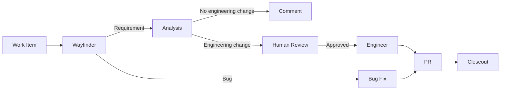

# Rondo

**Multica + OpenSpec · AI 原生研发协作工程**

以 Multica 为协作运行时，以 OpenSpec 为工程契约，通过 Agent、Skill 与 Rondo CLI 构建规范驱动、可验证、可追溯的研发交付体系。

## 核心架构

| 组件 | 职责 |
| --- | --- |
| Multica | Issue、Run、Agent 与 Squad 协作，维护 Delivery Truth |
| OpenSpec | Change、Schema 与 Artifact，维护 Engineering Truth |
| Skill / MCP | 专业方法、上下文获取与工具集成 |
| Rondo CLI | 确定性校验、Gate、Git / TFS 交付与 Workspace 管理 |

## 交付流程

以单一 Multica Issue 组织交付；确有工程增量的 Requirement 使用 OpenSpec Change 承载工程契约，直接 Bug Fix 不使用 OpenSpec；专业判断由 Agent 负责，关键授权由 Human 决定，明确的硬条件由确定性机制校验。独立 Verification 按需参与。

完整流程与适用分支见 [交付生命周期](02-multica-delivery-lifecycle-design.md)。

## 工程结构

| 目录 | 职责 |
| --- | --- |
| [agents/](agents/README.md) · [squads/](squads/README.md) | 角色职责与协作 Instructions |
| [skills/](skills/README.md) · [mcps/](mcps/README.md) | 专业方法与工具配置 |
| [openspec/](openspec/config.yaml) | Schema 与 Artifact 模板 |
| [rondo/](rondo/README.md) | CLI 源码、构建、测试与使用说明 |
| [workspace-config/](workspace-config/) · [projects/](projects/description.md) | Workspace 受管配置与 Project 描述 |
| [validation/](validation/) · [archive/](archive/) | 实际验证与历史资料 |

## 设计文档

| 领域 | 阅读入口 |
| --- | --- |
| 总体架构 | [统一设计规范](01-multica-openspec-design-guideline.md) · [交付生命周期](02-multica-delivery-lifecycle-design.md) |
| 分析与研发 | [Workitem Analysis](03-workitem-analysis-design.md) · [Engineer Development](04-engineer-development-design.md) |
| 规范与方法 | [OpenSpec Schema](05-openspec-schema-implementation-design.md) · [Method Skill Library](06-method-skill-library-implementation-design.md) |
| 实施规划 | [Roadmap](07-multica-openspec-implementation-roadmap.md) |

01–07 是现行设计基线。08–20 专项已按领域整合，详见 [合并索引](07-multica-openspec-implementation-roadmap.md#6-0820-专项方案合并索引) 与 [历史归档](archive/00-design/2026-11-28-consolidated/)。

## 配置与使用

安装及环境配置见 [Rondo CLI](rondo/README.md)，完整参数见 [命令参考](rondo/COMMANDS.md)。

| 命令 | 用途 |
| --- | --- |
| `rondo workspace provision` | 发布受管对象与绑定 |
| `rondo workspace sync-skills` | 同步 Skill |

受管配置以 [provisioning.json](workspace-config/provisioning.json) 为准。具体运行契约以对应设计、配置与实现为准；设计方案、仓内实现、远端发布和运行验收是不同状态，实际结果以回读与验证为准。

---

**设计原则**：First Principles · KISS · YAGNI · Native First · One Rule One Owner
