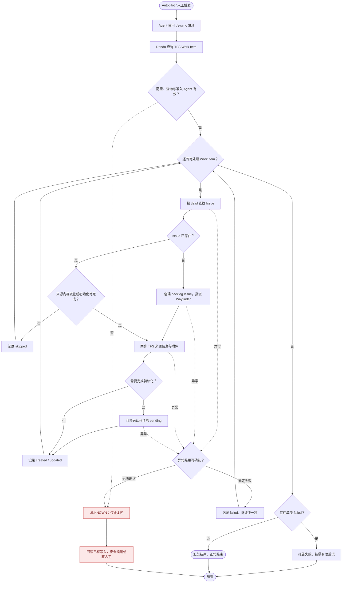

# TFS Sync Agent 主流程

> 视角：TFS Sync Agent + `tfs-sync` Skill；以当前 Rondo 实现为准。

## 流程图

## 关键说明

- **前置条件**：Agent 使用已挂载的 `tfs-sync` Skill，调用 `rondo tfs reconcile-workitem`；同步范围由 Skill 配置决定（当前为指派给 `@me` 的需求和 Bug，单次最多 50 项）。
- **新建**：Issue 以 `backlog + Wayfinder Agent` 初始化；来源信息和附件同步后回读收口，不主动触发 Wayfinder Run。
- **更新 / 跳过**：按 `tfs.id` 匹配；已有 Issue 仅同步 TFS 来源字段、正文及附件，保留业务执行状态和负责人；无变化且无待完成初始化则跳过。
- **异常**：确定性单项失败记录 `failed` 后继续；`UNKNOWN` 停止批次，先核对已写入事实，再决定能否安全续跑。Agent 汇总 `created / updated / skipped / failed` 和待处理项。
- **边界**：Wayfinder 准入、研发交付与 TFS Writeback 不属于本 Agent 流程。

## 实现依据

- [Agent Instructions](./instructions.md)
- [tfs-sync Skill](../../skills/tfs-sync/SKILL.md)
- [同步配置](../../skills/tfs-sync/config/sync-config.json)
- [Rondo 同步实现](../../rondo/src/commands/tfs/reconcile-workitem.ts)
