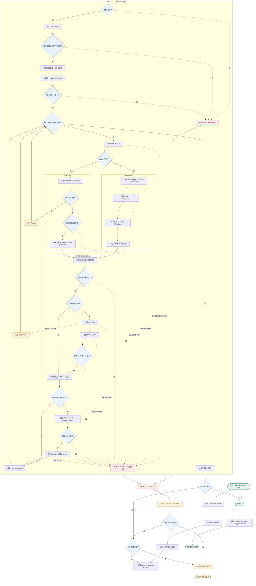

# TFS Sync Agent 全流程图（当前实现）

> 基线：`winning-platform-rondo` 仓库 `main`（2026-11-20 核对）  
> 视角：**Agent Instructions → 挂载 Skill → Rondo CLI → TFS / Multica**  
> 范围：同步前置条件、正常执行、关键分支、异常恢复、结束节点。不包括下游 Wayfinder 准入与研发派发。

## 1. 角色与执行契约

**TFS Sync Agent** 负责将配置范围内的 TFS Work Item 同步为 Multica Issue，并保证来源信息、附件和初始化结果可追溯。

| 项目 | 当前实现 |
| --- | --- |
| 执行入口 | Autopilot Run 或人工执行 |
| Agent Instructions | `agents/tfs-sync-agent/instructions.md` |
| 挂载 Skill | `tfs-sync`（未为本 Agent 绑定 MCP） |
| 核心命令 | `rondo tfs reconcile-workitem --config <absolute-config-path>` |
| 默认配置 | `skills/tfs-sync/config/sync-config.json` |
| TFS 查询范围 | `WorkItemType IN ('需求', 'Bug')`、`AssignedTo = @me`、排除 `已验证` / `已关闭` |
| 单次处理上限 | `max_items_per_run = 50`；超出时处理前 50 项 |
| Issue 查找键 | 字符串形式的 `tfs.id` |
| 新建 Issue | `status=backlog`、`assignee=Wayfinder Agent` |
| 已有 Issue | 更新 TFS 受管信息及来源正文/附件；不修改执行状态或负责人 |
| 返回结果 | `created` / `updated` / `skipped` / `failed`；必要时包含 `result=UNKNOWN` 与 `unprocessed` |

**前置条件**：有效的同步配置、TFS 查询命令、Rondo 与 Multica CLI 可执行、有效的 Workspace / Project 身份，以及目标 Workspace 中名称唯一的 Wayfinder Agent。需要物化附件时，还必须能够使用查询所对应的 CLI 执行附件下载。

## 2. Mermaid 全流程图

图中**实线**为正常路径，**虚线**为失败或未知结果路径。`Exit 2` 表示存在确定性单项失败；`Exit 3` 表示结果无法确认（`UNKNOWN`），不能直接认定未写入。

> **图示抽象说明**：为了保持流程图可读性，多个 Metadata 写入和附件循环以逻辑节点合并表示。实际 CLI 对每个工作项逐项处理；附件下载、上传按当前待物化附件逐个执行。新建 Issue 的 `backlog` 与 Wayfinder 指派在同一 `issue create` 调用中完成。CLI 不自行重试整个批次；图中的有限重试由 Agent 根据 Skill 结果处理约定判断。

## 3. 关键路径说明

### 3.1 新建 Issue

1. 按 `tfs.id` 查找，未命中时创建 `backlog` Issue，指定 Wayfinder Agent。
2. 依次写入 `tfs.id`、`tfs.intake_pending=true`、来源 Metadata 和 `tfs.body_at`。
3. 若存在附件，按来源附件身份查询映射，下载并上传尚未物化的附件，更新正文中的副本链接。
4. 回读来源字段、Owner 与状态；符合条件后清除 `tfs.intake_pending`，标记为 `created`。

初始化收口通常要求 `backlog`；同时兼容人工已提前调整到 `todo`、且仍由 Wayfinder 持有的情形。**TFS Sync 不主动激活 Issue 或触发 Wayfinder Run。**

### 3.2 已有 Issue

- **跳过**：受管 Metadata、`tfs.body_at`、附件映射和内嵌图片展示均已满足，且不存在 `intake_pending`。
- **更新**：只更新 `tfs.type`、`tfs.url`、`tfs.changed_at` 等同步管理字段；根据需要刷新来源正文、同步附件、更新 `tfs.body_at`。
- **恢复**：检测到 `tfs.intake_pending` 时，补齐未完成的初始化事实，再进行身份与 Owner 回读收口。
- **保留执行事实**：不修改既有 Issue 的业务执行 `status`、`assignee` 或当前 Run。

### 3.3 附件物化

CLI 从 Issue 正文解析 TFS 原始附件与 Multica 副本的映射，对已确认的副本不重复上传。对于历史上传后残留的裸引用，只有能**唯一**匹配到 TFS 附件时才认领；出现同名歧义或上传结果不可确认时停止当前批次，保留已有写入事实。

## 4. 异常处理与结束状态

| 情况 | CLI 行为 | Agent 处理 |
| --- | --- | --- |
| 全部成功或无变化 | `Exit 0` | 报告结果，本轮完成 |
| 确定性单项失败 | 记录到 `failed`，继续后续 Work Item，最终 `Exit 2` | 核实原因，必要时有限重试 |
| 配置错误、TFS 查询失败或查询字段缺失 | `Exit 3` / `UNKNOWN` | 停止批次并排查前置条件 |
| 重复 Issue 匹配、附件映射歧义 | `Exit 3` / `UNKNOWN` | 回读确认身份，避免重复写入 |
| 写入响应或附件上传结果不明 | 回读确认；无法确认时 `UNKNOWN` | 先检查已有写入，再决定是否续跑 |
| 初始化未完成 | 保留 `intake_pending` | 修复问题后按 `tfs.id` 安全续接 |
| 多次重试仍未恢复 | 输出失败原因与未处理项 | 报告外部处理需求；不擅自改配置或回滚已确认写入 |

**退出码含义**：`0` = 成功（可包含全部 `skipped`）；`2` = 存在确定性失败；`3` = 结果不确定；`64` = 命令用法错误。`UNKNOWN` 不能当作没有副作用，也不能直接全量重试。

## 5. 职责边界

`TFS Sync Agent` 只负责 **TFS → Multica Issue** 的同步。Wayfinder 准入、`delivery handoff`、Requirement / Bug 分流、开发、PR 状态同步以及 TFS 完成状态和工时回写，均不属于本 Agent 的执行职责。

当前 `workspace-config/provisioning.json` 为 `TFS Sync` Autopilot 配置了 `run_only` 与每 15 分钟的调度备注；备注本身**不会自动创建定时 Trigger**。实际调度状态须在目标 Workspace 中核实。

## 6. 依据文件

- [Agent Instructions](https://github.com/lilei921/winning-platform-rondo/blob/main/agents/tfs-sync-agent/instructions.md)
- [Autopilot Prompt](https://github.com/lilei921/winning-platform-rondo/blob/main/agents/tfs-sync-agent/autopilot-prompt.md)
- [tfs-sync Skill](https://github.com/lilei921/winning-platform-rondo/blob/main/skills/tfs-sync/SKILL.md)
- [同步配置](https://github.com/lilei921/winning-platform-rondo/blob/main/skills/tfs-sync/config/sync-config.json)
- [Workspace Provisioning](https://github.com/lilei921/winning-platform-rondo/blob/main/workspace-config/provisioning.json)
- [Rondo 对账实现](https://github.com/lilei921/winning-platform-rondo/blob/main/rondo/src/commands/tfs/reconcile-workitem.ts)
- [Rondo CLI 命令参考](https://github.com/lilei921/winning-platform-rondo/blob/main/tools/COMMANDS.md)