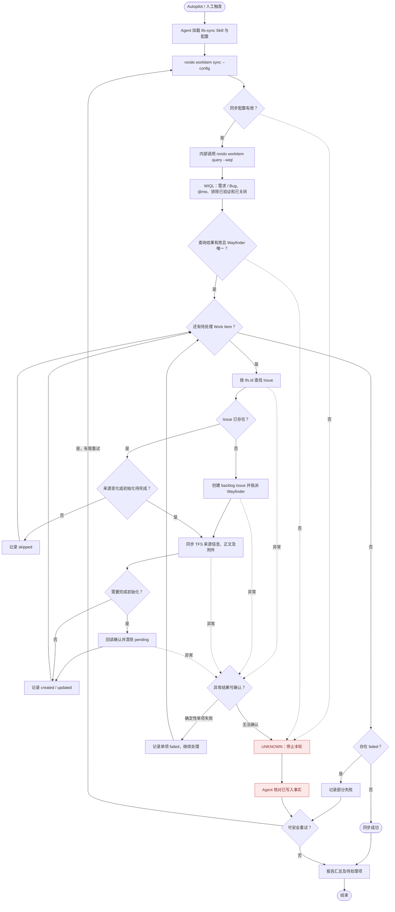

# TFS Sync Agent 主流程

> 视角：TFS Sync Agent → `tfs-sync` Skill → Rondo CLI。只展示主要节点与关键判断。

## 流程图



## Rondo 命令与逻辑

### 1. 同步主命令（Agent 调用）

```bash
rondo workitem sync --config "<config-path>"
```

`<config-path>` 是绝对路径，默认指向 [Skill 同步配置](../../skills/tfs-sync/config/sync-config.json)。主命令校验配置、查询 TFS、按 `tfs.id` 对账 Multica Issue，并输出 `created / updated / skipped / failed`。

### 2. TFS 查询命令（同步主命令内部调用）

当前 `sync-config.json` 的 `tfs.query_command` 为：

```bash
rondo workitem query --wiql "SELECT [System.Id], [System.WorkItemType], [System.Title], [System.AssignedTo], [System.State], [System.Tags], [System.CreatedDate], [System.ChangedDate] FROM workitems WHERE [System.WorkItemType] IN ('需求','Bug') AND [System.AssignedTo] = @me AND [System.State] <> '已验证' AND [System.State] <> '已关闭' ORDER BY [System.Id]"
```

- **筛选**：只查询指派给当前 TFS 认证身份（`@me`）的需求和 Bug，排除已验证、已关闭项。
- **排序与上限**：按 `System.Id` 升序；主命令最多处理查询结果的前 50 项（不是自动分页）。
- **校验**：查询结果必须是 JSON 数组，单项包含 `id / type / title / url / state / changedDate`；查询失败或身份不可信时停止，不视为空结果。

### 3. Issue 对账逻辑

- **新建**：无对应 `tfs.id` 时创建 `backlog + Wayfinder Agent` Issue，同步来源内容和附件，回读并完成初始化；不主动触发 Wayfinder Run。
- **更新**：已有 Issue 按需刷新 TFS 管理字段、来源正文和附件；待完成初始化可续接。保留既有执行状态和负责人。
- **跳过**：来源内容、附件及初始化状态均无变化时记录 `skipped`。
- **异常**：确定性单项失败记入 `failed` 并继续后续项；`UNKNOWN` 停止批次，Agent 先核对已有写入，再决定是否安全重试。退出码 `0 / 2 / 3` 分别代表成功、存在单项失败、结果不确定。

**职责边界**：本 Agent 不执行 Wayfinder 准入、研发交付或 TFS Writeback。

## 实现依据

- [Agent Instructions](./instructions.md)
- [tfs-sync Skill](../../skills/tfs-sync/SKILL.md)
- [同步配置](../../skills/tfs-sync/config/sync-config.json)
- [Rondo 对账实现](../../rondo/src/commands/tfs/reconcile-workitem.ts)
