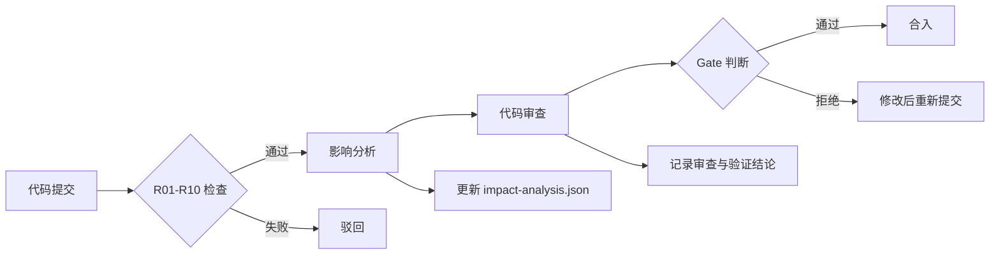

# Codex 会话回放 · 01a1fcc6-1b4c-7310-b48a-b9ff6a270ac9

| 项 | 值 |
| --- | --- |
| provider | `codex` |
| session | `01a1fcc6-1b4c-7310-b48a-b9ff6a270ac9` |
| transcript files | 1 |
| cwd | `D:\Multica\desktop-172.17.1.97-8080\winning-lil-b39bad65de56\lei-49-44b61e8cdd65\workdir` |
| 开始 | 2026-11-21 14:23:34 |
| 结束 | 2026-11-21 14:41:35 |
| 时长 | 1080.6 秒 |
| 用户输入 | 2 |
| assistant 轮次 | 11 |
| 工具调用 | 78（失败 7）|
| 子代理 | 0 |
| hook 拦截 | 不可用（历史会话无 Codex hook 审计）|
| output tokens | 22910 |

## 初始诉求

> You are running as a local coding agent for a Multica workspace. Your assigned issue ID is: 01a1fc8d-4ebe-79aa-b302-a544c548a9ed [NEW COMMENT] Another agent (Delivery Lead) just left a new comment. Focus on THIS comment — do not confuse it with previous ones: > [@Workitem Analyst](mention://agent/46e4b7dd-d186-470e-beb3-2c2d322871e1) 请承接需求分析与 OpenSpec 研发准备，你的分析职责覆盖本阶段。以准入记录 `01a1fcc5-6397-78df-83f2-2a05f5a49fb8` 为依据，核实作用域枚举、空值传参及组合查询与分页行为，形成可审核的 Change 和验收条件；明确待 Human 决策项，获有效批准后再进入研发交接。 Start b…

## 时间线

### [1] USER · 2026-11-21 14:23:34

You are running as a local coding agent for a Multica workspace.

Your assigned issue ID is: 01a1fc8d-4ebe-79aa-b302-a544c548a9ed

[NEW COMMENT] Another agent (Delivery Lead) just left a new comment. Focus on THIS comment — do not confuse it with previous ones:

> [@Workitem Analyst](mention://agent/46e4b7dd-d186-470e-beb3-2c2d322871e1) 请承接需求分析与 OpenSpec 研发准备，你的分析职责覆盖本阶段。以准入记录 `01a1fcc5-6397-78df-83f2-2a05f5a49fb8` 为依据，核实作用域枚举、空值传参及组合查询与分页行为，形成可审核的 Change 和验收条件；明确待 Human 决策项，获有效批准后再进入研发交接。

Start by running `multica issue get 01a1fc8d-4ebe-79aa-b302-a544c548a9ed --output json` to understand your task, then decide how to proceed.

Triggering thread: `multica issue comment list 01a1fc8d-4ebe-79aa-b302-a544c548a9ed --thread 01a1fcc6-1487-7a01-901e-5db894838265 --tail 30 --compact --output json` (that thread's root + its 30 newest replies). The scan workflow step 2 requires is the same command with `--roots-only --summary` in place of `--thread ... --tail 30`.

Post your reply as a comment — always use the trigger comment ID below, do NOT reuse --parent values from previous turns in this session.

Write the body file first — never pipe via `--content-stdin` (PowerShell drops non-ASCII; full rules: ## Comment Formatting above). Use the variant for the shell your command tool runs:

PowerShell:

    multica issue comment add 01a1fc8d-4ebe-79aa-b302-a544c548a9ed --parent 01a1fcc6-1487-7a01-901e-5db894838265 --content-file ./reply.md --output table
    if ($LASTEXITCODE -ne 0) { exit $LASTEXITCODE }
    Remove-Item ./reply.md

Git Bash:

    multica issue comment add 01a1fc8d-4ebe-79aa-b302-a544c548a9ed --parent 01a1fcc6-1487-7a01-901e-5db894838265 --content-file ./reply.md --output table && rm ./reply.md

Do NOT drop the exit-code check or the `&&`: a bare cleanup after a failed post reports success and deletes the body.

Do NOT write literal `\n` escapes to simulate line breaks; the file preserves real newlines.

## On Behalf Of

You are acting on behalf of **lilei** (lilei@winning.com.cn). Apply any person-specific privacy or access rules in your instructions to this person. Your Multica credentials and access remain scoped to the runtime owner; do not assume this person can access everything you can.

### [2] ASSISTANT · 2026-11-21 14:23:38

我会先读取当前需求和准入记录，核实相关代码行为，再准备可审核的 OpenSpec 工件及待人工决策项。本次会使用 requirement-analysis 和 spec-preparation 技能。


### [3] ASSISTANT · 2026-11-21 14:24:40

已确认后端具备 value 包含匹配和作用域精确过滤能力，前端列表尚未传入这两个条件。另发现列表展示五种作用域，而新增表单只提供三种；我会将这一区别及“清空条件”的传参约定写入审核材料，避免直接推定产品意图。

- **CommandExecution** `[OK]` C:\Windows\System32\WindowsPowerShell\v1.0\powershell.exe -Command & "$env:MULTICA_CLI_PATH" issue get 01a1fc8d-4ebe-79aa-b302-a544c548a9ed --output json

  ```text
{
  "assignee_id": "03665e95-a7bd-48f0-afe3-c0860ebac5fc",
  "assignee_type": "squad",
  "created_at": "2026-11-21T13:21:21+08:00",
  "creator_id": "ecdbd930-275c-4fa5-b27f-b1f2ab08a0fe",
  "creator_type": "agent",
  "description": "## Source Requirement（TFS 原始事实）\\n\\n- TFS Work Item: 267307\\n- Type: 需求\\n- State: 已建议\\n- URL: http://tfs2018-web.winning.com.cn:8080/tfs/web/wi.aspx?pcguid=f7bf5021-f3a9-4a5f-b754-bc7a1f7d60e2\u0026id=267307\\n- Changed: 2026-11-21T03:31:38.01Z\\n\\n## Title\\n\\n数据集成-变量配置：增加根据value值查询、根据作用域查询\\n\\n## 需求详细信息（System.Description）\\n\\n【要求定位】\\n\\n数据集成-变量配置：增加根据value值查询\\n\\n目前支持根据变量key值查询，现在增加如下查询条件：\\n1、增加根据 变量value值进行查询，使用输入框模糊查询\\n2、增加作用域下拉框查询条件，精确查询，可以为空\\n\\n【系统运行情况】\\n描述系统运行情况及问题\\n\\n【详细调研结果】\\n\\n【分析者描述】\\n\\n【开发者描述】\\n\\n【测试者描述】\\n\\n## 需求分析（Winning.
…[已截断，原文共 1915 字符]
  ```
- **CommandExecution** `[OK]` C:\Windows\System32\WindowsPowerShell\v1.0\powershell.exe -Command & "$env:MULTICA_CLI_PATH" issue comment list 01a1fc8d-4ebe-79aa-b302-a544c548a9ed --roots-only --summary --compact --output json

  ```text
[
  {
    "author_id": "3068117f-163c-4ba9-86bf-fae3bfc1f6bf",
    "author_type": "agent",
    "content": "/note\n\ndecision: eligible\n\nrationale: 需求属于现有数据集成变量配置模块，前后端候选仓库及查询入口明确、源码可通过已授权只读 MCP 访问，具备继续需求分析的工程条件；未发现硬性准入限制。准入不代表 Human Approval 或功能已完成。\n\nsource: 当前 Issue LEI-49（01a1fc8d-4ebe-79aa-b302-a544c548a9…",
    "content_truncated": true,
    "created_at": "2026-11-21T14:22:36+08:00",
    "id": "01a1fcc5-6397-78df-83f2-2a05f5a49fb8",
    "last_activity_at": "2026-11-21T14:22:36+08:00",
    "reply_count": 0,
    "revision": 1,
    "type": "comment"
  },
  {
    "author_id": "3c1c3ac1-a922-4e7b-abdf-07a6268398a3",
    "author_type": "agent",
    "content": "[@Workitem Analyst](mention://agent/46e4b7dd-d186-470e-beb3-2c2d322871e1) 请承接需求分析与 OpenSpec 研发准备，你的分析职责覆盖本阶段。以准入记录 `01a1fcc5-6397
…[已截断，原文共 1125 字符]
  ```
- **CommandExecution** `[OK]` C:\Windows\System32\WindowsPowerShell\v1.0\powershell.exe -Command Get-Content -LiteralPath 'D:/Multica/desktop-172.17.1.97-8080/winning-lil-b39bad65de56/lei-49-44b61e8cdd65/codex-home/skills/requirement-analysis/SKILL.md'

  ```text
---
name: requirement-analysis
description: 面向 Intentional Requirement，按需探索现有业务与工程环境，分析需求目标、预期变化、规则、方案与影响；需要需求探索、方案评估或关键意图澄清时使用。
---

# requirement-analysis

## Inputs

- 当前 Requirement / Issue 的目标、来源、已确认决定、授权范围和业务约束。
- 已有业务规则、OpenSpec Specs、系统能力、代码事实及可信 Evidence（如有）。

## Method（按需采用，可往返）

- **Explore**：优先复用已有事实；按需要调查业务规则、相关 Specs、系统能力和实现约束，发现现状/目标差异、可复用机会、规则冲突、风险与未知项，只补影响当前判断的缺口。
- **Analyze**：分析真实目标、预期变化、用户场景、正常/异常/边界规则、In/Out Scope、影响及可验证结果；纯内部调整无 Spec-level Delta 时不制造新的 Requirement / Scenario。
- **Evaluate**：存在实质取舍时比较可行方案、既有能力复用、外部 Contract、依赖及风险，给出有证据支持的推荐及理由；简单需求不强制多个方案。
- **Clarify**：可核实的事实先自行调查；未获授权的关键产品意图或业务选择，即使技术事实充分，也须向调用者返回依据、选项、推荐及影响，供有权者决定。

方法不是固定四阶段；可根据新事实返回探索或调整方案，不以调用次数衡量完成质量。

## Output

- **Confirmed**：来源明确的目标、行为/约束、规则、场景、Scope、影响、验收依据及 Evidence。
…[已截断，原文共 1247 字符]
  ```
- **CommandExecution** `[OK]` C:\Windows\System32\WindowsPowerShell\v1.0\powershell.exe -Command Get-Content -LiteralPath 'D:/Multica/desktop-172.17.1.97-8080/winning-lil-b39bad65de56/lei-49-44b61e8cdd65/codex-home/skills/workspace-preparation/SKILL.md'

  ```text
---
name: workspace-preparation
description: 按需准备或复用授权的本地 Git 工作区，支持 Bug Fix Native Checkout 与业务仓 Clone、Requirement 持久根仓与业务 Worktree。
---

# Workspace Preparation

仅在需要本地工作树时使用。只读 MCP 能完成的调查无需准备仓库。下文业务仓命令中的 `<config>` 为本 Skill 的 `config/repo-registry.json` 绝对路径，使用前确认 `runtime.workspace_id` 匹配当前 Workspace。

## Bug Fix

需要本地根仓时，复用当前 Task 的 Native Checkout。首次检出在 Task workdir 使用 Project Resource 的 URL 和 ref；Resource 未指定 ref 时省略 `--ref`：

```bash
multica repo checkout <root-url> --ref <resource-ref>
```

使用实际 Checkout 路径核实根仓就绪：

```bash
rondo runtime check-checkout --root-repo "<root>"
```

需要本地业务源码时，使用检查返回的 `rootRepo`、当前 Bug Issue 和已授权的 `repo_key` 准备或复用业务仓：

```bash
rondo dev prepare --mode bug --config "<config>" --issue <issue> --repo <repo_key> --root-repo "<root>"
…[已截断，原文共 1519 字符]
  ```
- **CommandExecution** `[OK]` C:\Windows\System32\WindowsPowerShell\v1.0\powershell.exe -Command & "$env:MULTICA_CLI_PATH" issue comment list 01a1fc8d-4ebe-79aa-b302-a544c548a9ed --thread 01a1fcc6-1487-7a01-901e-5db894838265 --tail 30 --compact --output json

  ```text
[
  {
    "author_id": "3c1c3ac1-a922-4e7b-abdf-07a6268398a3",
    "author_type": "agent",
    "content": "[@Workitem Analyst](mention://agent/46e4b7dd-d186-470e-beb3-2c2d322871e1) 请承接需求分析与 OpenSpec 研发准备，你的分析职责覆盖本阶段。以准入记录 `01a1fcc5-6397-78df-83f2-2a05f5a49fb8` 为依据，核实作用域枚举、空值传参及组合查询与分页行为，形成可审核的 Change 和验收条件；明确待 Human 决策项，获有效批准后再进入研发交接。",
    "created_at": "2026-11-21T14:23:22+08:00",
    "id": "01a1fcc6-1487-7a01-901e-5db894838265",
    "revision": 1,
    "type": "comment"
  }
]

  ```
- **CommandExecution** `[OK]` C:\Windows\System32\WindowsPowerShell\v1.0\powershell.exe -Command & "$env:MULTICA_CLI_PATH" issue comment list 01a1fc8d-4ebe-79aa-b302-a544c548a9ed --thread 01a1fcc5-6397-78df-83f2-2a05f5a49fb8 --tail 30 --compact --output json

  ```text
[
  {
    "author_id": "3068117f-163c-4ba9-86bf-fae3bfc1f6bf",
    "author_type": "agent",
    "content": "/note\n\ndecision: eligible\n\nrationale: 需求属于现有数据集成变量配置模块，前后端候选仓库及查询入口明确、源码可通过已授权只读 MCP 访问，具备继续需求分析的工程条件；未发现硬性准入限制。准入不代表 Human Approval 或功能已完成。\n\nsource: 当前 Issue LEI-49（01a1fc8d-4ebe-79aa-b302-a544c548a9ed）；`source=tfs`，`tfs.id=267307`，`tfs.type=需求`，`tfs.changed_at=tfs.body_at=2026-11-21T03:31:38.01Z`。本次依据 Issue 内来源快照，未独立回查 TFS 最新版本。写入前复核来源、正文及负责人未发生实质变化；无历史 Decision。\n\ncandidate_repositories:\n- repo_id: `dataintegration-web`；repo_path: `winning-dps-df-dataintegration-web`；读取版本：`dev@9a7f119c044ee75ac66e8149805df6ab582abfbf`。\n- repo_id: `dataintegration`；repo_path: `winning-dps-df-dataintegration`；读取版本：`dev@4a6ea5e1a4f7f65a465dd26a0996439dab7d295d`。\n\n关键事实与 evidence_refs:\n- E1：
…[已截断，原文共 2080 字符]
  ```
- **CommandExecution** `[OK]` C:\Windows\System32\WindowsPowerShell\v1.0\powershell.exe -Command Get-ChildItem -Force

  ```text


    目录: D:\Multica\desktop-172.17.1.97-8080\winning-lil-b39bad65de56\lei-49-44b61e8cdd65\workdir


Mode                 LastWriteTime         Length Name
----                 -------------         ------ ----
d-----        2026/11/21     14:23                .agent_context
d-----        2026/11/21     14:23                .multica
-a----        2026/11/21     14:23          25077 AGENTS.md


  ```
- **CommandExecution** `[OK]` C:\Windows\System32\WindowsPowerShell\v1.0\powershell.exe -Command Get-Content -LiteralPath 'D:/Multica/desktop-172.17.1.97-8080/winning-lil-b39bad65de56/lei-49-44b61e8cdd65/codex-home/skills/spec-preparation/SKILL.md'

  ```text
---
name: spec-preparation
description: 使用项目 OpenSpec CLI 与当前 Schema / Artifact Instruction 安全新建、补全或定向修订 Change 工件；需要将已有专业结论准备为实现前工程契约时使用。
---

# spec-preparation

## Inputs / Preconditions

- 当前 Issue 的身份、写入授权、已确认的 Technical Change Kind、当前 Change 的 Schema、可追溯专业结论与 Evidence，以及已知的 `change_ref`、`tfs.id`。首次准备时按项目契约确定并持久化 Schema。
- 本 Skill 的 `config/repo-registry.json` 由 `rondo workspace sync` 按 Workspace 发布；确认可读取且 `runtime.workspace_id` 与当前 Issue 所在 Workspace 一致，否则停止，不借用其他 Skill 配置或猜测路径。
- 写入前确认 `root_repo` 在当前项目分支真正就绪（路径存在不等于准备成功）；必要时使用 `workspace-preparation`。所有 `openspec` 命令均以已核实根仓为 `cwd`。

## Method（按需选择，不是固定流水线）

- **Inspect & Resolve**：查看当前 Change、Artifact 和未满足的契约，复用可信结论及有效工件。使用 `rondo change resolve-identity --openspec-root <root> [--change-ref <stable-id>] [--tfs-id <tf
…[已截断，原文共 3348 字符]
  ```
- **CommandExecution** `[OK]` C:\Windows\System32\WindowsPowerShell\v1.0\powershell.exe -Command Get-Content -LiteralPath 'D:/Multica/desktop-172.17.1.97-8080/winning-lil-b39bad65de56/lei-49-44b61e8cdd65/codex-home/skills/analysis-completion/SKILL.md'

  ```text
---
name: analysis-completion
description: 将已完成的 Analysis Engineering Contract 经真实 Gate 和固定 Git 来源提交 Human Review。
---

# analysis-completion

## Inputs / Preconditions

- 当前 Issue 已获授权，专业分析和唯一 OpenSpec Change 已完成。
- 根仓已在当前项目分支准备就绪；必要时使用 `workspace-preparation`，不能仅凭目录存在判断。
- `<facts.json>` 是 Change 目录外的临时 CLI 输入，包含 `change_kind`、`change_ref`、`verify_agent`；Intentional 还需 `ai_review.verdict`。
- `<config>` 为本 Skill 的 `config/repo-registry.json`；`runtime.workspace_id` 与当前 Workspace 一致。

## Execution

提交 Analysis Facts：

```bash
rondo analysis stage --issue <issue> --facts <facts.json> --workspace-id <workspace> --registry-config "<config>"
```

按需预检查（结果输出至 stdout，不生成文件）：

```bash
rondo analysis validate --issue <issue> --openspec-root "<root>" --workspace-id <workspac
…[已截断，原文共 1753 字符]
  ```
- **McpToolCall** `[OK]` {"type": "McpToolCall", "id": "exec-11d9a56e-c03c-462a-8db9-c0c2afd59dd0", "server": "remote-filesystem", "tool": "list_allowed_directories", "arguments": {}, "readOnlyHint": true, "status": "completed", "result": {"content": [{"type": "text", "text": "Allowed directories:\n/root/workspace/winning-…
- **CommandExecution** `[OK]` C:\Windows\System32\WindowsPowerShell\v1.0\powershell.exe -Command Get-Content -LiteralPath 'D:/Multica/desktop-172.17.1.97-8080/winning-lil-b39bad65de56/lei-49-44b61e8cdd65/codex-home/skills/spec-preparation/config/repo-registry.json' Get-Content -LiteralPath 'D:/Multica/desktop-172.17.1.97-8080/w…

  ```text
{
  "runtime": {
    "multica_cli": "multica",
    "multica_server_url": "http://172.17.1.97:8080",
    "workspace_id": "a9469044-700c-4206-80d2-b39bad65de56",
    "rondo": "rondo",
    "delivery_squad_id": "03665e95-a7bd-48f0-afe3-c0860ebac5fc"
  },
  "registry": {
    "basedata": {
      "repo_path": "winning-dps-df-basedata",
      "repo_url": "http://tfs2018-web.winning.com.cn:8080/tfs/WN_Data_Platform/IP-08-%E5%9F%BA%E7%A1%80%E6%95%B0%E6%8D%AE%E7%AE%A1%E7%90%86%E8%BD%AF%E4%BB%B6/_git/winning-dps-df-basedata",
      "tfs_repo": "winning-dps-df-basedata",
      "tfs_project": "IP-08-基础数据管理软件",
      "default_target_branch": "dev"
    },
    "basedata-webui": {
      "repo_path": "winning-dps-df-basedata-webui",
      "repo_url": "http://tfs2018-web.winning.com.cn:8080/
…[已截断，原文共 19392 字符]
  ```
- **McpToolCall** `[OK]` {"type": "McpToolCall", "id": "exec-dfbf865a-03c3-4519-a937-4f34488610eb", "server": "remote-codegraph", "tool": "codegraph_explore", "arguments": {"projectPath": "/root/workspace/winning-platform-monorepo/winning-dps-df-dataintegration-web", "query": "src/application/variable/index.vue getTableLis…
- **CommandExecution** `[OK]` C:\Windows\System32\WindowsPowerShell\v1.0\powershell.exe -Command rondo runtime prepare-root

  ```text
$ git rev-parse --show-toplevel
$ git rev-parse --show-prefix
$ git check-ref-format --branch main
$ git show HEAD:docs/config/repo-context.yaml
$ git remote get-url origin
$ git remote get-url --push --all origin
$ git config --get-regexp ^url\..*\.(insteadof|pushinsteadof)$
$ git fetch --no-tags origin +refs/heads/main:refs/remotes/origin/main
$ git rev-parse --verify refs/remotes/origin/main
$ git rev-parse --verify --quiet refs/heads/main
$ git merge-base --is-ancestor b81fb0e3915869701b511d1852346f0350bd0bcf 21dd9c35bda0699e6210f0f18b1516ea119ae449
$ git symbolic-ref HEAD
$ git fetch --dry-run --no-write-fetch-head --no-tags --no-recurse-submodules --no-auto-maintenance D:/UserProgram/winning-platform-monorepo refs/heads/main:refs/heads/main
$ git ls-tree -z --format=%(objectmode) %(p
…[已截断，原文共 1570 字符]
  ```
- **McpToolCall** `[OK]` {"type": "McpToolCall", "id": "exec-0cbec5c4-3c91-4c6a-b67b-352429851ffe", "server": "remote-codegraph", "tool": "codegraph_explore", "arguments": {"projectPath": "/root/workspace/winning-platform-monorepo/winning-dps-df-dataintegration", "query": "pageEtlParameter EtlParameterMapper.xml EtlParamet…
- **McpToolCall** `[OK]` {"type": "McpToolCall", "id": "exec-f2f67059-d8dc-4844-858c-fbfbd0734ada", "server": "remote-codegraph", "tool": "codegraph_explore", "arguments": {"projectPath": "/root/workspace/winning-platform-monorepo/winning-dps-df-dataintegration-web", "query": "src/api/variable.js src/application/variable/c…
- **CommandExecution** `[OK]` C:\Windows\System32\WindowsPowerShell\v1.0\powershell.exe -Command Get-Content AGENTS.md Get-Content openspec/config.yaml Get-Content docs/config/repo-context.yaml rondo change resolve-identity --openspec-root . --tfs-id 267307 Get-ChildItem openspec/schemas

  ```text
# Winning DF Agent 工作规范

## 1. 工作区边界

本工作区是 monorepo 形态的协同工作区，由根仓和多个业务子仓组成：

- 根目录负责 Agent 配置、共享文档、OpenSpec、Wiki、图谱和工具。
- 子仓负责业务实现、构建、测试及各自的 Git 变更。

执行要求：

- 从根工作区开展任务，按需求跨仓定位和实施。
- OpenSpec 命令在根工作区执行；构建、测试和 Git 命令必须显式指定所属仓库的工作目录。
- 只加载当前任务所需的规范、文档和源码。
- 当前上下文中已完整提供且适用于目标目录的项目指令，视为已阅读，无需重复加载。仅在适用指令缺失、不完整或有更新依据时补读；进入新检出的仓库或新目录时，补齐尚未加载的适用指令。
- 平台文件只维护平台专属配置；共享规则由本入口及对应领域文件维护，不重复复制。

## 2. 任务入口

| 任务 | 入口 |
| --- | --- |
| 业务需求、缺陷、代码分析 | 按 §4 定位仓库、模块和实现 |
| 继续已有变更 | 读取目标 OpenSpec change，再补充相关代码上下文 |
| Agent 配置、技能、共享工具 | 目标资产、适用技能及对应配置或工具实现 |
| 知识查询、摄入、建图 | 对应 Wiki 技能及 `wiki/knowledge-flow.yaml` |

- Wiki 查询只读；摄入和建图按明确的任务意图及对应技能执行。

## 3. 快速导航

按任务需要读取对应入口，再进入相关局部章节。

| 目的 | 入口 |
| --- | --- |
| 共享文档 | `docs/README.md` |
| 仓库职责与路径 | `docs/config/repo-context
…[已截断，原文共 17060 字符]
  ```
- **McpToolCall** `[OK]` {"type": "McpToolCall", "id": "exec-ec018afc-1243-47d6-9af5-cf7af9fea824", "server": "remote-codegraph", "tool": "codegraph_explore", "arguments": {"projectPath": "/root/workspace/winning-platform-monorepo/winning-dps-df-dataintegration", "query": "ParameterScope PageSet.getParams EtlParameterMappe…

### [4] ASSISTANT · 2026-11-21 14:25:40

建议沿用现有五种作用域，清空时不发送作用域过滤值；key、value、分类和作用域按 AND 组合，新查询回到第一页，翻页保留条件。审核材料会明确这些建议，并保留当前机构可见范围和 SQL LIKE 语义，供 Human 在研发交接前确认。

- **CommandExecution** `[ERROR]` C:\Windows\System32\WindowsPowerShell\v1.0\powershell.exe -Command rondo change resolve-identity --openspec-root . --tfs-id 267307 openspec schema which intentional-change --json Get-Content openspec/schemas/intentional-change/schema.yaml rg --files -g AGENTS.md openspec rg -n "变量|parameter|variabl…

  ```text
--openspec-root 已归一为 D:\UserProgram\winning-platform-monorepo\openspec（传入的是根仓路径）
{
  "result": "NOT_FOUND",
  "change_ref": null,
  "path": null,
  "archived": false,
  "schema": null,
  "detail": "active 与 archive 均无匹配候选"
}
Note: Schema commands are experimental and may change.
{
  "name": "intentional-change",
  "source": "project",
  "path": "D:\\UserProgram\\winning-platform-monorepo\\openspec\\schemas\\intentional-change",
  "shadows": [
    {
      "source": "user",
      "path": "C:\\Users\\lilei\\AppData\\Local\\openspec\\schemas\\intentional-change"
    }
  ]
}
name: intentional-change
version: 1
description: Intentional change artifact contract
artifacts:
  - id: proposal
    generates: proposal.md
    description: 描述本次变更的初始提案文档
    template: proposal.md
    instruction:
…[已截断，原文共 5279 字符]
  ```
- **McpToolCall** `[OK]` {"type": "McpToolCall", "id": "exec-88d93513-9365-467b-8243-3f9e94576240", "server": "remote-codegraph", "tool": "codegraph_explore", "arguments": {"projectPath": "/root/workspace/winning-platform-monorepo/winning-dps-df-dataintegration", "query": "ParameterScope PageSet.getParams", "maxFiles": 2},…
- **CommandExecution** `[ERROR]` C:\Windows\System32\WindowsPowerShell\v1.0\powershell.exe -Command openspec list --specs Get-ChildItem openspec/changes Get-ChildItem openspec -Filter AGENTS.md -Recurse rondo analysis --help rondo analysis stage --help rondo analysis complete --help

  ```text
Specs:
  api-config-ext-crud                    requirements 0
  api-config-ext-validation              requirements 0
  api-config-history-backup              requirements 4
  api-history-viewer                     requirements 6
  api-param-validation                   requirements 0
  datamodel-mainjs-comments              requirements 3
  datasource-duplicate-confirm           requirements 0
  datasource-ip-fuzzy-query              requirements 3
  datasource-save-confirm-ui             requirements 0
  dk-cluster-manager                     requirements 3
  dk-datasource-query                    requirements 5
  knowledge-job-system-name-filter       requirements 2
  model-config-search-optimization       requirements 5
  model-config-tree-display              requirements 5
  schedul
…[已截断，原文共 4843 字符]
  ```
- **McpToolCall** `[OK]` {"type": "McpToolCall", "id": "exec-5f0d5743-4031-4965-bf3c-ed8c560ac2c0", "server": "remote-filesystem", "tool": "search_files", "arguments": {"path": "/root/workspace/winning-platform-monorepo/winning-dps-df-dataintegration-web/src/api", "pattern": "**/*variable*"}, "readOnlyHint": true, "status"…
- **McpToolCall** `[OK]` {"type": "McpToolCall", "id": "exec-a167636a-4e86-4f7e-9d29-9a22ba85d388", "server": "remote-ripgrep", "tool": "search", "arguments": {"path": "/root/workspace/winning-platform-monorepo/winning-dps-df-dataintegration-web/src/application/variable/index.vue", "pattern": "<a-input|<a-select|pageSearch…
- **CommandExecution** `[OK]` C:\Windows\System32\WindowsPowerShell\v1.0\powershell.exe -Command openspec new change variable-value-scope-query-267307 --schema intentional-change openspec status --change variable-value-scope-query-267307 --json openspec instructions proposal --change variable-value-scope-query-267307 --json

  ```text
- Creating change 'variable-value-scope-query-267307' with schema 'intentional-change'...
Created change 'variable-value-scope-query-267307' at openspec\changes\variable-value-scope-query-267307/
Schema: intentional-change
Next: openspec status --change variable-value-scope-query-267307
{
  "changeName": "variable-value-scope-query-267307",
  "schemaName": "intentional-change",
  "planningHome": {
    "kind": "repo",
    "root": "D:\\UserProgram\\winning-platform-monorepo",
    "changesDir": "D:\\UserProgram\\winning-platform-monorepo\\openspec\\changes",
    "defaultSchema": "spec-driven"
  },
  "changeRoot": "D:\\UserProgram\\winning-platform-monorepo\\openspec\\changes\\variable-value-scope-query-267307",
  "artifactPaths": {
    "proposal": {
      "outputPath": "proposal.md",
      "r
…[已截断，原文共 5696 字符]
  ```
- **McpToolCall** `[OK]` {"type": "McpToolCall", "id": "exec-63ef7774-743f-4dd3-ab20-3be980cc9c13", "server": "remote-filesystem", "tool": "list_directory", "arguments": {"path": "/root/workspace/winning-platform-monorepo/winning-dps-df-dataintegration-web/src/api/variable"}, "readOnlyHint": true, "status": "completed", "r…
- **CommandExecution** `[OK]` C:\Windows\System32\WindowsPowerShell\v1.0\powershell.exe -Command Get-Content -LiteralPath "D:/Multica/desktop-172.17.1.97-8080/winning-lil-b39bad65de56/lei-49-44b61e8cdd65/codex-home/skills/multica-platform/SKILL.md"

  ```text
---
name: multica-platform
description: "Use for Multica platform actions the runtime brief does not fully cover: issue and PR contracts, charts and files in comments, mentions, agents, squads, autopilots, projects, runtimes, skill import. Not for the product code you are working on."
user-invocable: false
allowed-tools: Bash(multica *), Bash(git *), Bash(gh *)
---

# Operating Multica

Your runtime brief owns the per-turn workflow: which issue you are on, when to
comment, what status to write. This skill owns the platform contracts behind
it — what a command actually does, what the server validates, and which writes
have consequences you cannot take back.

Read the invariants below, then open the reference(s) your task actually needs
— usually one, sometimes a few. Do not r
…[已截断，原文共 5109 字符]
  ```
- **CommandExecution** `[OK]` C:\Windows\System32\WindowsPowerShell\v1.0\powershell.exe -Command rg -n -A 8 "x-repositories:" openspec/changes -g .openspec.yaml Get-Content openspec/changes/variable-value-scope-query-267307/.openspec.yaml openspec show model-config-search-optimization --type spec openspec show dk-datasource-que…

  ```text
schema: intentional-change
created: 2026-11-21
# Spec: model-config-search-optimization

## Purpose

模型配置搜索优化能力，提供模糊查询、树搜索和性能优化功能，支持中英文匹配且不区分大小写。

## Requirements

### Requirement: 模糊查询支持中英文匹配

系统 SHALL 支持对字段列表进行模糊查询，同时匹配中文名（`name`）和英文名（`columnCode`），且不区分大小写。

#### Scenario: 中文关键词模糊匹配
- **WHEN** 用户在字段列表搜索框输入中文关键词（如"用户名"）
- **THEN** 系统返回所有包含该中文名的字段，不区分大小写

#### Scenario: 英文关键词模糊匹配
- **WHEN** 用户在字段列表搜索框输入英文关键词（如"user_name"）
- **THEN** 系统返回所有包含该英文名的字段，不区分大小写

#### Scenario: 混合关键词模糊匹配
- **WHEN** 用户输入包含中英文的关键词（如"user用户"）
- **THEN** 系统返回所有包含该关键词的字段，不区分大小写

#### Scenario: 空关键词搜索
- **WHEN** 用户清空搜索框内容
- **THEN** 系统显示全部字段列表，恢复原始状态

---

### Requirement: 模糊查询不区分大小写

系统 SHALL 在模糊查询时统一转换为小写进行比较，确保大小写不影响匹配结果。

#### Scenario: 大写英文关键词匹配小写字段名
- **WHEN** 用户输入大写英文关键词（如"USER_NAME"）
- **THEN** 系统匹配包含小写英文的字段（
…[已截断，原文共 4854 字符]
  ```
- **McpToolCall** `[OK]` {"type": "McpToolCall", "id": "exec-4873127d-e496-45f5-bdca-4ae07c61263f", "server": "remote-codegraph", "tool": "codegraph_explore", "arguments": {"projectPath": "/root/workspace/winning-platform-monorepo/winning-dps-df-dataintegration-web", "query": "src/api/variable/index.js", "maxFiles": 1}, "r…
- **CommandExecution** `[OK]` C:\Windows\System32\WindowsPowerShell\v1.0\powershell.exe -Command Get-Content -LiteralPath "D:/Multica/desktop-172.17.1.97-8080/winning-lil-b39bad65de56/lei-49-44b61e8cdd65/codex-home/skills/multica-platform/references/issues.md"

  ```text
# Issues

Product contracts the runtime brief does not fully encode.

- [PR linking](#pr-linking)
- [Reading a linked PR's real state](#reading-a-linked-prs-real-state)
- [Custom properties: typed workflow state](#custom-properties-typed-workflow-state)
- [Status changes have server side effects](#status-changes-have-server-side-effects)
- [Who else is running right now](#who-else-is-running-right-now)
- [Sub-issues: todo starts work now, backlog parks it](#sub-issues-todo-starts-work-now-backlog-parks-it)
- [Charts and files in a comment](#charts-and-files-in-a-comment)
- [Incorrect to correct](#incorrect-to-correct)

To attach a local file to an existing issue description, use `multica issue update <id> --attachment <local-path>`. The CLI appends the file's Markdown referenc
…[已截断，原文共 30694 字符]
  ```

### [5] ASSISTANT · 2026-11-21 14:27:59

Change 工件已准备完成，OpenSpec 严格校验通过，包含枚举、空值传参、组合查询、分页和机构边界的验收场景。接下来使用 analysis-completion 执行 Analysis Gate 并发布固定审核版本；发布成功后仍需 Human 批准，才可进入研发交接。

- **CommandExecution** `[OK]` C:\Windows\System32\WindowsPowerShell\v1.0\powershell.exe -Command rg -n --hidden -A 8 "x-repositories:" openspec/changes -g .openspec.yaml Get-Content openspec/changes/job-import-variable-override-234978/.openspec.yaml Get-Content openspec/changes/metadata-refresh-optimize-230223/.openspec.yaml

  ```text
Get-Content : 找不到路径“D:\UserProgram\winning-platform-monorepo\openspec\changes\job-import-variable-override-234978\.open
spec.yaml”，因为该路径不存在。
所在位置 行:3 字符: 1
+ Get-Content openspec/changes/job-import-variable-override-234978/.ope ...
+ ~~~~~~~~~~~~~~~~~~~~~~~~~~~~~~~~~~~~~~~~~~~~~~~~~~~~~~~~~~~~~~~~~~~~~
    + CategoryInfo          : ObjectNotFound: (D:\UserProgram\...\.openspec.yaml:String) [Get-Content], ItemNotFoundEx
   ception
    + FullyQualifiedErrorId : PathNotFound,Microsoft.PowerShell.Commands.GetContentCommand

schema: sdd
created: 2026-07-07
openspec_root: "D:/UserProgram/winning-datafactory/openspec"

  ```
- **McpToolCall** `[OK]` {"type": "McpToolCall", "id": "exec-deee0686-41cf-418b-a093-979be78b1171", "server": "remote-codegraph", "tool": "codegraph_explore", "arguments": {"projectPath": "/root/workspace/winning-platform-monorepo/winning-dps-df-dataintegration", "query": "BasicController.getParameterScope", "maxFiles": 1}…
- **FileChange** `[OK]` D:\UserProgram\winning-platform-monorepo\openspec\changes\variable-value-scope-query-267307\proposal.md, D:\UserProgram\winning-platform-monorepo\openspec\changes\variable-value-scope-query-267307\.openspec.yaml

  ```text
Success. Updated the following files:
A D:/UserProgram/winning-platform-monorepo/openspec/changes/variable-value-scope-query-267307/proposal.md
M D:/UserProgram/winning-platform-monorepo/openspec/changes/variable-value-scope-query-267307/.openspec.yaml

  ```
- **CommandExecution** `[OK]` C:\Windows\System32\WindowsPowerShell\v1.0\powershell.exe -Command openspec instructions specs --change variable-value-scope-query-267307 --json openspec instructions design --change variable-value-scope-query-267307 --json

  ```text
{
  "changeName": "variable-value-scope-query-267307",
  "artifactId": "specs",
  "schemaName": "intentional-change",
  "changeDir": "D:\\UserProgram\\winning-platform-monorepo\\openspec\\changes\\variable-value-scope-query-267307",
  "planningHome": {
    "kind": "repo",
    "root": "D:\\UserProgram\\winning-platform-monorepo",
    "changesDir": "D:\\UserProgram\\winning-platform-monorepo\\openspec\\changes",
    "defaultSchema": "spec-driven"
  },
  "outputPath": "specs/**/*.md",
  "resolvedOutputPath": "D:\\UserProgram\\winning-platform-monorepo\\openspec\\changes\\variable-value-scope-query-267307\\specs\\**\\*.md",
  "existingOutputPaths": [],
  "description": "本次变更的详细规格",
  "instruction": "创建规格文件，定义系统应该做什么。Spec 是行为契约，不是实现计划：\n只写对外可观察的行为、输入输出、错误条件和外部约束（安全、隐私、可靠性、兼容性）；\n不写内部实现、技术选型或执行计
…[已截断，原文共 5127 字符]
  ```
- **FileChange** `[OK]` D:\UserProgram\winning-platform-monorepo\openspec\changes\variable-value-scope-query-267307\specs\variable-list-filter\spec.md, D:\UserProgram\winning-platform-monorepo\openspec\changes\variable-value-scope-query-267307\design.md

  ```text
Success. Updated the following files:
A D:/UserProgram/winning-platform-monorepo/openspec/changes/variable-value-scope-query-267307/specs/variable-list-filter/spec.md
A D:/UserProgram/winning-platform-monorepo/openspec/changes/variable-value-scope-query-267307/design.md

  ```
- **CommandExecution** `[OK]` C:\Windows\System32\WindowsPowerShell\v1.0\powershell.exe -Command openspec instructions tasks --change variable-value-scope-query-267307 --json

  ```text
{
  "changeName": "variable-value-scope-query-267307",
  "artifactId": "tasks",
  "schemaName": "intentional-change",
  "changeDir": "D:\\UserProgram\\winning-platform-monorepo\\openspec\\changes\\variable-value-scope-query-267307",
  "planningHome": {
    "kind": "repo",
    "root": "D:\\UserProgram\\winning-platform-monorepo",
    "changesDir": "D:\\UserProgram\\winning-platform-monorepo\\openspec\\changes",
    "defaultSchema": "spec-driven"
  },
  "outputPath": "tasks.md",
  "resolvedOutputPath": "D:\\UserProgram\\winning-platform-monorepo\\openspec\\changes\\variable-value-scope-query-267307\\tasks.md",
  "existingOutputPaths": [],
  "description": "可跟踪的实现任务清单",
  "instruction": "创建任务列表，将实现工作拆分成可执行任务。\n\n若存在 design.md，编写前先检查其中的 Open Questions：会改变实际构建内容的问题\n必须先与用户解决，不把未说明的假设写进任务列表。\n\n
…[已截断，原文共 1981 字符]
  ```
- **FileChange** `[OK]` D:\UserProgram\winning-platform-monorepo\openspec\changes\variable-value-scope-query-267307\tasks.md

  ```text
Success. Updated the following files:
A D:/UserProgram/winning-platform-monorepo/openspec/changes/variable-value-scope-query-267307/tasks.md

  ```
- **CommandExecution** `[OK]` C:\Windows\System32\WindowsPowerShell\v1.0\powershell.exe -Command openspec validate variable-value-scope-query-267307 --type change --strict --no-interactive --json openspec status --change variable-value-scope-query-267307 --json git diff --check git status --short Get-Content D:/UserApp/nvm/node…

  ```text
{
  "items": [
    {
      "id": "variable-value-scope-query-267307",
      "type": "change",
      "valid": true,
      "issues": [],
      "durationMs": 24
    }
  ],
  "summary": {
    "totals": {
      "items": 1,
      "passed": 1,
      "failed": 0
    },
    "byType": {
      "change": {
        "items": 1,
        "passed": 1,
        "failed": 0
      }
    }
  },
  "version": "1.0",
  "root": {
    "path": "D:\\UserProgram\\winning-platform-monorepo",
    "source": "nearest"
  }
}
{
  "changeName": "variable-value-scope-query-267307",
  "schemaName": "intentional-change",
  "planningHome": {
    "kind": "repo",
    "root": "D:\\UserProgram\\winning-platform-monorepo",
    "changesDir": "D:\\UserProgram\\winning-platform-monorepo\\openspec\\changes",
    "defaultSchema": "spec-dri
…[已截断，原文共 4174 字符]
  ```

### [6] ASSISTANT · 2026-11-21 14:29:17

Analysis Gate 已通过。发布工具随后要求 Change 先有本地 Git 提交，审核发布尚未完成；我会按当前根仓约定仅提交本次工件，再重新执行发布和来源核验。

- **CommandExecution** `[OK]` C:\Windows\System32\WindowsPowerShell\v1.0\powershell.exe -Command rg -n "verify_agent|ai_review|x-repositories|verdict" D:/UserApp/nvm/node_global/node_modules/@winning/rondo/dist -g "*analysis*" -g "*gate*" -g "*facts*" -g "*change*" --max-count 6

  ```text
D:/UserApp/nvm/node_global/node_modules/@winning/rondo/dist\commands\bug\finalize-facts.js:46:    if (md["verify_agent.required"] === "true") {
D:/UserApp/nvm/node_global/node_modules/@winning/rondo/dist\commands\analysis\facts.js:44:    if (!f.verify_agent || !["required", "not_required"].includes(f.verify_agent.recommendation))
D:/UserApp/nvm/node_global/node_modules/@winning/rondo/dist\commands\analysis\facts.js:45:        missing.push("verify_agent.recommendation");
D:/UserApp/nvm/node_global/node_modules/@winning/rondo/dist\commands\analysis\facts.js:46:    if (typeof f.verify_agent?.reason !== "string" || !f.verify_agent.reason.trim())
D:/UserApp/nvm/node_global/node_modules/@winning/rondo/dist\commands\analysis\facts.js:47:        missing.push("verify_agent.reason");
D:/UserApp/nvm/
…[已截断，原文共 1824 字符]
  ```
- **CommandExecution** `[OK]` C:\Windows\System32\WindowsPowerShell\v1.0\powershell.exe -Command Get-Content openspec/changes/variable-value-scope-query-267307/.openspec.yaml Get-Content openspec/changes/variable-value-scope-query-267307/tasks.md

  ```text
schema: intentional-change
created: 2026-11-21
x-repositories:
  - dataintegration-web
# Tasks

以下任务以本次建议契约取得有效 Human Approval 为执行前提。当前未开始研发；如审批修改行为或授权范围，先同步工程工件再交接。进度通过 `rondo change update-progress` 维护。

## 1. 变量列表筛选

- [ ] 1.1 在变量配置页增加 value 输入框和可清空作用域下拉，复用列表五种作用域及现有翻译方式，回车/查询按钮提交输入、作用域选择/清空触发查询；通过组件或页面操作验证五项显示、默认未选及清空行为，保持既有 key/类别入口可用。
- [ ] 1.2 扩展列表请求构造，将非空 paramValue、paramScope 与 paramCategory 合并在 key 内，searchKey 保持原位置；value 原样传递，空值省略，清空作用域不发送空串；用请求断言验证四条件组合、逐项清空、空格和百分号/下划线传参，确认未新增机构参数或修改增删改接口。
- [ ] 1.3 接入统一分页查询，新查询和每页条数变化回到第 1 页，翻页保留全部条件，正确替换结果与总数；用分页组件事件/页面操作验证第 3 页查询回首页、翻页条件不丢失、零结果 count=0，运行实际 package.json 对应的相关静态检查与构建，并更新直接相关的页面/API 说明（如存在）。

## 2. 组合行为集成验收

- [ ] 2.1 在具备当前后端接口的受控环境，按 design.md 样本执行 value 单独查询、五种作用域逐一查询、四条件交集/无交集、清空/默认等价及旧 key/类别回归；记录实际请求与结果，对照
…[已截断，原文共 945 字符]
  ```
- **CommandExecution** `[OK]` C:\Windows\System32\WindowsPowerShell\v1.0\powershell.exe -Command Get-Content D:/UserApp/nvm/node_global/node_modules/@winning/rondo/dist/commands/analysis/facts.js Get-Content D:/UserApp/nvm/node_global/node_modules/@winning/rondo/dist/commands/analysis/stage.js rg -n -A 7 -B 3 "x-repositories" D…

  ```text
/**
 * Analysis Handoff Facts 的单一字段契约（stage / complete 共用）。
 * TFS Type、持久化的 analysis.change_kind 与 OpenSpec Schema 各司其职；不维护独立路由。
 * stage 仅检查 draft 字段形状；Gate 按 Change Schema 检查专业结果；
 * complete 在写入审核状态前再次按持久化 Schema 核验。
 */
import { readFileSync } from "node:fs";
import { UnknownError } from "../../cli/errors.js";
import { CHANGE_KINDS, changeKindSchemaViolation } from "./change-schema.js";
/** 来源管理类型，不用于推断 Technical Change Kind。 */
export function classifyTfsType(value) {
    if (value === "Bug")
        return "bug";
    if (value === "需求" || value === "Requirement")
        return "requirement";
    return null;
}
export class PreconditionError extends Error {
}
export function loadFactsFile(path) {
    try {
        return JSON.parse(readFileSync(path, "utf8"));

…[已截断，原文共 11222 字符]
  ```
- **FileChange** `[OK]` D:\Multica\desktop-172.17.1.97-8080\winning-lil-b39bad65de56\lei-49-44b61e8cdd65\workdir\analysis-facts.json, D:\UserProgram\winning-platform-monorepo\openspec\changes\variable-value-scope-query-267307\design.md

  ```text
Success. Updated the following files:
A D:/Multica/desktop-172.17.1.97-8080/winning-lil-b39bad65de56/lei-49-44b61e8cdd65/workdir/analysis-facts.json
M D:/UserProgram/winning-platform-monorepo/openspec/changes/variable-value-scope-query-267307/design.md

  ```
- **CommandExecution** `[OK]` C:\Windows\System32\WindowsPowerShell\v1.0\powershell.exe -Command rondo analysis stage --issue 01a1fc8d-4ebe-79aa-b302-a544c548a9ed --facts "D:/Multica/desktop-172.17.1.97-8080/winning-lil-b39bad65de56/lei-49-44b61e8cdd65/workdir/analysis-facts.json" --workspace-id a9469044-700c-4206-80d2-b39bad65…

  ```text
$ C:\Users\lilei\AppData\Local\Programs\@multicadesktop\resources\app.asar.unpacked\resources\bin\multica.exe --server-url http://172.17.1.97:8080 issue get 01a1fc8d-4ebe-79aa-b302-a544c548a9ed --workspace-id a9469044-700c-4206-80d2-b39bad65de56 --output json
$ C:\Users\lilei\AppData\Local\Programs\@multicadesktop\resources\app.asar.unpacked\resources\bin\multica.exe --server-url http://172.17.1.97:8080 issue metadata list 01a1fc8d-4ebe-79aa-b302-a544c548a9ed --workspace-id a9469044-700c-4206-80d2-b39bad65de56 --output json
$ C:\Users\lilei\AppData\Local\Programs\@multicadesktop\resources\app.asar.unpacked\resources\bin\multica.exe --server-url http://172.17.1.97:8080 issue metadata set 01a1fc8d-4ebe-79aa-b302-a544c548a9ed --key analysis.change_kind --value <metadata: 11 bytes; omitted> --
…[已截断，原文共 3238 字符]
  ```
- **CommandExecution** `[OK]` C:\Windows\System32\WindowsPowerShell\v1.0\powershell.exe -Command rondo analysis validate --issue 01a1fc8d-4ebe-79aa-b302-a544c548a9ed --openspec-root "D:/UserProgram/winning-platform-monorepo" --workspace-id a9469044-700c-4206-80d2-b39bad65de56 --registry-config "D:/Multica/desktop-172.17.1.97-80…

  ```text
$ C:\Users\lilei\AppData\Local\Programs\@multicadesktop\resources\app.asar.unpacked\resources\bin\multica.exe --server-url http://172.17.1.97:8080 issue get 01a1fc8d-4ebe-79aa-b302-a544c548a9ed --workspace-id a9469044-700c-4206-80d2-b39bad65de56 --output json
$ C:\Users\lilei\AppData\Local\Programs\@multicadesktop\resources\app.asar.unpacked\resources\bin\multica.exe --server-url http://172.17.1.97:8080 issue metadata list 01a1fc8d-4ebe-79aa-b302-a544c548a9ed --workspace-id a9469044-700c-4206-80d2-b39bad65de56 --output json
--openspec-root 已归一为 D:\UserProgram\winning-platform-monorepo\openspec（传入的是根仓路径）
$ openspec validate variable-value-scope-query-267307 --type change --strict --json
{
  "result": "PASS",
  "tool_version": "1.2.29",
  "issue_id": "01a1fc8d-4ebe-79aa-b302-a544c548a9ed",

…[已截断，原文共 1820 字符]
  ```
- **CommandExecution** `[ERROR]` C:\Windows\System32\WindowsPowerShell\v1.0\powershell.exe -Command rondo analysis complete --mode requirement --issue 01a1fc8d-4ebe-79aa-b302-a544c548a9ed --facts "D:/Multica/desktop-172.17.1.97-8080/winning-lil-b39bad65de56/lei-49-44b61e8cdd65/workdir/analysis-facts.json" --registry-config "D:/Mul…

  ```text
$ C:\Users\lilei\AppData\Local\Programs\@multicadesktop\resources\app.asar.unpacked\resources\bin\multica.exe --server-url http://172.17.1.97:8080 issue get 01a1fc8d-4ebe-79aa-b302-a544c548a9ed --workspace-id a9469044-700c-4206-80d2-b39bad65de56 --output json
$ C:\Users\lilei\AppData\Local\Programs\@multicadesktop\resources\app.asar.unpacked\resources\bin\multica.exe --server-url http://172.17.1.97:8080 issue metadata list 01a1fc8d-4ebe-79aa-b302-a544c548a9ed --workspace-id a9469044-700c-4206-80d2-b39bad65de56 --output json
$ git rev-parse --show-toplevel
$ git rev-parse --show-prefix
$ C:\Users\lilei\AppData\Local\Programs\@multicadesktop\resources\app.asar.unpacked\resources\bin\multica.exe --server-url http://172.17.1.97:8080 issue get 01a1fc8d-4ebe-79aa-b302-a544c548a9ed --workspace-id
…[已截断，原文共 1803 字符]
  ```
- **CommandExecution** `[OK]` C:\Windows\System32\WindowsPowerShell\v1.0\powershell.exe -Command git status --short git log -3 --oneline git remote -v Get-Content D:/UserApp/nvm/node_global/node_modules/@winning/rondo/dist/commands/analysis/complete.js | Select-Object -First 220 rg -n "mode|requirement|Commit|commit|publish" D:…

  ```text
?? openspec/changes/variable-value-scope-query-267307/
73491de3 Merge branch 'main' of http://tfs2018-web.winning.com.cn:8080/tfs/WN_Data_Platform/DP-01-%E6%95%B0%E6%8D%AE%E4%BB%93%E5%BA%93/_git/winning-platform-monorepo
21dd9c35 更新于 .openspec.yaml
b81fb0e3 Merge branch 'main' of http://tfs2018-web.winning.com.cn:8080/tfs/WN_Data_Platform/DP-01-%E6%95%B0%E6%8D%AE%E4%BB%93%E5%BA%93/_git/winning-platform-monorepo
origin	http://tfs2018-web.winning.com.cn:8080/tfs/WN_Data_Platform/DP-01-%E6%95%B0%E6%8D%AE%E4%BB%93%E5%BA%93/_git/winning-platform-monorepo (fetch)
origin	http://tfs2018-web.winning.com.cn:8080/tfs/WN_Data_Platform/DP-01-%E6%95%B0%E6%8D%AE%E4%BB%93%E5%BA%93/_git/winning-platform-monorepo (push)
/** Verify the reviewed Change, publish it and record its immutable remote source before
…[已截断，原文共 19309 字符]
  ```
- **CommandExecution** `[ERROR]` C:\Windows\System32\WindowsPowerShell\v1.0\powershell.exe -Command rg -n -B 18 -A 85 "Change 尚未形成 Git Commit" D:/UserApp/nvm/node_global/node_modules/@winning/rondo/dist/commands/runtime/root-git.js rg -n -A 45 "async function publishChange|function publishChange" D:/UserApp/nvm/node_global/node_mo…

  ```text
314-    if (!/^[A-Za-z0-9][A-Za-z0-9._-]*$/.test(changeRef))
315-        throw new FailError("Change 名称非法");
316-    const path = "openspec/changes/" + changeRef;
317-    const { expectedBranch: branch, repoUrl, remote = runAuthenticatedGit } = options;
318-    const checkTarget = () => {
319-        const target = rootGitUrls(root);
320-        if (target.pushUrls.length !== 1 || canonicalRepositoryIdentity(target.repoUrl) !== canonicalRepositoryIdentity(repoUrl) ||
321-            run(root, ["symbolic-ref", "--short", "HEAD"], "核对根仓分支") !== branch) {
322-            throw new FailError("根仓 Origin / Branch 与批准的发布目标不一致");
323-        }
324-        return target;
325-    };
326-    let target = checkTarget();
327-    const branchRef = "refs/heads/" + branch;
328-    const fetch = () => fetc
…[已截断，原文共 13438 字符]
  ```
- **CommandExecution** `[OK]` C:\Windows\System32\WindowsPowerShell\v1.0\powershell.exe -Command rg -n "AI Commit|提交信息|Commit 格式" docs/conventions -g "*.md" git fetch --no-tags origin main if ($LASTEXITCODE -ne 0) { exit $LASTEXITCODE } git diff --name-only HEAD origin/main -- docs/config/repo-context.yaml openspec/schemas/inte…

  ```text
docs/conventions\convention-contract.md:194:### 6.2 提交信息格式
From http://tfs2018-web.winning.com.cn:8080/tfs/WN_Data_Platform/DP-01-%E6%95%B0%E6%8D%AE%E4%BB%93%E5%BA%93/_git/winning-platform-monorepo
 * branch              main       -> FETCH_HEAD
?? openspec/changes/variable-value-scope-query-267307/.openspec.yaml
?? openspec/changes/variable-value-scope-query-267307/design.md
?? openspec/changes/variable-value-scope-query-267307/proposal.md
?? openspec/changes/variable-value-scope-query-267307/specs/variable-list-filter/spec.md
?? openspec/changes/variable-value-scope-query-267307/tasks.md

  ```

### [7] ASSISTANT · 2026-11-21 14:30:05

固定 Git 审核版本和 `analysis_review` 状态已写入，但工具自动发布审核摘要时因未指定回复线程而被平台拒绝。我会在本次触发线程中补齐摘要，再回读确认发布结果；这不代表 Human 已批准。

- **CommandExecution** `[OK]` C:\Windows\System32\WindowsPowerShell\v1.0\powershell.exe -Command Get-Content docs/conventions/convention-contract.md | Select-Object -Skip 185 -First 44

  ```text

根目录与各子目录是独立 Git 仓库，**禁止在根目录提交子服务的业务代码**。

| 目录 | 提交范围 | Git 操作位置 |
|------|----------|-------------|
| 根目录 | 共享配置（`.claude/`、`CLAUDE.md`、`docs/` 等） | 根目录 |
| `winning-dps-df-*/` | 各子服务业务代码 | 对应子目录内 |

### 6.2 提交信息格式

```
AI-{标签} {type}: 描述
AI-ANALYSIS docs: 更新架构设计文档
AI-CHECK feat(frame): 新增用户管理接口
```

| 标签 | 说明 |
|------|------|
| `ANALYSIS` | 分析调研 |
| `CHECK` | 审查验证 |
| `ARCH` | 架构设计 |

---

## 7. 验证与合入

规则通过项目测试、静态检查、代码审查和 CI 验证落实；实际执行入口由目标子仓和团队流程决定。

### 7.1 CI 验证流程



### 7.2 例外处理

  ```
- **CommandExecution** `[OK]` C:\Windows\System32\WindowsPowerShell\v1.0\powershell.exe -Command git add -- openspec/changes/variable-value-scope-query-267307/.openspec.yaml openspec/changes/variable-value-scope-query-267307/proposal.md openspec/changes/variable-value-scope-query-267307/design.md openspec/changes/variable-value…

  ```text
[main d19f9cc6] AI-ANALYSIS docs: prepare variable value and scope query contract LEI-49
 5 files changed, 197 insertions(+)
 create mode 100644 openspec/changes/variable-value-scope-query-267307/.openspec.yaml
 create mode 100644 openspec/changes/variable-value-scope-query-267307/design.md
 create mode 100644 openspec/changes/variable-value-scope-query-267307/proposal.md
 create mode 100644 openspec/changes/variable-value-scope-query-267307/specs/variable-list-filter/spec.md
 create mode 100644 openspec/changes/variable-value-scope-query-267307/tasks.md
d19f9cc6 AI-ANALYSIS docs: prepare variable value and scope query contract LEI-49
 .../.openspec.yaml                                 |  4 ++
 .../variable-value-scope-query-267307/design.md    | 70 ++++++++++++++++++++++
 .../variable-val
…[已截断，原文共 1031 字符]
  ```
- **CommandExecution** `[ERROR]` C:\Windows\System32\WindowsPowerShell\v1.0\powershell.exe -Command rondo analysis complete --mode requirement --issue 01a1fc8d-4ebe-79aa-b302-a544c548a9ed --facts "D:/Multica/desktop-172.17.1.97-8080/winning-lil-b39bad65de56/lei-49-44b61e8cdd65/workdir/analysis-facts.json" --registry-config "D:/Mul…

  ```text
$ C:\Users\lilei\AppData\Local\Programs\@multicadesktop\resources\app.asar.unpacked\resources\bin\multica.exe --server-url http://172.17.1.97:8080 issue get 01a1fc8d-4ebe-79aa-b302-a544c548a9ed --workspace-id a9469044-700c-4206-80d2-b39bad65de56 --output json
$ C:\Users\lilei\AppData\Local\Programs\@multicadesktop\resources\app.asar.unpacked\resources\bin\multica.exe --server-url http://172.17.1.97:8080 issue metadata list 01a1fc8d-4ebe-79aa-b302-a544c548a9ed --workspace-id a9469044-700c-4206-80d2-b39bad65de56 --output json
$ git rev-parse --show-toplevel
$ git rev-parse --show-prefix
$ C:\Users\lilei\AppData\Local\Programs\@multicadesktop\resources\app.asar.unpacked\resources\bin\multica.exe --server-url http://172.17.1.97:8080 issue get 01a1fc8d-4ebe-79aa-b302-a544c548a9ed --workspace-id
…[已截断，原文共 9938 字符]
  ```

### [8] ASSISTANT · 2026-11-21 14:31:30

已在触发线程提交审核结果。Change `variable-value-scope-query-267307` 已发布固定 Git 版本，严格校验和 Analysis Gate 通过，状态为 `analysis_review`。

待 Human 批准作用域、空值及匹配语义后再交接研发。附件上传失败，完整工件以评论中的固定 Git 版本为准。

- **CommandExecution** `[OK]` C:\Windows\System32\WindowsPowerShell\v1.0\powershell.exe -Command & "$env:MULTICA_CLI_PATH" issue get 01a1fc8d-4ebe-79aa-b302-a544c548a9ed --output json & "$env:MULTICA_CLI_PATH" issue metadata list 01a1fc8d-4ebe-79aa-b302-a544c548a9ed --output json

  ```text
{
  "assignee_id": "03665e95-a7bd-48f0-afe3-c0860ebac5fc",
  "assignee_type": "squad",
  "created_at": "2026-11-21T13:21:21+08:00",
  "creator_id": "ecdbd930-275c-4fa5-b27f-b1f2ab08a0fe",
  "creator_type": "agent",
  "description": "## Source Requirement（TFS 原始事实）\\n\\n- TFS Work Item: 267307\\n- Type: 需求\\n- State: 已建议\\n- URL: http://tfs2018-web.winning.com.cn:8080/tfs/web/wi.aspx?pcguid=f7bf5021-f3a9-4a5f-b754-bc7a1f7d60e2\u0026id=267307\\n- Changed: 2026-11-21T03:31:38.01Z\\n\\n## Title\\n\\n数据集成-变量配置：增加根据value值查询、根据作用域查询\\n\\n## 需求详细信息（System.Description）\\n\\n【要求定位】\\n\\n数据集成-变量配置：增加根据value值查询\\n\\n目前支持根据变量key值查询，现在增加如下查询条件：\\n1、增加根据 变量value值进行查询，使用输入框模糊查询\\n2、增加作用域下拉框查询条件，精确查询，可以为空\\n\\n【系统运行情况】\\n描述系统运行情况及问题\\n\\n【详细调研结果】\\n\\n【分析者描述】\\n\\n【开发者描述】\\n\\n【测试者描述】\\n\\n## 需求分析（Winning.
…[已截断，原文共 4189 字符]
  ```
- **CommandExecution** `[OK]` C:\Windows\System32\WindowsPowerShell\v1.0\powershell.exe -Command git archive --format=zip --output="D:/Multica/desktop-172.17.1.97-8080/winning-lil-b39bad65de56/lei-49-44b61e8cdd65/workdir/LEI-49-analysis-contract.zip" 9abcd82282f339ad9d818eaabc70f19fe85b1610 openspec/changes/variable-value-scope…
- **FileChange** `[OK]` D:\Multica\desktop-172.17.1.97-8080\winning-lil-b39bad65de56\lei-49-44b61e8cdd65\workdir\reply.md

  ```text
Success. Updated the following files:
A D:/Multica/desktop-172.17.1.97-8080/winning-lil-b39bad65de56/lei-49-44b61e8cdd65/workdir/reply.md

  ```
- **CommandExecution** `[ERROR]` C:\Windows\System32\WindowsPowerShell\v1.0\powershell.exe -Command & "$env:MULTICA_CLI_PATH" issue comment add 01a1fc8d-4ebe-79aa-b302-a544c548a9ed --parent 01a1fcc6-1487-7a01-901e-5db894838265 --content-file ./reply.md --attachment ./LEI-49-analysis-contract.zip --output table if ($LASTEXITCODE -n…

  ```text
Uploaded ./LEI-49-analysis-contract.zip
Request conflict: attachment 01a1fccc-bb96-7e2b-99d0-53dee5df9885 is no longer available

  ```
- **CommandExecution** `[OK]` C:\Windows\System32\WindowsPowerShell\v1.0\powershell.exe -Command & "$env:MULTICA_CLI_PATH" issue comment list 01a1fc8d-4ebe-79aa-b302-a544c548a9ed --thread 01a1fcc6-1487-7a01-901e-5db894838265 --tail 30 --compact --output json

  ```text
[
  {
    "author_id": "3c1c3ac1-a922-4e7b-abdf-07a6268398a3",
    "author_type": "agent",
    "content": "[@Workitem Analyst](mention://agent/46e4b7dd-d186-470e-beb3-2c2d322871e1) 请承接需求分析与 OpenSpec 研发准备，你的分析职责覆盖本阶段。以准入记录 `01a1fcc5-6397-78df-83f2-2a05f5a49fb8` 为依据，核实作用域枚举、空值传参及组合查询与分页行为，形成可审核的 Change 和验收条件；明确待 Human 决策项，获有效批准后再进入研发交接。",
    "created_at": "2026-11-21T14:23:22+08:00",
    "id": "01a1fcc6-1487-7a01-901e-5db894838265",
    "revision": 1,
    "type": "comment"
  }
]

  ```
- **CommandExecution** `[OK]` C:\Windows\System32\WindowsPowerShell\v1.0\powershell.exe -Command & "$env:MULTICA_CLI_PATH" attachment --help & "$env:MULTICA_CLI_PATH" issue comment add --help

  ```text
Work with attachments

USAGE
  multica attachment <command> [flags]

COMMANDS
  download:  Download an attachment to a local file
  upload:    Upload a file to attach to your chat reply


FLAGS
  -h, --help   help for attachment

INHERITED FLAGS
  --help   Show help for command

LEARN MORE
  Use `multica attachment <command> --help` for more information about a command.
Add a comment to an issue.

A plain comment reaches a busy agent only after its current run ends. To add the message to a run that is in progress instead, pass --steer <run-id> (repeatable; from `multica issue runs <issue-id> --active`) or --steer-active for every running agent on the issue you may steer. You may steer an agent's run exactly when your comment could start that agent; an agent never steers its own run, and on
…[已截断，原文共 3330 字符]
  ```
- **FileChange** `[OK]` D:\Multica\desktop-172.17.1.97-8080\winning-lil-b39bad65de56\lei-49-44b61e8cdd65\workdir\reply.md

  ```text
Success. Updated the following files:
M D:/Multica/desktop-172.17.1.97-8080/winning-lil-b39bad65de56/lei-49-44b61e8cdd65/workdir/reply.md

  ```
- **CommandExecution** `[OK]` C:\Windows\System32\WindowsPowerShell\v1.0\powershell.exe -Command & "$env:MULTICA_CLI_PATH" issue comment add 01a1fc8d-4ebe-79aa-b302-a544c548a9ed --parent 01a1fcc6-1487-7a01-901e-5db894838265 --content-file ./reply.md --output table if ($LASTEXITCODE -ne 0) { exit $LASTEXITCODE } Remove-Item -Lit…

  ```text
Comment added to issue 01a1fc8d-4ebe-79aa-b302-a544c548a9ed.

  ```
- **CommandExecution** `[OK]` C:\Windows\System32\WindowsPowerShell\v1.0\powershell.exe -Command rondo analysis complete --mode requirement --issue 01a1fc8d-4ebe-79aa-b302-a544c548a9ed --facts "D:/Multica/desktop-172.17.1.97-8080/winning-lil-b39bad65de56/lei-49-44b61e8cdd65/workdir/analysis-facts.json" --registry-config "D:/Mul…

  ```text
$ C:\Users\lilei\AppData\Local\Programs\@multicadesktop\resources\app.asar.unpacked\resources\bin\multica.exe --server-url http://172.17.1.97:8080 issue get 01a1fc8d-4ebe-79aa-b302-a544c548a9ed --workspace-id a9469044-700c-4206-80d2-b39bad65de56 --output json
$ C:\Users\lilei\AppData\Local\Programs\@multicadesktop\resources\app.asar.unpacked\resources\bin\multica.exe --server-url http://172.17.1.97:8080 issue metadata list 01a1fc8d-4ebe-79aa-b302-a544c548a9ed --workspace-id a9469044-700c-4206-80d2-b39bad65de56 --output json
$ C:\Users\lilei\AppData\Local\Programs\@multicadesktop\resources\app.asar.unpacked\resources\bin\multica.exe --server-url http://172.17.1.97:8080 issue get 01a1fc8d-4ebe-79aa-b302-a544c548a9ed --workspace-id a9469044-700c-4206-80d2-b39bad65de56 --output json
$ C:\Users
…[已截断，原文共 2254 字符]
  ```
- **CommandExecution** `[OK]` C:\Windows\System32\WindowsPowerShell\v1.0\powershell.exe -Command & "$env:MULTICA_CLI_PATH" issue comment list 01a1fc8d-4ebe-79aa-b302-a544c548a9ed --thread 01a1fcc6-1487-7a01-901e-5db894838265 --tail 2 --compact --output json

  ```text
[
  {
    "author_id": "3c1c3ac1-a922-4e7b-abdf-07a6268398a3",
    "author_type": "agent",
    "content": "[@Workitem Analyst](mention://agent/46e4b7dd-d186-470e-beb3-2c2d322871e1) 请承接需求分析与 OpenSpec 研发准备，你的分析职责覆盖本阶段。以准入记录 `01a1fcc5-6397-78df-83f2-2a05f5a49fb8` 为依据，核实作用域枚举、空值传参及组合查询与分页行为，形成可审核的 Change 和验收条件；明确待 Human 决策项，获有效批准后再进入研发交接。",
    "created_at": "2026-11-21T14:23:22+08:00",
    "id": "01a1fcc6-1487-7a01-901e-5db894838265",
    "revision": 1,
    "type": "comment"
  },
  {
    "author_id": "46e4b7dd-d186-470e-beb3-2c2d322871e1",
    "author_type": "agent",
    "content": "## Analysis Review\n\n已形成可审核 Change `variable-value-scope-query-267307`（`intentional-change`），包含 proposal、规格、设计与 4 项未执行研发任务。OpenSpec 严格校验及真实 Analysis Gate 均 PASS，当前状态为 `analysis_review`；尚无 Human Approval，未进入研发交接。\
…[已截断，原文共 2171 字符]
  ```

### [9] USER · 2026-11-21 14:37:17

You are running as a local coding agent for a Multica workspace.

Your assigned issue ID is: 01a1fc8d-4ebe-79aa-b302-a544c548a9ed

[NEW COMMENT] Another agent (Delivery Lead) just left a new comment. Focus on THIS comment — do not confuse it with previous ones:

> 已记录本条附条件批准：删除“2. 组合行为集成验收”，其余按此前审核版本通过。

[@Workitem Analyst](mention://agent/46e4b7dd-d186-470e-beb3-2c2d322871e1) 请完成这项契约修订并同步相关工件，严格限定为删除该验收项及其对应任务，不扩大为删除组合查询功能。发布新固定 commit、相对此前版本的差异及重新执行的 Analysis Gate 结果，关联本条人工批准；仅落实这一明确条件无需再次请求批准，如发现必须改变其他语义则明确提出。完成后由 Delivery Lead 登记符合本条批准的新版本并交接 Engineer。

The issue is unchanged since your last run — the server compared title and description (status: in_progress; assignee: squad 03665e95-a7bd-48f0-afe3-c0860ebac5fc). That answers workflow step 1: continue from your resumed context, and re-read with `multica issue get 01a1fc8d-4ebe-79aa-b302-a544c548a9ed --output json` only if resumed memory is not enough.

2 new comment(s) on this issue since your last run, across all threads — the server computed this delta, and reading it is the scan workflow step 2 requires. Read exactly those comments with `multica issue comment list 01a1fc8d-4ebe-79aa-b302-a544c548a9ed --since 2026-11-21T06:23:22Z --compact --output json` (every comment created after that anchor, in every thread — it also returns the triggering comment and your own replies, which the count above excludes, so expect more rows than that number). Triggering thread in full, if resumed memory is not enough for the reply: `multica issue comment list 01a1fc8d-4ebe-79aa-b302-a544c548a9ed --thread 01a1fcd2-2b03-7ea2-8ea5-bdb00331fb4d --tail 30 --compact --output json`.

Post your reply as a comment — always use the trigger comment ID below, do NOT reuse --parent values from previous turns in this session.

Write the body file first — never pipe via `--content-stdin` (PowerShell drops non-ASCII; full rules: ## Comment Formatting above). Use the variant for the shell your command tool runs:

PowerShell:

    multica issue comment add 01a1fc8d-4ebe-79aa-b302-a544c548a9ed --parent 01a1fcd2-bc25-7a36-b8a3-613b03b064bc --content-file ./reply.md --output table
    if ($LASTEXITCODE -ne 0) { exit $LASTEXITCODE }
    Remove-Item ./reply.md

Git Bash:

    multica issue comment add 01a1fc8d-4ebe-79aa-b302-a544c548a9ed --parent 01a1fcd2-bc25-7a36-b8a3-613b03b064bc --content-file ./reply.md --output table && rm ./reply.md

Do NOT drop the exit-code check or the `&&`: a bare cleanup after a failed post reports success and deletes the body.

Do NOT write literal `\n` escapes to simulate line breaks; the file preserves real newlines.

## On Behalf Of

You are acting on behalf of **lilei** (lilei@winning.com.cn). Apply any person-specific privacy or access rules in your instructions to this person. Your Multica credentials and access remain scoped to the runtime owner; do not assume this person can access everything you can.

### [10] ASSISTANT · 2026-11-21 14:37:23

我会按这条附条件批准，仅删除“组合行为集成验收”及其对应任务，同步相关引用，保留组合查询功能。修订后会重新执行 Analysis Gate，发布新固定版本和相对旧版本的差异。


### [11] ASSISTANT · 2026-11-21 14:38:14

已读到 Human 原始批准：“2. 组合行为集成验收 删除，其余可以”。相关功能规格将保留；设计文档中的同一集成验收要求和验证建议引用也会同步删除，避免在其他章节重新要求已取消的任务。

- **CommandExecution** `[OK]` C:\Windows\System32\WindowsPowerShell\v1.0\powershell.exe -Command & "$env:MULTICA_CLI_PATH" issue comment list 01a1fc8d-4ebe-79aa-b302-a544c548a9ed --since 2026-11-21T06:23:22Z --compact --output json

  ```text
[
  {
    "author_id": "3c1c3ac1-a922-4e7b-abdf-07a6268398a3",
    "author_type": "agent",
    "content": "[@Workitem Analyst](mention://agent/46e4b7dd-d186-470e-beb3-2c2d322871e1) 请承接需求分析与 OpenSpec 研发准备，你的分析职责覆盖本阶段。以准入记录 `01a1fcc5-6397-78df-83f2-2a05f5a49fb8` 为依据，核实作用域枚举、空值传参及组合查询与分页行为，形成可审核的 Change 和验收条件；明确待 Human 决策项，获有效批准后再进入研发交接。",
    "created_at": "2026-11-21T14:23:22+08:00",
    "id": "01a1fcc6-1487-7a01-901e-5db894838265",
    "revision": 1,
    "type": "comment"
  },
  {
    "author_id": "46e4b7dd-d186-470e-beb3-2c2d322871e1",
    "author_type": "agent",
    "content": "## Analysis Review\n\n已形成可审核 Change `variable-value-scope-query-267307`（`intentional-change`），包含 proposal、规格、设计与 4 项未执行研发任务。OpenSpec 严格校验及真实 Analysis Gate 均 PASS，当前状态为 `analysis_review`；尚无 Human Approval，未进入研发交接。\
…[已截断，原文共 3722 字符]
  ```
- **CommandExecution** `[OK]` C:\Windows\System32\WindowsPowerShell\v1.0\powershell.exe -Command Get-Content openspec/changes/variable-value-scope-query-267307/tasks.md Get-Content openspec/changes/variable-value-scope-query-267307/design.md Get-Content openspec/changes/variable-value-scope-query-267307/proposal.md git status -…

  ```text
# Tasks

以下任务以本次建议契约取得有效 Human Approval 为执行前提。当前未开始研发；如审批修改行为或授权范围，先同步工程工件再交接。进度通过 `rondo change update-progress` 维护。

## 1. 变量列表筛选

- [ ] 1.1 在变量配置页增加 value 输入框和可清空作用域下拉，复用列表五种作用域及现有翻译方式，回车/查询按钮提交输入、作用域选择/清空触发查询；通过组件或页面操作验证五项显示、默认未选及清空行为，保持既有 key/类别入口可用。
- [ ] 1.2 扩展列表请求构造，将非空 paramValue、paramScope 与 paramCategory 合并在 key 内，searchKey 保持原位置；value 原样传递，空值省略，清空作用域不发送空串；用请求断言验证四条件组合、逐项清空、空格和百分号/下划线传参，确认未新增机构参数或修改增删改接口。
- [ ] 1.3 接入统一分页查询，新查询和每页条数变化回到第 1 页，翻页保留全部条件，正确替换结果与总数；用分页组件事件/页面操作验证第 3 页查询回首页、翻页条件不丢失、零结果 count=0，运行实际 package.json 对应的相关静态检查与构建，并更新直接相关的页面/API 说明（如存在）。

## 2. 组合行为集成验收

- [ ] 2.1 在具备当前后端接口的受控环境，按 design.md 样本执行 value 单独查询、五种作用域逐一查询、四条件交集/无交集、清空/默认等价及旧 key/类别回归；记录实际请求与结果，对照 specs/variable-list-filter/spec.md 全部场景；至少 16 条命中样本核对默认 15 条分页及 count，跨机构同值与已删除记录均不出现在列表或总
…[已截断，原文共 6820 字符]
  ```
- **CommandExecution** `[OK]` C:\Windows\System32\WindowsPowerShell\v1.0\powershell.exe -Command & "$env:MULTICA_CLI_PATH" issue metadata list 01a1fc8d-4ebe-79aa-b302-a544c548a9ed --output json Get-Content ./analysis-facts.json

  ```text
{
  "analysis.ai_review.verdict": "APPROVED",
  "analysis.change_kind": "intentional",
  "analysis.change_ref": "variable-value-scope-query-267307",
  "analysis.gate.result": "PASS",
  "analysis.source": "{\"repo_url\":\"http://tfs2018-web.winning.com.cn:8080/tfs/WN_Data_Platform/DP-01-%E6%95%B0%E6%8D%AE%E4%BB%93%E5%BA%93/_git/winning-platform-monorepo\",\"branch\":\"main\",\"commit\":\"9abcd82282f339ad9d818eaabc70f19fe85b1610\",\"change_ref\":\"variable-value-scope-query-267307\"}",
  "analysis.verify_agent.focus_refs": "[\"openspec/changes/variable-value-scope-query-267307/design.md#verification-considerations\",\"openspec/changes/variable-value-scope-query-267307/specs/variable-list-filter/spec.md\",\"openspec/changes/variable-value-scope-query-267307/tasks.md#2-组合行为集成验收\"]",
  "analysi
…[已截断，原文共 1888 字符]
  ```
- **CommandExecution** `[OK]` C:\Windows\System32\WindowsPowerShell\v1.0\powershell.exe -Command rondo runtime prepare-root

  ```text
$ git rev-parse --show-toplevel
$ git rev-parse --show-prefix
$ git check-ref-format --branch main
$ git show HEAD:docs/config/repo-context.yaml
$ git remote get-url origin
$ git remote get-url --push --all origin
$ git config --get-regexp ^url\..*\.(insteadof|pushinsteadof)$
$ git fetch --no-tags origin +refs/heads/main:refs/remotes/origin/main
$ git rev-parse --verify refs/remotes/origin/main
$ git rev-parse --verify --quiet refs/heads/main
$ git merge-base --is-ancestor 4339b3ba8c153eba890462177ca61628cf6ba9f1 9abcd82282f339ad9d818eaabc70f19fe85b1610
$ git symbolic-ref HEAD
$ git ls-tree -z --format=%(objectmode) %(path) 4339b3ba8c153eba890462177ca61628cf6ba9f1 -- docs/config/repo-context.yaml openspec/schemas openspec/changes
$ git status --porcelain --untracked-files=all
$ git rev-par
…[已截断，原文共 1106 字符]
  ```

### [12] ASSISTANT · 2026-11-21 14:40:21

修订已完成，新的 Analysis Gate 预检查通过。逐项比对确认，任务 1.1–1.3 的编号和正文、全部功能规格及仓库授权均与原审核版本一致；本次只删除集成验收任务，并同步修正其设计要求、验证建议和批准引用。接下来发布固定 commit。

- **CommandExecution** `[OK]` C:\Windows\System32\WindowsPowerShell\v1.0\powershell.exe -Command rondo change resolve-identity --openspec-root . --change-ref variable-value-scope-query-267307 --tfs-id 267307 --expect-schema intentional-change openspec schema which intentional-change --json openspec status --change variable-valu…

  ```text
--openspec-root 已归一为 D:\UserProgram\winning-platform-monorepo\openspec（传入的是根仓路径）
[resolve-change-identity] primary lookup hit: variable-value-scope-query-267307
{
  "result": "ACTIVE_FOUND",
  "change_ref": "variable-value-scope-query-267307",
  "path": "D:\\UserProgram\\winning-platform-monorepo\\openspec\\changes\\variable-value-scope-query-267307",
  "archived": false,
  "schema": "intentional-change"
}
Note: Schema commands are experimental and may change.
{
  "name": "intentional-change",
  "source": "project",
  "path": "D:\\UserProgram\\winning-platform-monorepo\\openspec\\schemas\\intentional-change",
  "shadows": [
    {
      "source": "user",
      "path": "C:\\Users\\lilei\\AppData\\Local\\openspec\\schemas\\intentional-change"
    }
  ]
}
{
  "changeName": "variable-value-scop
…[已截断，原文共 10959 字符]
  ```
- **FileChange** `[OK]` D:\UserProgram\winning-platform-monorepo\openspec\changes\variable-value-scope-query-267307\proposal.md, D:\UserProgram\winning-platform-monorepo\openspec\changes\variable-value-scope-query-267307\tasks.md, D:\UserProgram\winning-platform-monorepo\openspec\changes\variable-value-scope-query-267307\…

  ```text
Success. Updated the following files:
M D:/UserProgram/winning-platform-monorepo/openspec/changes/variable-value-scope-query-267307/tasks.md
M D:/UserProgram/winning-platform-monorepo/openspec/changes/variable-value-scope-query-267307/proposal.md
M D:/UserProgram/winning-platform-monorepo/openspec/changes/variable-value-scope-query-267307/design.md
M D:/Multica/desktop-172.17.1.97-8080/winning-lil-b39bad65de56/lei-49-44b61e8cdd65/workdir/analysis-facts.json

  ```
- **CommandExecution** `[OK]` C:\Windows\System32\WindowsPowerShell\v1.0\powershell.exe -Command git diff --check git diff --stat 9abcd82282f339ad9d818eaabc70f19fe85b1610 -- openspec/changes/variable-value-scope-query-267307 git diff --exit-code 9abcd82282f339ad9d818eaabc70f19fe85b1610 -- openspec/changes/variable-value-scope-q…

  ```text
openspec/changes/variable-value-scope-query-267307/tasks.md:10: new blank line at EOF.
 .../changes/variable-value-scope-query-267307/design.md  | 16 +++++++---------
 .../variable-value-scope-query-267307/proposal.md        |  6 +++---
 .../changes/variable-value-scope-query-267307/tasks.md   |  5 +----
 3 files changed, 11 insertions(+), 16 deletions(-)
openspec/changes/variable-value-scope-query-267307\tasks.md:3:依据 Human 评论 `01a1fcd2-2b03-7ea2-8ea5-bdb00331fb4d` 的附条件批准，删除原第 2 组“组合行为集成验收”及任务 2.1（取消而非完成）；保留任务 1.1–1.3 的编号与正文。新固定版本由 Delivery Lead 登记后交接研发，进度通过 `rondo change update-progress` 维护。
openspec/changes/variable-value-scope-query-267307\tasks.md:7:- [ ] 1.1 在变量配置页增加 value 输入框和可清空作用域下拉，复用列表五种作用域及现有翻译方式，回车/查询按钮提交输入、作用域选择/清空触发查询；通过组件或页面操作验证五项显示、默认未选及清空行为，保持既有 key/类别入口可用。
openspec/chang
…[已截断，原文共 2311 字符]
  ```
- **FileChange** `[OK]` D:\UserProgram\winning-platform-monorepo\openspec\changes\variable-value-scope-query-267307\tasks.md

  ```text
Success. Updated the following files:
M D:/UserProgram/winning-platform-monorepo/openspec/changes/variable-value-scope-query-267307/tasks.md

  ```
- **CommandExecution** `[OK]` C:\Windows\System32\WindowsPowerShell\v1.0\powershell.exe -Command git diff --check if ($LASTEXITCODE -ne 0) { exit $LASTEXITCODE } openspec validate variable-value-scope-query-267307 --type change --strict --no-interactive --json if ($LASTEXITCODE -ne 0) { exit $LASTEXITCODE } openspec status --ch…

  ```text
{
  "items": [
    {
      "id": "variable-value-scope-query-267307",
      "type": "change",
      "valid": true,
      "issues": [],
      "durationMs": 62
    }
  ],
  "summary": {
    "totals": {
      "items": 1,
      "passed": 1,
      "failed": 0
    },
    "byType": {
      "change": {
        "items": 1,
        "passed": 1,
        "failed": 0
      }
    }
  },
  "version": "1.0",
  "root": {
    "path": "D:\\UserProgram\\winning-platform-monorepo",
    "source": "nearest"
  }
}
{
  "changeName": "variable-value-scope-query-267307",
  "schemaName": "intentional-change",
  "planningHome": {
    "kind": "repo",
    "root": "D:\\UserProgram\\winning-platform-monorepo",
    "changesDir": "D:\\UserProgram\\winning-platform-monorepo\\openspec\\changes",
    "defaultSchema": "spec-dri
…[已截断，原文共 3776 字符]
  ```
- **CommandExecution** `[OK]` C:\Windows\System32\WindowsPowerShell\v1.0\powershell.exe -Command rondo analysis stage --issue 01a1fc8d-4ebe-79aa-b302-a544c548a9ed --facts "./analysis-facts.json" --workspace-id a9469044-700c-4206-80d2-b39bad65de56 --registry-config "D:/Multica/desktop-172.17.1.97-8080/winning-lil-b39bad65de56/le…

  ```text
$ C:\Users\lilei\AppData\Local\Programs\@multicadesktop\resources\app.asar.unpacked\resources\bin\multica.exe --server-url http://172.17.1.97:8080 issue get 01a1fc8d-4ebe-79aa-b302-a544c548a9ed --workspace-id a9469044-700c-4206-80d2-b39bad65de56 --output json
$ C:\Users\lilei\AppData\Local\Programs\@multicadesktop\resources\app.asar.unpacked\resources\bin\multica.exe --server-url http://172.17.1.97:8080 issue metadata list 01a1fc8d-4ebe-79aa-b302-a544c548a9ed --workspace-id a9469044-700c-4206-80d2-b39bad65de56 --output json
$ C:\Users\lilei\AppData\Local\Programs\@multicadesktop\resources\app.asar.unpacked\resources\bin\multica.exe --server-url http://172.17.1.97:8080 issue metadata set 01a1fc8d-4ebe-79aa-b302-a544c548a9ed --key analysis.change_kind --value <metadata: 11 bytes; omitted> --
…[已截断，原文共 3238 字符]
  ```
- **CommandExecution** `[OK]` C:\Windows\System32\WindowsPowerShell\v1.0\powershell.exe -Command rondo analysis validate --issue 01a1fc8d-4ebe-79aa-b302-a544c548a9ed --openspec-root "D:/UserProgram/winning-platform-monorepo" --workspace-id a9469044-700c-4206-80d2-b39bad65de56 --registry-config "D:/Multica/desktop-172.17.1.97-80…

  ```text
$ C:\Users\lilei\AppData\Local\Programs\@multicadesktop\resources\app.asar.unpacked\resources\bin\multica.exe --server-url http://172.17.1.97:8080 issue get 01a1fc8d-4ebe-79aa-b302-a544c548a9ed --workspace-id a9469044-700c-4206-80d2-b39bad65de56 --output json
$ C:\Users\lilei\AppData\Local\Programs\@multicadesktop\resources\app.asar.unpacked\resources\bin\multica.exe --server-url http://172.17.1.97:8080 issue metadata list 01a1fc8d-4ebe-79aa-b302-a544c548a9ed --workspace-id a9469044-700c-4206-80d2-b39bad65de56 --output json
--openspec-root 已归一为 D:\UserProgram\winning-platform-monorepo\openspec（传入的是根仓路径）
$ openspec validate variable-value-scope-query-267307 --type change --strict --json
{
  "result": "PASS",
  "tool_version": "1.2.29",
  "issue_id": "01a1fc8d-4ebe-79aa-b302-a544c548a9ed",

…[已截断，原文共 1820 字符]
  ```
- **CommandExecution** `[OK]` C:\Windows\System32\WindowsPowerShell\v1.0\powershell.exe -Command git diff -- openspec/changes/variable-value-scope-query-267307 $oldTaskLines = @(git show "9abcd82282f339ad9d818eaabc70f19fe85b1610:openspec/changes/variable-value-scope-query-267307/tasks.md" | Select-String -Pattern "^- \[ \] 1\."…

  ```text
diff --git a/openspec/changes/variable-value-scope-query-267307/design.md b/openspec/changes/variable-value-scope-query-267307/design.md
index e2219374..e3f8e9f5 100644
--- a/openspec/changes/variable-value-scope-query-267307/design.md
+++ b/openspec/changes/variable-value-scope-query-267307/design.md
@@ -6,7 +6,7 @@

 ## Technical Decisions

-1. 下拉复用列表 `scopeList` 的五种值；后端 `ParameterScope` 也定义同一组枚举。新增表单仅开放 GLOBAL/JOB/TASK，不代表列表不能查询 ORG/SYSTEM。备选仅三种会导致现有列表可展示的两类记录无法按作用域定位，故推荐五种；Human 审核确认该建议基线后生效。
+1. 下拉复用列表 `scopeList` 的五种值；后端 `ParameterScope` 也定义同一组枚举。新增表单仅开放 GLOBAL/JOB/TASK，不代表列表不能查询 ORG/SYSTEM。备选仅三种会导致现有列表可展示的两类记录无法按作用域定位，故采用五种；本次依 proposal 所引附条件批准保留该基线。
 2. 空作用域统一从请求 `key` 省略；非空时传大写枚举值。不发送 `""`，不传标签。接口显式 null 也会跳过 SQL 条件，但前端采用省略字段以避免组件清空值差异。这里不调整后端对其他调用者空字符串的既有行为。
 3. value 空字符串/null
…[已截断，原文共 5909 字符]
  ```

### [13] ASSISTANT · 2026-11-21 14:41:35

已按附条件批准删除第 2 组验收及任务 2.1，同步相关工件，保留组合查询功能和任务 1.1–1.3。

新固定版本：`5e804cffe8a6594b5f92aca42756c4a80bba2fd0`。重新执行的 Analysis Gate 通过，差异及批准关联已回复到指定线程，供 Delivery Lead 登记并交接 Engineer。

- **CommandExecution** `[OK]` C:\Windows\System32\WindowsPowerShell\v1.0\powershell.exe -Command git fetch --no-tags origin main if ($LASTEXITCODE -ne 0) { exit $LASTEXITCODE } git status --short git add -- openspec/changes/variable-value-scope-query-267307/proposal.md openspec/changes/variable-value-scope-query-267307/design.m…

  ```text
From http://tfs2018-web.winning.com.cn:8080/tfs/WN_Data_Platform/DP-01-%E6%95%B0%E6%8D%AE%E4%BB%93%E5%BA%93/_git/winning-platform-monorepo
 * branch              main       -> FETCH_HEAD
 M openspec/changes/variable-value-scope-query-267307/design.md
 M openspec/changes/variable-value-scope-query-267307/proposal.md
 M openspec/changes/variable-value-scope-query-267307/tasks.md
[main a32694bd] AI-ANALYSIS docs: apply conditional approval to LEI-49 acceptance contract
 3 files changed, 11 insertions(+), 17 deletions(-)
a32694bd AI-ANALYSIS docs: apply conditional approval to LEI-49 acceptance contract
 .../changes/variable-value-scope-query-267307/design.md  | 16 +++++++---------
 .../variable-value-scope-query-267307/proposal.md        |  6 +++---
 .../changes/variable-value-scope-query-267
…[已截断，原文共 879 字符]
  ```
- **CommandExecution** `[ERROR]` C:\Windows\System32\WindowsPowerShell\v1.0\powershell.exe -Command rondo analysis complete --mode requirement --issue 01a1fc8d-4ebe-79aa-b302-a544c548a9ed --facts "D:/Multica/desktop-172.17.1.97-8080/winning-lil-b39bad65de56/lei-49-44b61e8cdd65/workdir/analysis-facts.json" --registry-config "D:/Mul…

  ```text
$ C:\Users\lilei\AppData\Local\Programs\@multicadesktop\resources\app.asar.unpacked\resources\bin\multica.exe --server-url http://172.17.1.97:8080 issue get 01a1fc8d-4ebe-79aa-b302-a544c548a9ed --workspace-id a9469044-700c-4206-80d2-b39bad65de56 --output json
$ C:\Users\lilei\AppData\Local\Programs\@multicadesktop\resources\app.asar.unpacked\resources\bin\multica.exe --server-url http://172.17.1.97:8080 issue metadata list 01a1fc8d-4ebe-79aa-b302-a544c548a9ed --workspace-id a9469044-700c-4206-80d2-b39bad65de56 --output json
$ git rev-parse --show-toplevel
$ git rev-parse --show-prefix
$ C:\Users\lilei\AppData\Local\Programs\@multicadesktop\resources\app.asar.unpacked\resources\bin\multica.exe --server-url http://172.17.1.97:8080 issue get 01a1fc8d-4ebe-79aa-b302-a544c548a9ed --workspace-id
…[已截断，原文共 10223 字符]
  ```
- **CommandExecution** `[OK]` C:\Windows\System32\WindowsPowerShell\v1.0\powershell.exe -Command git diff --stat 9abcd82282f339ad9d818eaabc70f19fe85b1610 5e804cffe8a6594b5f92aca42756c4a80bba2fd0 -- openspec/changes/variable-value-scope-query-267307 git diff --exit-code 9abcd82282f339ad9d818eaabc70f19fe85b1610 5e804cffe8a6594b5f…

  ```text
 .../changes/variable-value-scope-query-267307/design.md  | 16 +++++++---------
 .../variable-value-scope-query-267307/proposal.md        |  6 +++---
 .../changes/variable-value-scope-query-267307/tasks.md   |  6 +-----
 3 files changed, 11 insertions(+), 17 deletions(-)
openspec/changes/variable-value-scope-query-267307/design.md
openspec/changes/variable-value-scope-query-267307/proposal.md
openspec/changes/variable-value-scope-query-267307/tasks.md

  ```
- **CommandExecution** `[OK]` C:\Windows\System32\WindowsPowerShell\v1.0\powershell.exe -Command & "$env:MULTICA_CLI_PATH" issue get 01a1fc8d-4ebe-79aa-b302-a544c548a9ed --output json

  ```text
{
  "assignee_id": "03665e95-a7bd-48f0-afe3-c0860ebac5fc",
  "assignee_type": "squad",
  "created_at": "2026-11-21T13:21:21+08:00",
  "creator_id": "ecdbd930-275c-4fa5-b27f-b1f2ab08a0fe",
  "creator_type": "agent",
  "description": "## Source Requirement（TFS 原始事实）\\n\\n- TFS Work Item: 267307\\n- Type: 需求\\n- State: 已建议\\n- URL: http://tfs2018-web.winning.com.cn:8080/tfs/web/wi.aspx?pcguid=f7bf5021-f3a9-4a5f-b754-bc7a1f7d60e2\u0026id=267307\\n- Changed: 2026-11-21T03:31:38.01Z\\n\\n## Title\\n\\n数据集成-变量配置：增加根据value值查询、根据作用域查询\\n\\n## 需求详细信息（System.Description）\\n\\n【要求定位】\\n\\n数据集成-变量配置：增加根据value值查询\\n\\n目前支持根据变量key值查询，现在增加如下查询条件：\\n1、增加根据 变量value值进行查询，使用输入框模糊查询\\n2、增加作用域下拉框查询条件，精确查询，可以为空\\n\\n【系统运行情况】\\n描述系统运行情况及问题\\n\\n【详细调研结果】\\n\\n【分析者描述】\\n\\n【开发者描述】\\n\\n【测试者描述】\\n\\n## 需求分析（Winning.
…[已截断，原文共 2981 字符]
  ```
- **FileChange** `[OK]` D:\Multica\desktop-172.17.1.97-8080\winning-lil-b39bad65de56\lei-49-44b61e8cdd65\workdir\reply.md

  ```text
Success. Updated the following files:
A D:/Multica/desktop-172.17.1.97-8080/winning-lil-b39bad65de56/lei-49-44b61e8cdd65/workdir/reply.md

  ```
- **CommandExecution** `[OK]` C:\Windows\System32\WindowsPowerShell\v1.0\powershell.exe -Command & "$env:MULTICA_CLI_PATH" issue comment add 01a1fc8d-4ebe-79aa-b302-a544c548a9ed --parent 01a1fcd2-bc25-7a36-b8a3-613b03b064bc --content-file ./reply.md --output table if ($LASTEXITCODE -ne 0) { exit $LASTEXITCODE } Remove-Item -Lit…

  ```text
Comment added to issue 01a1fc8d-4ebe-79aa-b302-a544c548a9ed.

  ```
- **CommandExecution** `[OK]` C:\Windows\System32\WindowsPowerShell\v1.0\powershell.exe -Command rondo analysis complete --mode requirement --issue 01a1fc8d-4ebe-79aa-b302-a544c548a9ed --facts "D:/Multica/desktop-172.17.1.97-8080/winning-lil-b39bad65de56/lei-49-44b61e8cdd65/workdir/analysis-facts.json" --registry-config "D:/Mul…

  ```text
$ C:\Users\lilei\AppData\Local\Programs\@multicadesktop\resources\app.asar.unpacked\resources\bin\multica.exe --server-url http://172.17.1.97:8080 issue get 01a1fc8d-4ebe-79aa-b302-a544c548a9ed --workspace-id a9469044-700c-4206-80d2-b39bad65de56 --output json
$ C:\Users\lilei\AppData\Local\Programs\@multicadesktop\resources\app.asar.unpacked\resources\bin\multica.exe --server-url http://172.17.1.97:8080 issue metadata list 01a1fc8d-4ebe-79aa-b302-a544c548a9ed --workspace-id a9469044-700c-4206-80d2-b39bad65de56 --output json
$ C:\Users\lilei\AppData\Local\Programs\@multicadesktop\resources\app.asar.unpacked\resources\bin\multica.exe --server-url http://172.17.1.97:8080 issue get 01a1fc8d-4ebe-79aa-b302-a544c548a9ed --workspace-id a9469044-700c-4206-80d2-b39bad65de56 --output json
$ C:\Users
…[已截断，原文共 2254 字符]
  ```
